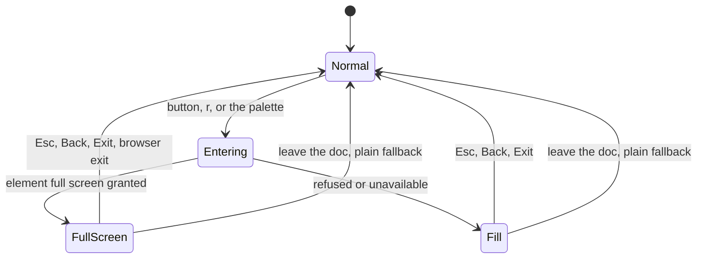
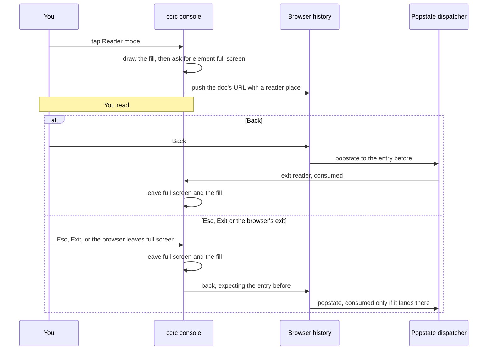
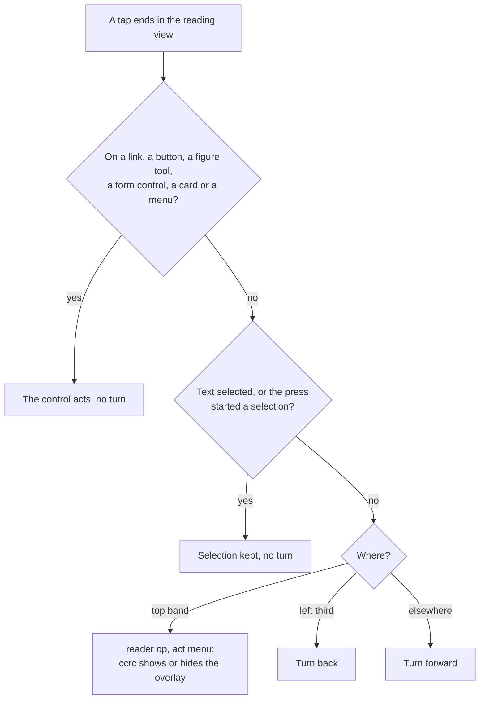
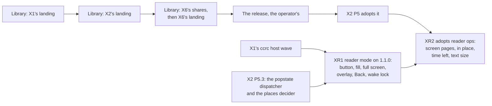

# Native Docs reader: reader mode

**Spec** · 2026-11-20 · Status: Draft, for review (X6, run 2847) · Owner: the operator · Linear: none · Related: docs/superpowers/plans/2026-11-20-native-docs-reader-mode.md, docs/superpowers/specs/2026-10-12-rich-docs-reader-and-shared-renderer-design.md, docs/superpowers/specs/2026-11-18-native-docs-appearance-continuity-design.md, docs/superpowers/specs/2026-11-18-native-docs-parity-design.md, docs/superpowers/programs/native-docs-reader.md

## In short

- **What this is.** Your request of 2026-11-19: "when reading a document via docserver I need a button to enter "reader mode" where the document becomes full-screen (think Kindle-like experience when used)". It is designed for ccrc's native Docs reader, the reader you now read in. The standalone reader is being retired and gets nothing.
- **What reader mode is.** One button, or the `r` key, takes the open document full screen. Everything but the text goes away: ccrc's head and banners, and the reader's own bar, contents rail and Aa button. You turn one screen at a time by tapping the side of the page, swiping, or pressing an arrow key, and each turn lands on a whole line. A tap at the top shows a small overlay with how far you are and the time left, Aa and Exit. Esc, Back, the overlay's Exit and the browser's own exit all leave it, and the place you were reading is kept. It works on a phone and on a desktop (§2).
- **What is decided.** ccrc's window owns full screen; the sandboxed frame never asks for it, and its sandbox stays `allow-scripts` with no new attribute. Where an engine refuses element full screen (the iPhone is the likely case, still to be measured), the same view fills the viewport without the browser's request (§4). Screen pages, not true book pages, is your answer to ask 656 on 2026-11-20 (§5). Reading stays one scroll underneath, so place, progress, the quick jump and change marks keep working. A screen wake lock is taken while you read, with an idle release (§6).
- **What changes.** Two ccrc waves and one library landing. XR1 is ccrc only, on library 1.1.0: the button, full screen, the overlay, Back and the wake lock. The library landing adds the turning, the in-place hiding of the reader's chrome, a text size and one small op each way on the existing port. XR2 takes that release up (§7). Nothing widens the sandbox, the shell CSP or the set of channels.
- **What you must check.** The phone's entry button on the one bar (§3.1) and the wake lock (§6.3), both decided here with the alternatives priced. Three departures from the rich-docs spec's closed lists are recorded as D-8803 to D-8805 (§8). The phone engines' full-screen behaviour is one device item for the coordinator to raise (§4.4); desktop Chromium was measured in part (§4.5).

## 1. Context

This section says what reader mode builds on. Every claim about ccrc was read from `main` at `62276e71b`, and every claim about the library from the installed `@synapsium-labs/docserver` 1.1.0, on 2026-11-20.

### 1.1 What exists

| What | Where | Fact |
|---|---|---|
| The reader frame | `pwa/src/docs/ReaderFrame.tsx`, `docs/reader/bridge.ts` | `<div className="docs-reader">` hosts the library's iframe, `sandbox="allow-scripts"`, sized by `.docs-reader iframe { position: absolute; inset: 0 }` inside a `100dvh` shell (`docs.css`). Sourced |
| Chrome at mount | `reader/policy.ts#readerMountPlan`, `bridge.ts` | A phone mount is `host-bar`: the library's `features.chrome` gets `{bar: false, topSpace: false}`, and `onProgress` is passed. A desktop mount keeps the frame's own bar. Sourced |
| The library's chrome switches | library `dist/enhance/options.js` `CHROME_KEYS` | `bar`, `rail`, `settings`, `topSpace`, each true by default, read once at mount. `bar: false` builds no top bar, running head, tool tray or progress line. Sourced |
| Progress | library `enhance/scroll.js`, `frame/protocol.js` | The share of the document scrolled, sent as thousandths at most once per 250 ms window, to any host that passed `onProgress`, with or without the bar. Sourced |
| Reading position | library `nav.js` `tokenOf`, `position.js`, `DOC_FIELDS` | A token `{line, offset, y}` saved under the doc's `pos` field 250 ms after scrolling stops and on `pagehide`, and restored at mount unless an `initialHash` wins. Sourced |
| Reading time | library `enhance/reading.js` | 230 words a minute for prose, 520 for code, half a minute per figure. It lives in the frame's DOM only: no op and no `render()` meta carries it. Sourced |
| Width and font | library `FRAME_PREF_VALUES` | `width: standard \| wide`, `font: serif \| sans`. No text size: the body is a fixed 18 px (17.5 px sans). Sourced |
| Scrolling | library `scroll.js` header | The frame's window scrolls. No pagination, multicolumn or scroll snap anywhere. Sourced |
| Keys the frame binds | library `keys.js` `SHEET_ORDER` | `/ j k w i n p m o ?`, Mod+K and Esc. Not bound: the arrow keys at page level, Space, PageUp, PageDown, Home, End, `f`, `r`. Sourced |
| Keys the console binds | `pwa/src/command/useShortcuts.ts` | Ctrl or Cmd+K, `[`, `]`, `?`, `i` and `g` chords, on the window, never while a dialog is open. The Docs screen binds no key of its own. Sourced |
| Taps in the frame | library `guard.js`, `nav.js` | A click guard routes links; no body-level tap or swipe handling exists. Sourced |
| Commands | library `COMMAND_NAMES` | `jump`, `settings`, `contents`, `outline`, sent by ccrc's one bar only. Sourced |
| Sheets | `ui/src/primitives/sheet.tsx` | vaul drawers portalled to the document body, `z-index` layers (`--z-sheet: 40` up to `--z-block: 100`). Nothing uses the browser's top layer. Sourced |
| Full screen, wake lock | `pwa/src`, `ui/src` | No use of the Fullscreen API, the Wake Lock API or `screen.orientation`. The viewport meta carries `viewport-fit=cover`, and the tokens define `--safe-top` and `--safe-bottom`. Sourced |
| The installed app | `pwa/vite.config.ts` manifest | `display: 'standalone'`, no `display_override`, no `orientation`. Sourced |
| History | `lib/router.ts`, `lib/swupdate.ts`, `docs/readerHistory.ts` | Three `popstate` listeners today. X2's wave P5.3 replaces them with one dispatcher, `lib/popstate.ts`, and a pure decider, `lib/historyPlaces.ts` (X2 spec §4.7). Sourced |

### 1.2 Boundaries that do not move

| Boundary | Value | Where it is pinned |
|---|---|---|
| Reader frame sandbox | Exactly `allow-scripts`; no `allow`, no `allowfullscreen` | rich-docs §4.1 |
| Shell CSP | `frame-src 'none'` | completion plan, Global Constraints |
| Frame and console | No parent-DOM access, no new channel, no window `message` listener in `pwa/src`; frame ops additive on the existing port | rich-docs §4.4, §5.1 |
| Library | Exactly 1.1.0 in this wave. A library change is designed here, not made | brief |
| Phone | Both 2026-11-06 phone blocks byte for byte; the tap, one-bar and desktop-fit budgets stand | completion plan, Global Constraints |
| Appearance | Reader mode uses ccrc's appearance through X1's contract. No new palette, catalogue or token list | X1 spec §2, §10 |
| The standalone reader | Gets nothing | brief |

### 1.3 Words used here

| Word | Meaning |
|---|---|
| Reader mode | The full-screen reading view of one Docs page |
| Fill | Reader mode drawn over the whole viewport by ccrc's own layout, with no Fullscreen API request |
| Full screen | Fill, plus the browser's element full screen on ccrc's reading container, where the engine grants it |
| Screen page | One viewport of text. A turn moves to the next screen page and lands on a whole line |
| Turn | Moving one screen page forward or back |
| The overlay | ccrc's small reader-mode toolbar: progress and time left, Aa, the turn setting and Exit |
| The top band | The strip at the top of the reading view whose tap shows the overlay |
| Reading container | The ccrc element that holds the reader frame and the overlay, and that goes full screen |

## 2. The experience

This section shows reader mode as you see it, on a desktop and on a phone, before any mechanism.

### 2.1 Desktop

```text
Normal view, 1280 x 800
+--------------------------------------------------------------------------------+
| <  docs / specs / 2026-11-20-...-design.md   [Reader mode] [GitHub] [Share] ...|  ccrc's head
| Committed at main, 62276e7 ...                                                 |  truth line
+--------------------------------------------------------------------------------+
| [reader's own bar: running head, Jump, Contents, Aa]                           |
| Contents |  1. Context                                                         |
| rail     |  This section says ...                                              |
+--------------------------------------------------------------------------------+

Reader mode, full screen
+--------------------------------------------------------------------------------+
|                       (top band: a tap or hover shows the overlay)             |
|                 1. Context                                                     |
|                 This section says what reader mode builds on. Every claim      |
|                 about ccrc was read from main ... the text at its measure,     |
|                 centred, nothing else on the screen.                           |
|   <- turn back                                              turn forward ->    |
|                                                                                |
+--------------------------------------------------------------------------------+

Reader mode, overlay shown
+--------------------------------------------------------------------------------+
| [x Exit]   Native Docs reader: reader mode                    [Pages|Scroll] [Aa]|
|                 1. Context                                                     |
|                 ...                                                            |
| ===========================------------------------------------  41%  12 min left|
+--------------------------------------------------------------------------------+
```
*Mockup 1. Desktop. The Reader mode action leads the head's action row. In reader mode only the text remains. The overlay is two thin strips: Exit, the title, the turn setting and Aa at the top, and the progress line with percent and time left at the bottom.*

### 2.2 Phone

```text
Normal view, 412 x 915, one bar            Reader mode                    Overlay shown
+------------------------------+     +------------------------------+  +------------------------------+
| < Title of the doc  [/][=][R]|     |  (top band)                  |  |[x]  Title of the doc   [S][Aa]|
|==============---------------- |     | 1. Context                   |  | 1. Context                   |
| 1. Context                   |     | This section says what       |  | This section says what       |
| This section says what       |     | reader mode builds on.       |  | reader mode builds on.       |
| reader mode builds on.       |     | Every claim about ccrc ...   |  | ...                          |
| ...                          |     |                              |  |                              |
|                              |     | <- back   |   forward ->     |  |==========-------- 41% 12 min |
+------------------------------+     +------------------------------+  +------------------------------+
  [/] Jump  [=] Contents  [R] Reader mode            [S] Pages or Scroll   [Aa] the reader's own Aa
```
*Mockup 2. Phone. The Reader mode tool is the last tool on the one bar, at the thumb's side. In reader mode the text fills the screen inside the safe areas. A tap at the top shows the overlay; a tap on the left third turns back, anywhere else below the top band turns forward.*

### 2.3 The states


*Figure 1. Reader mode's states. Start at Normal. Entering always draws the fill first and then asks for full screen, so a refusal leaves a working reader mode. Every exit returns to Normal at the same place in the document.*

## 3. Entry and exit

This section places the button and the key, and gives every exit one model through X2's history places.

### 3.1 The button

| Where | Choice | Alternatives considered | Why |
|---|---|---|---|
| Desktop, the full head (600 px and wider) | The first action of `.docs-actions`, the word "Reader mode" with a book icon; it becomes an icon at the row's first stage, as its neighbours do (`ROW_STAGES`) | (a) The last action; (b) inside the frame's own bar; (c) a floating button over the text | (a) The most used action belongs nearest the start. (b) The frame cannot request full screen and its bar goes away in reader mode. (c) Covers text and is the frame's ground, not ccrc's. |
| Phone, the one bar (a ready frame under 600 px) | The last control, icon only, `aria-label` "Reader mode", after Jump, Contents and a plan's Outline; at least 44 by 44 px. It is ccrc's own action drawn by `OneBarControls`, not a row of `oneBarTools`, which holds the library's command names only (`reader-commands.test-d.ts`) | (a) Inside Page details; (b) replace a tool; (c) a long press on the title | (a) Two taps, against "one button enters it". (b) Jump and Contents are in daily use. (c) Not discoverable. The title loses 44 px of width, which the one bar's ellipsis absorbs; the bar's height, the title's position and the tap floor do not change (§4.6). |
| Phone, the compact row | None | Show it disabled | The compact row draws only while the frame is not ready, and reader mode needs the frame. |
| The plain view | None in this design | A host-drawn reader mode of the plain tree | The plain view is a fallback. Reading it full screen is Later (Where things stand). |
| The command palette | One command, "Reader mode", on a Docs page with a ready frame | None | The palette lists every command; one row in the existing registry, no new mechanism. |

### 3.2 The key

**`r`, no modifier.** It is free in the console and in the frame (§1.1).

| Option | Verdict |
|---|---|
| `r` | Chosen. Free on both sides, and "reader". |
| `f` | Free too, but it reads as "full screen of anything"; reader mode is more than full screen. |
| F11 | The browser's own full screen of the whole page, ccrc's chrome included. Not ours to take. |
| Shift+R or Ctrl+Shift+R | Ctrl+Shift+R is a hard reload in every desktop browser. |
| Esc to enter | Esc leaves things. |

**Who sees the key.** The frame keeps focus while you read, and its keys never reach ccrc's window (the opaque origin). So:
- In XR1, `r` is one row in the console's shortcut registry (`pwa/src/command/commands.ts`), active on a Docs page with a ready frame while focus is in the console, for example after a tap on the head.
- From the library landing, the frame forwards `r` as a `reader` op with `act: 'toggle'`, only when the host's seed says it accepts reader mode (§7.2). The library's keys sheet then lists `r`.

### 3.3 One place, one Back

Entering pushes one history entry, a place of kind `reader`, through X2's dispatcher. Every exit removes it exactly once. This is X2's own model (X2 spec §4.7) with one more place kind, made by ccrc, never by the frame.


*Figure 2. One Back model. Entering pushes one place, Back pops it, and an exit by any other path steps back over it. The router never runs for these pops, so the page does not reload or move.*

- **The place.** `docsPlace: {visit, seq, kind: 'reader'}` on an entry carrying the doc's URL unchanged, beside X2's `overlay` and `jump` places. It counts toward X2's `PLACES_MAX` of 50 per visit.
- **The decider.** `historyPlaces.ts#decidePop` gains one answer, `{kind: 'exit-reader'}`, for a popped entry below a current-visit `reader` place. A place of another visit is skipped as X2 decides, so a stale reader place never costs a Back.
- **User activation.** The push follows a tap or a key on ccrc's own chrome, which gives the console activation directly. Unlike X2's frame-reported places, it does not wait on lab E16.
- **Order of exit.** Esc in browser full screen is the browser's: it leaves full screen, and the `fullscreenchange` that follows is ccrc's signal. ccrc then leaves the fill and calls `history.back()` with the expected landing recorded, as X2 does when the frame closes its own overlay. A Back that pops the place first leaves full screen through `document.exitFullscreen()`; the `fullscreenchange` that follows finds reader mode already off and does nothing. So one Esc, or one Back, is one exit, whichever order an engine fires them in. Android Back while in full screen is a device row (§4.4).

| Exit | XR1 | From XR2 |
|---|---|---|
| Esc, browser full screen | The browser leaves full screen, ccrc follows | Same |
| Esc, fill only, focus in ccrc's overlay | ccrc's own key handler | Same |
| Esc, fill only, focus in the frame | Not seen: the frame's keys stay in the frame. Exit and Back remain | The frame sends `reader {act: 'exit'}` when no overlay of its own is open |
| Back (button, Alt+Left, Android Back, iOS swipe) | Pops the place | Same |
| The overlay's Exit | ccrc | Same |
| The browser's own exit (its banner or gesture) | `fullscreenchange`, ccrc follows | Same |
| `r` again | Console focus only | Forwarded by the frame |
| Leaving the doc (a link to another doc, the back arrow, another screen) | Reader mode ends with the visit; its place is stale and skipped | Same |
| The frame falls back to the plain view | Reader mode ends; the fallback note shows as today | Same |

| Decision | Options | Chosen, and why |
|---|---|---|
| Does losing full screen end reader mode? | (a) Yes, entirely; (b) keep the fill | (a): one model. The browser's exit is the one exit ccrc cannot veto; keeping the fill after it would leave you in a half state with the console hidden and the browser's bars back. |
| A link to another doc | (a) Ends reader mode, the doc opens in the normal view; (b) the next doc opens in reader mode | (a) in this design: X2's places are per doc visit, and (b) needs a reader session that spans visits, a history design of its own. (b) is Later. A same-page link stays in reader mode, because the reading container outlives the frame's remount (§4.1). |
| Who keeps the entry | (a) The console, as one more place kind; (b) none, Back leaves the page | (a): Back on a phone must leave reader mode, not the document. |

## 4. Full screen

This section says who requests full screen, on what element, what happens where it is refused, and what the phone budgets become.

### 4.1 The host owns it

The frame cannot request full screen: it has no `allowfullscreen` and no `allow` attribute, and both stay unset (rich-docs §4.1). ccrc's window requests it on ccrc's own element.


*Figure 3. The reading container. Start at your tap. ccrc's element, not the frame, goes full screen, and the fill is drawn first so a refusal changes nothing you can see beyond the browser's own bars. The frame keeps its sandbox and talks to ccrc only over the existing port.*

- **The reading container is always there.** An iframe moved in the DOM reloads, so reader mode never re-parents the frame. A new element, the reading container, wraps the Docs screen's body (`DocsScreen.tsx`, around `{body}`) on every Docs page, in normal view too. It carries no React key, so adding it remounts nothing. Reader mode records the document it was entered for (project or folder, section, path): a same-document remount (a new commit, a same-page link spelled with its file name) happens inside the container and keeps reader mode, and a change of document ends it.
- **The fill comes first.** On entry ccrc sets `data-reader-mode` on the container. Its rule draws the container `position: fixed; inset: 0` over the console, on the reader's ground, inside the safe areas (`--safe-top`, `--safe-bottom`, and the side insets), at a new layer token `--z-reading` between `--z-toast` and `--z-block`. So a session-expired or update block still shows over reader mode, and nothing else does.
- **Then full screen, where it exists.** If `document.fullscreenEnabled` is true, ccrc calls `container.requestFullscreen({navigationUI: 'hide'})` in the same task as your tap. A rejection, or an engine without the API, leaves the fill as reader mode. ccrc never retries without a new tap.
- **Sheets go inside.** In element full screen only the full-screen element's subtree is drawn. The sheets the frame can raise (the external-link sheet, the copy sheet, a "not loaded" chip's sheet) are portalled to the document body today, so they would open unseen. While reader mode is on, ccrc's `Sheet` primitive takes its portal target from a context the reading container provides, so these sheets open inside it. The same context serves the fill.
- **The rest of the console is suspended.** While reader mode is on, the command layer takes no key but Esc, and the palette does not open. Toasts wait behind the container and show on exit.
- **The mockup frame's own Full screen** (`.docs-mockup[data-frame='full']`) is a different view, for HTML leaves, and is unchanged.

| Decision | Options | Chosen, and why |
|---|---|---|
| Which element | (a) A container around the reader host and the overlay; (b) the reader host itself; (c) the document element | (a): the overlay and sheets must be inside the full-screen subtree. (b) is the library's mount point, which ccrc does not fill with its own children. (c) shows the console's chrome. |
| When the API is refused | (a) The fill stays as reader mode; (b) reader mode fails with a note | (a): the fill is the designed experience on every engine. Full screen only adds hiding the browser's own bars. |
| Fill before or after the request | (a) Before, in the same task; (b) after the promise resolves | (a): the request must run inside the tap's activation, and drawing first means no flash of the console when it resolves or fails. |
| Widen the frame (`allowfullscreen`) | No | Forbidden by rich-docs §4.1, and unnecessary. |

### 4.2 What disappears

| Element | In reader mode | How |
|---|---|---|
| ccrc's head, truth line, banners, the one bar, the shell's navigation | Hidden | Outside the container, covered by the fill or outside the full-screen subtree |
| The reader's own bar, running head, progress line | Hidden | XR1: the reader-mode remount passes `features.chrome {bar: false}`. XR2: the library hides it in place |
| The contents rail | Hidden | XR1: `rail: false` at the remount. XR2: in place |
| The frame's Aa button | Hidden, reachable from the overlay's Aa (`command settings`) | XR1: `settings: false` only if the command still opens the menu at 1.1.0, measured in XR1 Step 0; otherwise it stays. XR2: in place |
| Figure tools, Render buttons of figures not drawn yet, code copy, table filter, cards | Kept | They are the document's own controls. Figures stay on request (E17, both phone blocks unchanged) |
| The top space above the first heading | Trimmed | `topSpace: false` |

### 4.3 XR1 enters by a remount; XR2 does not

Library 1.1.0 reads its chrome switches once, at mount. So XR1 enters and leaves reader mode by remounting the same document in the same container: the same rendered document, a new `MessageChannel` and nonce, as the same-page link already does (rich-docs §4.1, D2). The place comes back from the library's own `pos` field, which the remount reads from the store snapshot. The visible cost is one frame swap, about 0.2 to 1.4 s (lab E4's srcdoc timings), and what a remount already resets: the "Changed since your last visit" notice, open folds and drawn figures. XR2 replaces the remount with the in-place `reader` op (§7.2), so entering and leaving keep the very scroll position, the drawn figures and the folds.

### 4.4 Engines

**Measured on desktop Chromium, in part.** §4.5: element full screen around a `sandbox="allow-scripts"` srcdoc frame, on the box's own headless Chromium 156.

**Not measured, one device item for the coordinator to raise** (the phone engines cannot be measured from this box):

| Row | Engine | What to record | Expected, not measured |
|---|---|---|---|
| FS-1 | iOS Safari, browser tab, iPhone | `document.fullscreenEnabled`; whether `requestFullscreen` on a `div` resolves; whether Safari's toolbar hides | Element full screen unavailable on iPhone; the fill path; Safari's bars stay |
| FS-2 | iOS, installed app (standalone) | The same, and the status bar's area with `viewport-fit=cover` | The fill path; no browser bars to hide |
| FS-3 | Android Chrome, browser tab | Full screen granted; Android Back while in full screen: does it leave full screen only, or also pop history (one exit either way, §3.3) | Granted |
| FS-4 | Android, installed app | The same as FS-3 | Granted; the status bar hides |
| FS-5 | Desktop Chrome, Firefox and Safari | Granted; Esc leaves full screen and fires `fullscreenchange` (M-5) | Granted |
| FS-6 | Every engine above | A tap in the frame after entry: keys and turns reach the frame; the external-link sheet shows inside reader mode | Holds |
| FS-7 | iOS and Android | Wake lock granted in the tab and in the installed app; released when hidden | Granted where the engine has the API |

### 4.5 The desktop Chromium measurement

Measured on 2026-11-20 on the box's own headless Chromium 156 (the browser leg's cached build), driven over the DevTools protocol by a scratch script in the session's temp root: a host page with the shell's `frame-src 'none'` meta, a `div` holding an `iframe sandbox="allow-scripts"` with a srcdoc under `default-src 'none'`, and the full-screen request on the `div`. No install, nothing in the worktree, the script and its profiles deleted after. Headless Chromium has no browser interface, so the rows about activation and Esc are not representative of a real browser.

| Row | Question | Reading |
|---|---|---|
| M-1 | `requestFullscreen` on the container resolves with a tap's activation | Measured: resolves, `fullscreenElement` is the container. Without activation it also resolved, which is the protocol's evaluation granting it, not the browser's rule; the rule that full screen needs transient activation is sourced from the Fullscreen API standard and is XR1's browser row |
| M-2 | The frame inside does not reload | Measured: one `load` before entering, one after, and one after leaving |
| M-3 | The frame cannot enter full screen itself | UNMEASURED: the script did not resolve the frame's context; the sandbox's missing `allowfullscreen` is sourced (rich-docs §4.1), and XR1's browser row measures it |
| M-4 | Keys reach the frame while the container is full screen | UNMEASURED, as M-3. The console's window saw none of the keys sent while the frame had focus, as the opaque origin implies |
| M-5 | Esc leaves full screen and fires `fullscreenchange` | UNMEASURED: an Esc sent through the protocol did not leave full screen in headless, which has no interface to own Esc. `fullscreenchange` fired on entering and on `exitFullscreen()` |
| M-6 | Entering and leaving add no history entry | Measured: `history.length` 2 before and after |
| M-7 | Wake lock in the console's window | Measured: `granted: screen`. Inside the frame: UNMEASURED, as M-3 |
| M-8 | Orientation lock on a desktop | Measured: `NotSupportedError`, so §6.4's choice costs nothing there |

XR1 Step 0 measures M-1 (a real click against an evaluation with no activation), M-3, M-4 and M-7's frame half in the browser leg's Playwright-driven Chrome, before any code, and records them in the plan's Results. M-5 needs a browser with its interface, so it joins the device item as FS-5.

### 4.6 Phone blocks, budgets and safe areas

- **Both 2026-11-06 phone blocks stay byte for byte.** Reader mode changes no Mermaid draw and no lab reading; no phone block is reused as evidence for it.
- **The one bar.** One more tool of 44 by 44 px. The bar stays 44 px tall, the title stays at most 61 px down with at most 48 px of that the console's, and every tool keeps the 44 px floor, at 412 by 915 and at 915 by 412 (`pwa/browser/docs-compact-head.browser.test.ts`). The title's width falls by 44 px; at 360 px wide a plan's bar holds back, four tools and a title of about 140 px.
- **The desktop head.** The row stays one line and the head at most 80 px at 1280 by 800, with a new 1920 by 1080 row.
- **In reader mode.** Every overlay control is at least `--tap-min` (44 px). The overlay's top strip sits below `--safe-top`, its bottom strip above `--safe-bottom`, and the text inside the side insets. The fill's ground is the reader's ground, X1's `bg` slot while hosted, so the insets do not show as bands.

## 5. Reading: screen pages

This section designs the reading model you chose in ask 656 on 2026-11-20, screen pages, prices the two alternatives, and says what happens to figures, tables, code and Mermaid.

### 5.1 The three models, priced

| Model | What you see | Library change | ccrc change | Risk |
|---|---|---|---|---|
| Calm scroll | Continuous scroll, nothing turns | None for XR1; the `reader` op for in-place chrome | XR1 alone | Least; also least like a Kindle |
| **Screen pages (chosen)** | A turn moves one screen and lands on a whole line; one scroll underneath | A turn engine of about 6 to 10 thousand characters, inside the frame (§7.3) | XR2 adds the setting | Low: position, progress, jumps and change marks are unchanged, because the frame still scrolls |
| True book pages | Fixed pages with a count, laid out in columns | A paged layout of about 25 to 45 thousand characters, re-plumbing position, progress, the quick jump, `hash` jumps, scroll-spy and change marks | XR2 and a new progress model | Highest: WebKit multicolumn fragmentation, wide tables and long code against a horizontal swipe, figures taller than a page, re-pagination when a figure draws on tap |

The estimates for screen pages and true pages are judgement, sized against modules measured in 1.1.0 (X2 spec §6: `nav` 5 997, `overlays` 855, `commands` 594 characters; the default bundle 198 215).

### 5.2 Where paging runs

| Option | Verdict |
|---|---|
| (a) Inside the frame, a library reading mode | **Chosen.** Taps, swipes and keys happen in the frame, and only the frame can find line boxes. |
| (b) ccrc pages from outside | Not possible without a library op: ccrc cannot read the frame's DOM or scroll it, and 1.1.0 has no host scroll op. Even with one, ccrc would turn blind, cutting lines. |
| (c) ccrc draws tap zones over the frame | Blocks links and selection near the edges, and still needs a scroll op. |

### 5.3 A turn

- **Forward.** The frame finds the first line not wholly visible at the bottom of the viewport: a caret position at the bottom edge (`caretPositionFromPoint`, or `caretRangeFromPoint` where only that exists), its line box, its top. It scrolls instantly so that this line's top meets the top of the reading area. A line is never cut.
- **Back.** The mirror: the first wholly visible line at the top becomes the first line below the bottom edge, then the new top is snapped to a whole line.
- **Blocks that are not lines.** An image, a drawn figure, a table row or a block of code met at the edge: if it starts in the lower two thirds of the screen, the turn aligns its top; if it is taller than the screen, the turn moves one screen less one line height, so you keep one line of context.
- **Always forward.** A turn moves at least a third of a screen; otherwise it moves one screen less two line heights. So no layout can trap a turn.
- **No animation.** A turn is an instant jump, with no smooth scroll, so it reads as a page, not as scrolling. With reduced motion it is the same: nothing moves either way.
- **Scroll stays.** Dragging, the wheel and the up and down arrow keys still scroll freely. The next turn snaps from wherever you are.
- **After a resize, a rotation, or a new text size or width,** the frame keeps the reading token (`tokenOf`) from before the change, restores it after layout, and snaps to a whole line.
- **The end.** A forward turn at the bottom does nothing; the progress reads 100%.

### 5.4 Gestures, tap zones and keys


*Figure 4. What a tap does in screen pages. Start at the tap. Controls and selection always win, so links and copying behave as they do today. Only a plain tap on text or white space turns.*

| Input | Screen pages | Scroll setting |
|---|---|---|
| Tap, left third | Back | Nothing |
| Tap, elsewhere below the top band | Forward | Nothing |
| Tap, the top band (the top 15% of the view, at least 48 px) | Overlay | Overlay |
| Horizontal swipe (touch, at least 48 px, at least twice as wide as tall, under 600 ms) | Right to left forward, left to right back | Nothing |
| A swipe that starts in a horizontally scrollable table or code block | Scrolls that block, no turn | Scrolls that block |
| ArrowRight, PageDown, Space | Forward | PageDown and Space scroll natively |
| ArrowLeft, PageUp, Shift+Space | Back | Native |
| ArrowUp, ArrowDown, Home, End | Native scroll | Native |
| `r` | Leave reader mode | Leave |
| Esc | Closes the frame's own open overlay first; with none open, leaves reader mode | Same |

- **A tap** is a primary pointer up within 10 px and 500 ms of its down. A long press is not a tap.
- **Interactive targets** are named by one selector list in the library: `a[href]`, `button`, `summary`, `input`, `select`, `textarea`, `label`, `[role="button"]`, `[tabindex]`, the figure tools, the table filter, cards and menus. Mermaid's Render button is a button, so a tap on it draws the figure and never turns.
- **The top band** is the same in both settings, so you always know where the overlay is. It sits inside the frame, so it is the library's to draw nothing on and to report; ccrc draws the overlay.
- **XR1, before the library landing,** has no turns and no frame-side band. ccrc draws its own top band as a transparent strip, 44 px tall, over the top of the frame; a tap or a hover on it shows the overlay. The text under it scrolls into reach. XR2 removes the strip when the frame accepts the `reader` op, so one mechanism reports the band at a time.

### 5.5 Figures, tables, code and Mermaid

| Content | In screen pages |
|---|---|
| Mermaid, not drawn | Its source with the Render button, as today; production stays on request (E17 `does-not-hold`, both phone blocks unchanged) |
| Mermaid, drawn, taller than a screen | Stepped through, one screen less one line per turn; the figure's own Full screen tool shows it whole |
| Images | Unscaled, as today; a tall one is stepped through |
| Tables wider than the screen | Keep their own horizontal scroll; a swipe inside scrolls the table, never turns |
| Tables taller than a screen | Stepped through; the sticky header stays sticky, because the frame still scrolls |
| Code | Its own horizontal scroll, as tables |
| Footnotes, folds, cards | Unchanged; a fold opened mid-page changes nothing until the next turn |

### 5.6 Progress, time left and the place

- **Progress** is the library's existing `progress` op, unchanged (§1.1). XR1's reader-mode remount passes `onProgress`, so it arrives on a desktop too. From XR2 every production mount passes it (D-8805).
- **Time left** needs the document's reading time, which today lives only in the frame's DOM. The library landing adds it to `render()`'s `meta`, computed by the library's own rule (230, 520, half a minute a figure), so the byline and the overlay always agree and ccrc never copies the rule. ccrc's parse worker already runs `render()`, so the value arrives with the document. The overlay shows `minutes × (1 − share)`, rounded to whole minutes, "about 12 min left", and "less than a minute left" below one. XR1 shows the percentage alone.
- **The place** is the library's `pos` field, already per document and per device (§1.1). Reader mode adds nothing: leaving keeps the place, and reopening the document later, in either view, returns to it. Reader mode itself is not remembered: a document always opens in the normal view, because full screen needs a tap (Later).

## 6. Comfort

This section covers typography, motion, the wake lock, orientation and focus.

### 6.1 Typography

- **Appearance is ccrc's,** through X1's contract: the frame's colours, faces, focus ring and code wells follow ccrc's skin and palette while hosted. Reader mode adds no palette, catalogue or token list.
- **Width and font stay reader-local,** as X1 keeps them: Aa's `width` (`standard` or `wide`) and `font` (`serif` or `sans`).
- **Text size is new and reader-local.** The library landing adds `size: s | m | l | xl` to the frame's prefs, default `m`, today's 18 px, with `s` 16 px, `l` 20 px and `xl` 22 px, scaling `--rem` with it so headings and the measure follow. It is a row in Aa and is stored under `ccrc:reader:v1:` like width and font. It applies in both views: one setting, one writer.
- **The measure** is the library's `--measure`, 52 rem for serif and 42 rem for sans, centred. Reader mode does not widen it on a large screen; "wide" in Aa does.

### 6.2 Motion

Turns are instant in both motion settings (§5.3). The overlay appears and goes without a transition under `prefers-reduced-motion: reduce`, and with ccrc's `--dur-fast` fade otherwise. Entering and leaving full screen are the browser's own.

### 6.3 Screen wake lock: taken

| Option | Verdict |
|---|---|
| (a) No wake lock | A phone dims after 30 s to 2 min, mid-paragraph, on a long spec. A Kindle's e-ink never needs one; a phone's screen does. |
| (b) **A wake lock while reading, with an idle release** | **Chosen.** |
| (c) A wake lock for as long as reader mode is open | A phone left on a table with reader mode open would stay lit until its battery ran down. |

- ccrc's window requests `navigator.wakeLock.request('screen')` on entering, where the API exists. The frame never does: it has no permission, and the host owns the screen.
- It is released on exit, and by the browser when the page is hidden; ccrc requests it again when the page is visible and reader mode is still on.
- **The idle release.** After 5 minutes with no reading activity (no progress change, no turn and no tap on the overlay) ccrc releases it, and requests it again on the next activity. So a forgotten phone sleeps at its normal timeout after 5 minutes.
- A refusal or a missing API changes nothing you can see. There is no setting in this design; one is Later.

### 6.4 Orientation

Reader mode never locks orientation (`screen.orientation.lock` stays unused): you turn the phone as you like, and the frame restores the place after the turn and snaps to a whole line (§5.3).

### 6.5 Focus order and screen readers

- **On entering,** focus moves into the frame, so its keys work at once, and a polite live region in ccrc says "Reader mode. Esc or Back leaves it."
- **The overlay** is a `role="toolbar"` region named "Reader mode", not a modal: Exit, the turn setting, Aa, then the progress text, which is not focusable. Showing it moves focus to Exit. Tab past Aa returns to the frame. Esc on the overlay hides it and returns focus to the frame, without leaving reader mode.
- **On leaving,** focus returns to the control that entered, or to the frame when it was the key.
- **Screen pages and screen readers.** A turn only scrolls, so a screen reader's own reading order and navigation are untouched. A turn announces nothing, because the text is what the reader reads next.
- **The progress text** is a `role="status"` region updated at most once a second.

## 7. The split: what ccrc builds and what the library builds

This section names every new op, the paged reading, its size share under the library's test 8, and the order of the waves.

### 7.1 ccrc

| Part | Where | Ring |
|---|---|---|
| The reader-mode decisions: may it enter, which exit cause does what, attempt full screen or not, the idle rule, time left | `pwa/src/docs/reader/readerMode.ts` (new) | L1 |
| Its words: the labels, the live sentence, the time-left phrases | `pwa/src/docs/reader/readerModeWords.ts` (new) | L1 |
| The hook: the fill, full screen, `fullscreenchange`, the wake lock, the place push, focus | `pwa/src/docs/useReaderMode.ts` (new) | L4 |
| The overlay | `pwa/src/docs/ReaderModeOverlay.tsx` (new) | L4 |
| The reading container | `pwa/src/screens/DocsScreen.tsx`, around the body | L4 |
| The entry action and the one-bar control | `DocsHead.tsx` (`ActionsRow`, `OneBarControls`); whether to offer it is `readerMode.ts`'s | L4 |
| The `r` command | `pwa/src/command/commands.ts` | L1 table |
| The `reader` place kind and `exit-reader` | `pwa/src/lib/historyPlaces.ts` (X2 P5.3's decider) | L1 |
| The sheet portal target | `ui/src/primitives/sheet.tsx` and a context | L4 |
| `--z-reading` | `ui/src/styles/tokens.css` | L0 style |
| The mount: chrome off and `onProgress` for a reader-mode mount (XR1), the `reader` op and `onReader` (XR2) | `reader/bridge.ts`, `reader/policy.ts#readerMountPlan` | L3, L1 |

Every decision is in L1 and every act in L4 (CLAUDE.md, decide in L1, act in L4). The fill, the full-screen request and the wake lock are one hook; no second listener of any kind is added for history (X2's dispatcher) or keys (the command registry).

### 7.2 The library: ops

Both ops ride the existing port, the existing host parser and `BRIDGE_LIMITS`; the bridge's version stays 1, as when `mermaid`, `command` and `progress` were added. Neither adds a channel, a window listener, parent-DOM access or a CSP source.

| Op | Direction | Payload | Check | Effect |
|---|---|---|---|---|
| `reader` | parent to frame | `{mode}`, one of `screens`, `scroll`, `off` | The frame's port parser, through `FRAME_ACCEPTS`; an unknown mode is ignored | The frame hides or restores its bar, rail, settings button and top space in place, and turns screen pages on or off. `DocFrame.setReader(mode)` queues it before `ready`, latest wins, and seeds a later remount |
| `reader` | frame to parent | `{act}`, one of `menu`, `exit`, `toggle` | The host parser: a closed set, no other key; at most 4 a second, coalesced | ccrc's `onReader(act)` callback. Sent only when the seed's `bridge.reader` is true, which the library sets when the host passes `onReader`; so a 1.1 host never counts it as refused |

- `menu` is a tap on the top band. `exit` is Esc with no overlay of the frame's own open, or `r`, while reader mode is on. `toggle` is `r` while it is off. The frame never sends a URL or a position; ccrc decides what each act does.
- The library's `features.chrome` stays as it is for a mount; the `reader` op is the in-place switch for an open frame.

### 7.3 The library: the rest

| Change | Where in the library | Compatibility |
|---|---|---|
| The turn engine (§5.3), tap zones and the top band (§5.4), the swipe and the keys, active only in `screens` mode | enhance, a new module beside `nav` and `position` | Inert unless the host sends `reader {mode: 'screens'}` |
| In-place reading chrome | enhance and the stylesheet, a `data-reading` root attribute | Inert unless the host sends the op |
| `r` and Esc forwarded; `r` in the keys sheet | `keys.js`, `keysheet.js` | Only when the seed accepts reader |
| Text size, `size: s \| m \| l \| xl`, an Aa row | `FRAME_PREF_VALUES`, the stylesheet's `--rem` | Additive pref; an absent size reads as `m` |
| Reading time in `render()`'s `meta` | render | Additive field; not a frame asset |
| Conformance and browser cases: a turn lands on a whole line in a fixture of known line boxes; a tap on a link, a selection, a Render button and a swipe in a wide table never turn; reduced motion; the op's parser rows | the library's suites | New cases |

### 7.4 Size: this design's share under test 8

Test 8 (X1 spec §10, as X4 amended it) keeps one growth row per landing that changes a frame asset, and each design spends only its own share. This design's landing comes after X1's and X2's (the brief's L1 and L2 of the library wave): a shares-only landing records X6's shares first, then X6's asset landing appends its one growth row under its `Size-Design:` line. The estimates are judgement, from 1.1.0's measured modules; the landing measures its own row.

| Part | Comparator, measured in 1.1.0 | Estimate, characters |
|---|---|---|
| The turn engine, tap zones, swipe and keys | `nav` 5 997 (jumps, anchors, the token) | 8 192 |
| The `reader` op both ways, in-place chrome, `r` and Esc forwarding | `commands` 594 and `overlays` 855 | 2 048 |
| Text size and its Aa row | a settings-menu row; no module measured alone | 1 536 |
| Bundle growth | 11 776 times the bundling factor 0.952 | 11 211 |
| The bootstrap's parser rows for two op directions | X2's proxy for its rows, 2 329 for more ops | 1 280 |
| The stylesheet: reading chrome, size steps | rules, minified, times 1.252 for the unminified file | 2 048 |
| **One frame's growth** | the three rows above | 14 539 |

- **Frame share: 15 360 characters,** 14 539 rounded up to a multiple of 1 024.
- **Total share: 59 392 characters.** The enhance modules are shared by every layout, and X2's landing brings five (default and four), so X6's bundle growth lands in each: 11 211 times 5, plus the bootstrap and stylesheet once, 59 383, rounded up.
- The render's reading time is not a frame asset, so test 8 does not count it; it is reported beside the row.
- **The shares are a ceiling.** If the landing measures above either, the library wave stops and asks the coordinator with its rows. It never raises its own share.
- **Test 9.** `FRAME_ACCEPTS` gains `reader`, and `FRAME_OPS` gains `reader`: one entry appended to test 9's record in this landing.

### 7.5 Waves


*Figure 5. Wave order. XR1 needs X2's dispatcher and X1's host wave, because all three edit the reader host files. XR2 needs the release that carries X6's landing, taken up first by X2's P5. If the coordinator lands P5.3's host half (the dispatcher and the decider) before the library release, XR1 can ship ahead of it; otherwise XR1 follows P5.*

## 8. Boundaries, threat model and departures

This section checks reader mode against every wall and records what it departs from.

| Wall | Holds because |
|---|---|
| Sandbox exactly `allow-scripts` | No attribute is added to the frame; the frame never requests full screen or a wake lock |
| Shell CSP `frame-src 'none'` | No new frame, no navigation, no source |
| No parent-DOM access, no new channel | The two `reader` ops ride the existing port and parser |
| No window `message` listener | None added; keys go through the command registry, history through X2's dispatcher |
| Phishing inside the frame | ccrc's overlay and sheets stay ccrc's chrome. In reader mode the frame fills the screen, so a document can draw a fake "Exit" or a fake sign-in box; the real Exit is the overlay's, Esc and Back always work, the browser's own full-screen banner names the site, and the frame still cannot send anything out (`form-action 'none'`, `default-src 'none'`) |
| A frame spamming `reader` | Coalesced, at most 4 a second, inside `BRIDGE_LIMITS`. `menu` toggles a toolbar; `exit` ends reader mode, which is what Esc does; `toggle` while off is refused by ccrc's decision unless the frame is ready and holds focus, so a frame cannot pull you into reader mode while you are elsewhere; and entering from a frame's `toggle` asks for full screen only when ccrc's own window holds transient activation as the op arrives (`navigator.userActivation.isActive`, which a key press in the frame may or may not give its parent: lab E16, per engine), otherwise the fill alone. A reader place pushed without activation may be skipped by Chromium's Back; the decider's rule, a pop below a current reader place exits reader mode, covers that landing too |
| A frame holding the screen on | It cannot: the wake lock is ccrc's, with the idle release |
| History | ccrc builds every entry; one reader place per entry, bounded by X2's 50 per visit |

**Departures, defined in the leaf plan** (issued block 8803 to 8805):
- **D-8803:** the overlay's Aa sends `command settings` from ccrc's reader-mode overlay, not only "from a tap on ccrc's own bar" (rich-docs §4.4's `command` row).
- **D-8804:** the new `reader` op in each direction, against rich-docs §4.4's closed lists of parent messages ("`prefs`, `changes.result`, `mermaid` or `command`") and of frame ops.
- **D-8805:** ccrc asks for `progress` from a reader-mode mount in XR1, and from every production mount in XR2, against the `progress` row's "ccrc asks only for a frame mounted on its own bar".

## 9. Testing and proof

This section says how each part is proved; the plan carries the rows.

- **Unit (jsdom):** the decisions table of `readerMode.ts` (every exit cause by state); the decider's `exit-reader` answers and stale reader places; the wake lock's request, release and idle release under a fake clock; time left at 0, 0.5 and 1 and below a minute; the one-bar tool table; the command row; the sheet's portal target in and out of reader mode.
- **Browser (the `browser (pwa)` leg, desktop Chromium):** the button and `r` enter; the container goes full screen and the frame does not reload (one `load`); refused full screen leaves the fill covering the console; Esc, Back and Exit each leave with exactly one history entry consumed; the external-link sheet shows inside reader mode; the head and one-bar budgets at 412 by 915, 915 by 412, 1280 by 800 and 1920 by 1080; no `allowfullscreen` or `allow` on the reader frame (beside the mockup frame's existing row).
- **Library (its own suites, the landing):** the cases of §7.3, test 8's row and test 9's entry.
- **Device item (F):** FS-1 to FS-7 (§4.4) and the acceptance row below.
- **Mutation rows:** each guard ships with a row that a deletion reds (the plan's Mutation rows).

**Acceptance: a proposed row for completion Task 17.**

| Row | Installed action and observation |
|---|---|
| Reader mode | On the installed release: open a spec on a phone (412 by 915, in the browser and installed) and on a desktop (1280 by 800 and 1920 by 1080). Enter by the button and by `r`. Only the text remains. Turn forward and back by a side tap, a swipe and the arrow keys; every turn lands on a whole line; a link, a selection and a Render button never turn; a wide table scrolls under a swipe. Switch to Scroll and back. A tap at the top shows the percentage, the time left, Aa and Exit. Leave by Esc, Back (Android Back, iOS swipe), Exit and the browser's own exit, each once. Reopen the doc: the place is kept. The screen stays on while reading and sleeps after the idle release. An external link's sheet shows inside reader mode. Every control meets 44 px. FS-1 to FS-7 recorded per engine |

## 10. Decisions

Technical choices are the worker's, each argued above; the one product choice was asked.

| # | Decision | Chosen | Status |
|---|---|---|---|
| R1 | Reading model | Screen pages, scroll as a reader setting | Agreed: the operator, ask 656, 2026-11-20 |
| R2 | Who requests full screen | ccrc's window, on its reading container | Agreed: forced by the sandbox |
| R3 | A refused full screen | The fill is reader mode | Proposed |
| R4 | Desktop button | The first action of the head's row | Proposed |
| R5 | Phone button | The last tool of the one bar | Proposed |
| R6 | Key | `r` | Proposed |
| R7 | Back | One ccrc place of kind `reader` through X2's dispatcher | Proposed |
| R8 | Losing full screen | Ends reader mode | Proposed |
| R9 | A link to another doc | Ends reader mode; reader sessions across docs Later | Proposed |
| R10 | Paging runs | In the frame, a library reading mode | Proposed |
| R11 | Overlay trigger | The top band; ccrc's strip in XR1, the frame's band from XR2 | Proposed |
| R12 | Time left | From `render()`'s meta, the library's rule, no ccrc copy | Proposed |
| R13 | Text size | A new reader-local pref, four steps | Proposed |
| R14 | Wake lock | Taken, with a 5 minute idle release | Proposed |
| R15 | Orientation | Never locked | Proposed |
| R16 | Entry in XR1 | A remount with the chrome off; in place from XR2 | Proposed |

## 11. Promise delta

This design changes no Promise. It designs a reading view of the native Docs reader programme; its acceptance is the proposed row for completion Task 17 (§9).

```promise-delta
none - design of a reading view of the native Docs reader programme; acceptance rides completion Task 17, and no Promise capability or scenario changes in this wave
```

## Where things stand

### Agreed

- Screen pages, with scroll as a reader setting: your answer to ask 656, 2026-11-20, relayed by the coordinator (§5). Calm scroll and true book pages stay priced in §5.1.
- The walls stay: the frame keeps exactly `allow-scripts` with no new attribute, the shell keeps `frame-src 'none'`, and both new ops ride the existing port (§4.1, §7.2, §8).
- The library stays at 1.1.0 in this wave; its change is designed in §7 and built by the library programme.

### Waiting on you

- **The device item** (§4.4, FS-1 to FS-7): the phone engines' full-screen behaviour, raised by the coordinator. Nothing in XR1's code waits on it: the fill is the path wherever full screen is refused.
- Two choices made here are worth your glance, though neither waits on you: the phone's button as the last tool of the one bar (§3.1), and the wake lock with its 5 minute idle release (§6.3).

### Later

- Reader mode for the plain view, drawn by ccrc from the plain tree: when a phone user meets the fallback often enough to ask.
- A reader session across documents, so a followed link stays in reader mode: its own history design on top of X2's places.
- Reopening a document in reader mode: needs a tap for full screen, so at most the fill, as a setting.
- A setting for the wake lock and for using the browser's full screen on a desktop.
- True book pages, priced in §5.1, if screen pages do not read well enough on the device.

---

*Written by Claude for the operator. Diagrams are Mermaid text; Copy Mermaid on a figure card copies the source.*
