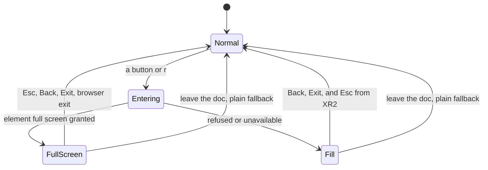
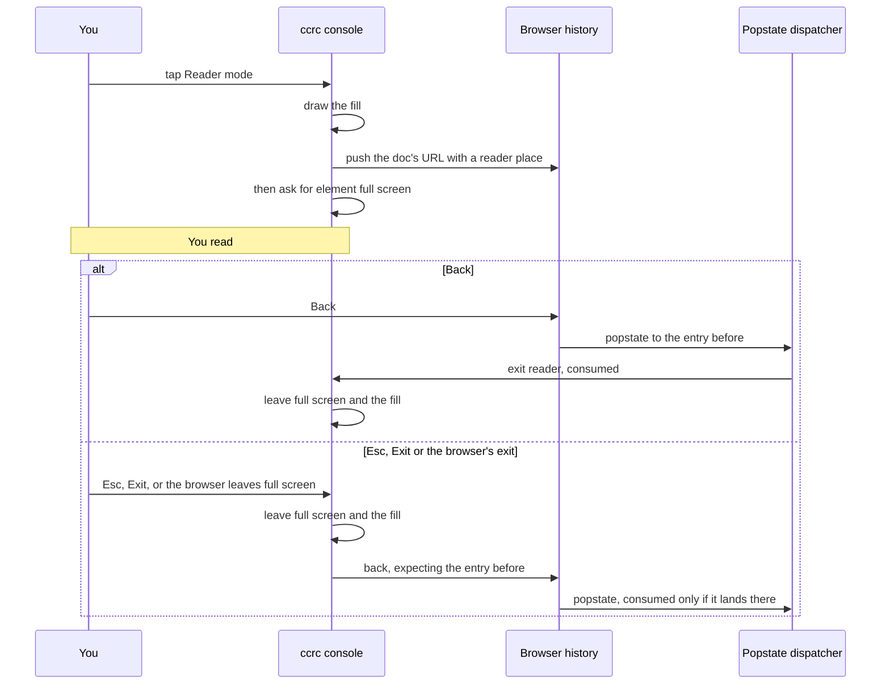
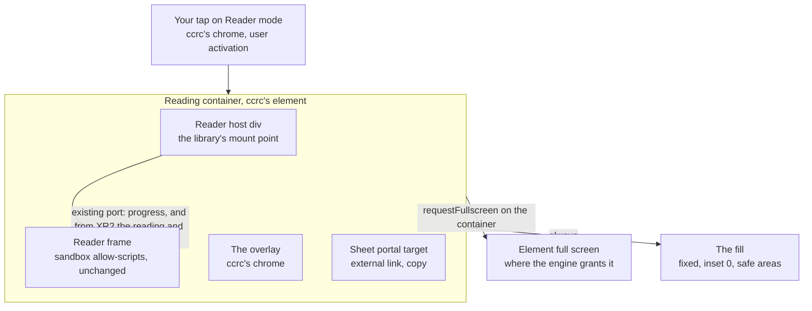
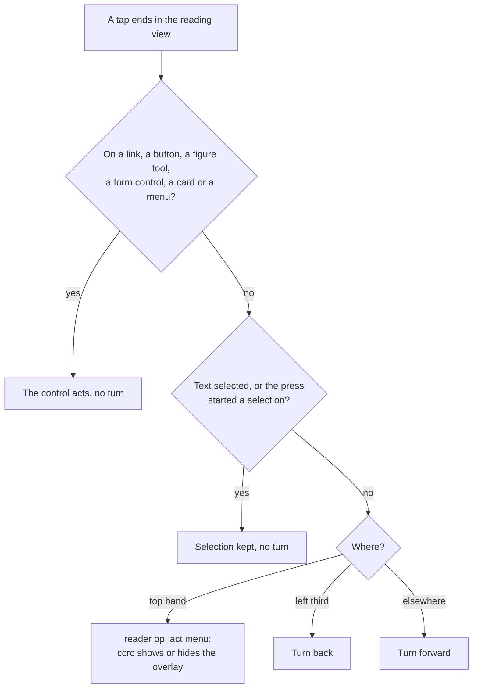
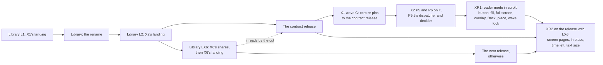

# Native Docs reader: reader mode

**Spec** · 2026-11-20 · Status: Draft, for review (X6, run 2847) · Owner: the operator · Linear: none · Related: docs/superpowers/plans/2026-11-20-native-docs-reader-mode.md, docs/superpowers/specs/2026-10-12-rich-docs-reader-and-shared-renderer-design.md, docs/superpowers/specs/2026-11-18-native-docs-appearance-continuity-design.md, docs/superpowers/specs/2026-11-18-native-docs-parity-design.md, docs/superpowers/programs/native-docs-reader.md

## In short

- **What this is.** Your request of 2026-11-19: "when reading a document via docserver I need a button to enter "reader mode" where the document becomes full-screen (think Kindle-like experience when used)". It is designed for ccrc's native Docs reader, the reader you now read in. The standalone reader is being retired and gets nothing.
- **What reader mode is.** One button, or the `r` key, takes the open document full screen, on a phone and on a desktop (§2). It comes in two steps:
  - **First (XR1).** ccrc's head and banners and the reader's own bar and contents rail go away. You scroll as you do today. Two small controls stay over the page's top corners: ccrc's menu control and the reader's own Aa, which still opens width, font and folds (§4.2). The menu control shows a small overlay with Exit and how far you are. Back and Exit leave reader mode, each once, and so does Esc where the browser's full screen is on. The place you were reading is kept.
  - **Then (XR2).** Everything but the text goes away, the two corner controls included. You turn one screen at a time by tapping the side of the page, swiping, or pressing an arrow key, and each turn lands on a whole line. A tap at the top shows the overlay, which adds the time left, Aa and the choice of pages or scroll. Esc leaves reader mode on every engine.
- **What is decided.** ccrc's window owns full screen; the sandboxed frame never asks for it, and its sandbox stays `allow-scripts` with no new attribute. Where an engine refuses element full screen (the iPhone is the likely case, still to be measured), the same view fills the viewport without the browser's request (§4). Screen pages, not true book pages, is your answer to ask 656 on 2026-11-20 (§5). Reading stays one scroll underneath, so place, progress, the quick jump and change marks keep working. A screen wake lock is taken while you read, with an idle release (§6).
- **What changes.** Two ccrc waves and one library landing. XR1 is ccrc only, on the library's contract release: the one that carries X1's appearance contract and X2's history places, which ccrc re-pins to in X1's wave C. It delivers reader mode in continuous scroll: the button, full screen, the overlay, Back and the place, and the wake lock. The library landing LX6 adds the turning, the in-place hiding of the reader's chrome, a text size and one small op each way on the existing port. It joins the contract release if it is ready by then, otherwise the next one, and no release waits for it. XR2 takes up the release that carries it and brings the screen pages (§7). Nothing widens the sandbox, the shell CSP or the set of channels.
- **What you must check.** The phone's entry button on the one bar (§3.1) and the wake lock (§6.3), both decided here with the alternatives priced. Four departures from the rich-docs spec are recorded: D-8803 to D-8805 against its closed lists, and D-8831 against its phishing row (§8). The phone engines' full-screen behaviour is one device item for the coordinator to raise (§4.4); desktop Chromium was measured in part (§4.5).

## 1. Context

This section says what reader mode builds on. Every claim about ccrc was read from `main` at `62276e71b`, and every claim about the library from the installed `@synapsium-labs/docserver` 1.1.0, on 2026-11-20.

XR1 does not run on 1.1.0. It runs on the contract release, after X1's wave C re-pins ccrc to it and X2's P5 builds on it (§7.5). That release is 1.1.0 plus two designed landings: X1's contract (X1 spec §2, §6, §10) and X2's additions (X2 spec §4.7): the `place` op, `push` and `from` on the `hash` op, and the `close-overlay` and `goto` commands. Neither landing changes the chrome switches, the Aa menu's `settings` command, `progress` or `pos`, or, in the default layout, the keys the frame binds. So the 1.1.0 facts below are the contract release's default layout as designed, and XR1's first step re-reads each one on the installed release before any code (the plan's Task XR1.1 Step 0).

The contract release also carries X2's five layouts (X2 spec §4.2): `default`, `classic`, `editorial`, `review` (with a rail and its own keys) and `guided` (folded sections, and tables as cards on a phone). The host picks one per device, and a change remounts the frame. Reader mode reads in the default layout only (§4.3, the coordinator's ruling on review 2947 F3), so every fact this design relies on is the default layout's.

### 1.1 What exists

| What | Where | Fact |
|---|---|---|
| The reader frame | `pwa/src/docs/ReaderFrame.tsx`, `docs/reader/bridge.ts` | `<div className="docs-reader">` hosts the library's iframe, `sandbox="allow-scripts"`, sized by `.docs-reader iframe { position: absolute; inset: 0 }` inside a `100dvh` shell (`docs.css`). Sourced |
| Chrome at mount | `reader/policy.ts#readerMountPlan`, `bridge.ts` | A phone mount is `host-bar`: the library's `features.chrome` gets `{bar: false, topSpace: false}`, and `onProgress` is passed. A desktop mount keeps the frame's own bar. Sourced |
| The library's chrome switches | library `dist/enhance/options.js` `CHROME_KEYS` | `bar`, `rail`, `settings`, `topSpace`, each true by default, read once at mount. `bar: false` builds no top bar, running head, tool tray or progress line. Sourced |
| Progress | library `enhance/scroll.js`, `frame/protocol.js` | The share of the document scrolled, sent as thousandths at most once per 250 ms window, to any host that passed `onProgress`, with or without the bar. Sourced |
| Reading position | library `nav.js` `tokenOf`, `position.js`, `DOC_FIELDS` | A token `{line, offset, y}` saved under the doc's `pos` field 250 ms after scrolling stops and on `pagehide`, and restored at mount unless an `initialHash` wins. Sourced |
| Reading time | library `enhance/reading.js` | 230 words a minute for prose, 520 for code, half a minute per figure. It lives in the frame's DOM only: no op and no `render()` meta carries it. Sourced |
| Width and font | library `FRAME_PREF_VALUES` | `width: standard \| wide`, `font: serif \| sans`. No text size: the body is a fixed 18 px (17.5 px sans). Sourced |
| Scrolling | library `scroll.js` header | The frame's window scrolls. No pagination, multicolumn or scroll snap anywhere. Sourced |
| Keys the frame binds | library `keys.js` `SHEET_ORDER` | `/ j k w i n p m o ?`, Mod+K and Esc. Not bound: the arrow keys at page level, Space, PageUp, PageDown, Home, End, `f`, `r`. Sourced |
| Keys the console binds | `pwa/src/command/useShortcuts.ts` | Ctrl or Cmd+K, `[`, `]`, `?`, `i` and `g` chords, on the window, never while a dialog is open. The Docs screen binds no key of its own. Sourced |
| Taps in the frame | library `guard.js`, `nav.js` | A click guard routes links; no body-level tap or swipe handling exists. Sourced |
| Commands | library `COMMAND_NAMES` | `jump`, `settings`, `contents`, `outline`, sent by ccrc's one bar only. Sourced |
| Sheets | `ui/src/primitives/sheet.tsx` | vaul drawers portalled to the document body, `z-index` layers (`--z-sheet: 40` up to `--z-block: 100`). Nothing uses the browser's top layer. Sourced |
| Full screen, wake lock | `pwa/src`, `ui/src` | No use of the Fullscreen API, the Wake Lock API or `screen.orientation`. The viewport meta carries `viewport-fit=cover`, and the tokens define `--safe-top` and `--safe-bottom`. Sourced |
| The installed app | `pwa/vite.config.ts` manifest | `display: 'standalone'`, no `display_override`, no `orientation`. Sourced |
| History | `lib/router.ts`, `lib/swupdate.ts`, `docs/readerHistory.ts` | Three `popstate` listeners today. X2's wave P5.3 replaces them with one dispatcher, `lib/popstate.ts`, and a pure decider, `lib/historyPlaces.ts` (X2 spec §4.7). Sourced |
| The contract release's history ops | X2 spec §4.7, §6 | The frame reports a figure overlay as `place {kind}` and a jump to return to as `hash {id, push, from}`; ccrc sends `close-overlay` and `goto {id, from}` on a Back that pops a place. Designed, landed by the library before XR1 |

### 1.2 Boundaries that do not move

| Boundary | Value | Where it is pinned |
|---|---|---|
| Reader frame sandbox | Exactly `allow-scripts`; no `allow`, no `allowfullscreen` | rich-docs §4.1 |
| Shell CSP | `frame-src 'none'` | completion plan, Global Constraints |
| Frame and console | No parent-DOM access, no new channel, no window `message` listener in `pwa/src`; frame ops additive on the existing port | rich-docs §4.4, §5.1 |
| Library | Exactly 1.1.0 in this design wave; XR1 on the contract release as X1's wave C pins it, XR2 on the release carrying LX6. A library change is designed here, not made | brief; the coordinator's ruling on review 2933 F7 |
| Phone | Both 2026-11-06 phone blocks byte for byte; the tap, one-bar and desktop-fit budgets stand | completion plan, Global Constraints |
| Appearance | Reader mode uses ccrc's appearance through X1's contract. No new palette, catalogue or token list | X1 spec §2, §10 |
| The standalone reader | Gets nothing | brief |

### 1.3 Words used here

| Word | Meaning |
|---|---|
| Reader mode | The full-screen reading view of one Docs page |
| Fill | Reader mode drawn over the whole viewport by ccrc's own layout, with no Fullscreen API request |
| Full screen | Fill, plus the browser's element full screen on ccrc's reading container, where the engine grants it |
| Screen page | One viewport of text. A turn moves to the next screen page and lands on a whole line |
| Turn | Moving one screen page forward or back |
| The overlay | ccrc's small reader-mode toolbar: progress and time left, Aa, the turn setting and Exit |
| The top band | The strip at the top of the reading view whose tap shows the overlay; drawn and reported by the frame, from XR2 |
| The menu control | XR1's small ccrc button in a top corner of the reading view, whose tap shows the overlay; gone from XR2 |
| Reading container | The ccrc element that holds the reader frame and the overlay, and that goes full screen |

## 2. The experience

This section shows reader mode as you see it, on a desktop and on a phone, before any mechanism.

### 2.1 Desktop

```text
Normal view, 1280 x 800
+--------------------------------------------------------------------------------+
| <  docs / specs / 2026-11-20-...-design.md   [Reader mode] [GitHub] [Share] ...|  ccrc's head
| Committed at main, 62276e7 ...                                                 |  truth line
+--------------------------------------------------------------------------------+
| [reader's own bar: running head, Jump, Contents, Aa]                           |
| Contents |  1. Context                                                         |
| rail     |  This section says ...                                              |
+--------------------------------------------------------------------------------+

Reader mode, full screen
+--------------------------------------------------------------------------------+
|                       (top band: a tap or hover shows the overlay)             |
|                 1. Context                                                     |
|                 This section says what reader mode builds on. Every claim      |
|                 about ccrc was read from main ... the text at its measure,     |
|                 centred, nothing else on the screen.                           |
|   <- turn back                                              turn forward ->    |
|                                                                                |
+--------------------------------------------------------------------------------+

Reader mode, overlay shown
+--------------------------------------------------------------------------------+
| [x Exit]   Native Docs reader: reader mode                    [Pages|Scroll] [Aa]|
|                 1. Context                                                     |
|                 ...                                                            |
| ===========================------------------------------------  41%  12 min left|
+--------------------------------------------------------------------------------+
```
*Mockup 1. Desktop. The Reader mode action leads the head's action row. In reader mode only the text remains. The overlay is two thin strips: Exit, the title, the turn setting and Aa at the top, and the progress line with percent and time left at the bottom.*

### 2.2 Phone

```text
Normal view, 412 x 915, one bar            Reader mode                    Overlay shown
+------------------------------+     +------------------------------+  +------------------------------+
| < Title of the doc  [/][=][R]|     |  (top band)                  |  |[x]  Title of the doc   [S][Aa]|
|==============---------------- |     | 1. Context                   |  | 1. Context                   |
| 1. Context                   |     | This section says what       |  | This section says what       |
| This section says what       |     | reader mode builds on.       |  | reader mode builds on.       |
| reader mode builds on.       |     | Every claim about ccrc ...   |  | ...                          |
| ...                          |     |                              |  |                              |
|                              |     | <- back   |   forward ->     |  |==========-------- 41% 12 min |
+------------------------------+     +------------------------------+  +------------------------------+
  [/] Jump  [=] Contents  [R] Reader mode            [S] Pages or Scroll   [Aa] the reader's own Aa
```
*Mockup 2. Phone. The Reader mode tool is the last tool on the one bar, at the thumb's side. In reader mode the text fills the screen inside the safe areas. A tap at the top shows the overlay; a tap on the left third turns back, anywhere else below the top band turns forward. Mockups 1 and 2 show reader mode from XR2.*

```text
XR1 on a phone, 412 x 915                 XR1, the menu control tapped
+------------------------------+          +------------------------------+
|[=]                       [Aa]|          |[=] Title of doc 41%[Exit][Aa]|
| 1. Context                   |          |::::::::::::::::::::::::::::::|
| This section says what       |          |: the reading area, under a  :|
| reader mode builds on.       |          |: clear layer: a tap here    :|
| Every claim about ccrc ...   |          |: hides the overlay          :|
|  (continuous scroll)         |          |::::::::::::::::::::::::::::::|
+------------------------------+          +------------------------------+
  [=] ccrc's menu control   [Aa] the reader's own Aa, drawn by the frame
```
*Mockup 3. XR1 on a phone. The text scrolls as it does today. Two small controls stay over the page's top corners: ccrc's menu control and the reader's own Aa, which still opens width, font and folds. The menu control shows the overlay strip between the two corners, with the title, the percentage and Exit. A second tap on the menu control, or a tap anywhere outside the strip, hides it. Exit never sits where the menu control was, and the Aa corner stays clear. XR2 removes both corner controls.*

### 2.3 The states


*Figure 1. Reader mode's states. Start at Normal. Entering always draws the fill first and then asks for full screen, so a refusal leaves a working reader mode. Every exit returns to Normal at the same place in the document.*

## 3. Entry and exit

This section places the button and the key, and gives every exit one model through X2's history places.

### 3.1 The button

| Where | Choice | Alternatives considered | Why |
|---|---|---|---|
| Desktop, the full head (600 px and wider) | The first action of `.docs-actions`, the word "Reader mode" with a book icon; it becomes an icon at the row's first stage, as its neighbours do (`ROW_STAGES`) | (a) The last action; (b) inside the frame's own bar; (c) a floating button over the text | (a) The most used action belongs nearest the start. (b) The frame cannot request full screen and its bar goes away in reader mode. (c) Covers text and is the frame's ground, not ccrc's. |
| Phone, the one bar (a ready frame under 600 px) | The last control, icon only, `aria-label` "Reader mode", after Jump, Contents and a plan's Outline; at least 44 by 44 px. It is ccrc's own action drawn by `OneBarControls`, not a row of `oneBarTools`, which holds the library's command names only (`reader-commands.test-d.ts`) | (a) Inside Page details; (b) replace a tool; (c) a long press on the title | (a) Two taps, against "one button enters it". (b) Jump and Contents are in daily use. (c) Not discoverable. The title loses 44 px of width, which the one bar's ellipsis absorbs; the bar's height, the title's position and the tap floor do not change (§4.6). |
| Phone, the compact row | None | Show it disabled | The compact row draws only while the frame is not ready, and reader mode needs the frame. |
| The plain view | None in this design | A host-drawn reader mode of the plain tree | The plain view is a fallback. Reading it full screen is Later (Where things stand). |
| The command palette | None. The `r` row's `when` is false while the palette is open, so the palette never lists it; the key does not read `when` (§3.2). The same `when` also asks the handle, so the shortcut sheet lists `r` only where it acts | One row in the palette | Choosing it there would start reader mode while the palette's own modal layer is still leaving. That layer's hiding undo and its focus restore (`CommandLayer.tsx`, which puts focus back on what had it) would race reader mode's hiding and its focus on the frame (§4.1). The two buttons and `r` are the entries. |

### 3.2 The key

**`r`, no modifier.** It is free in the console and in the frame (§1.1).

| Option | Verdict |
|---|---|
| `r` | Chosen. Free on both sides, and "reader". |
| `f` | Free too, but it reads as "full screen of anything"; reader mode is more than full screen. |
| F11 | The browser's own full screen of the whole page, ccrc's chrome included. Not ours to take. |
| Shift+R or Ctrl+Shift+R | Ctrl+Shift+R is a hard reload in every desktop browser. |
| Esc to enter | Esc leaves things. |

**Who sees the key.** The frame keeps focus while you read, and its keys never reach ccrc's window (the opaque origin). So:
- In XR1, `r` is one row in the console's shortcut registry (`pwa/src/command/commands.ts`), acting while focus is in the console, for example after a tap on the head. The registry does not apply `when` to single keys, so the row's `run` calls a handle the Docs screen sets while it is mounted (`pwa/src/docs/readerModeHandle.ts`), and does nothing where the handle is empty or reader mode is not offered.
- From the library landing, the frame forwards `r` as a `reader` op with `act: 'toggle'`, only when the host's seed says it accepts reader mode (§7.2). The library's keys sheet then lists `r`.

### 3.3 One place, one Back

Entering pushes one history entry, a place of kind `reader`, through X2's dispatcher. Every exit removes it exactly once. This is X2's own model (X2 spec §4.7) with one more place kind, made by ccrc, never by the frame.


*Figure 2. One Back model. Entering draws the fill, pushes one place and only then asks for full screen, because the request consumes the tap's activation and the push must not wait on it. Back pops the place, and an exit by any other path steps back over it. The router never runs for these pops, so the page does not reload or move.*

- **The place.** `docsPlace: {visit, seq, kind: 'reader'}` on an entry carrying the doc's URL unchanged, beside X2's `overlay` and `jump` places. It counts toward X2's `PLACES_MAX` of 50 per visit.
- **The visit's base.** X2's tab record (`{visit, doc, places, pendingSeq, lastIdx, next}`, X2 plan P5.3) gains one field, `baseIdx`: the `docsIdx` of the visit's own base entry, the doc's entry before any place, stamped when the visit starts. Without it the decider could not tell the doc's own entry from the previous screen's, because neither carries a `docsPlace`.
- **The reader place that counts** is the topmost `reader` place of the current visit at or below `lastIdx`. A visit can hold two (exit by Back, Forward, enter again), and only the topmost is live.
- **The decider.** `historyPlaces.ts#decidePop` gains one answer, `{kind: 'exit-reader'; closeOverlay: boolean; route: boolean}`, and only when two things hold together:
  - reader mode is on, as the reader host reports it (`on()`);
  - the pop crosses that reader place: the popped entry's `docsIdx` is below the place's, while `lastIdx` is at or above it. Any number of the frame's own places (X2's overlay and jump places) may sit between.

  `route` is false when the landing is in the visit (`docsIdx` at or above `baseIdx`): the pop is consumed, and reader mode ends with the doc still shown. It is true when one traversal goes past the doc (a long press on Back, several entries at once): reader mode ends, and X2's own answer for that landing (skip or router) follows in the same event. `closeOverlay` is true when an open figure overlay place lies between the landing and `lastIdx`.
- **The decider's input.** `decidePop` stays a pure L1 function. Its input grows from X2's `(popped, tab)` to `(popped, tab, readerOn)`: the dispatcher, `popstate.ts` (L4), reads the reader host's `on()` and passes it, and `tab` carries `baseIdx`. L1 never calls the host.
- **A crossing while reader mode is off is consumed only when it is the exit that just happened.** That is the recorded landing of the step-back an exit made, or the Back an engine fires inside `READER_EXIT_SETTLE_MS` after a lost full screen. It carries the same `closeOverlay`, so an overlay of the frame that was open at the exit is closed by X2's `close-overlay` on exactly that pop. That is the Back X2's departure D-8763 allows it on, and no exit sends it any other way. This holds in both waves, because the contract release carries the command. Any other crossing while off is X2's own answer for the landing, with the reader place left out.
- **ccrc never stands on a dead reader entry.** A reader entry is live only while its reader mode is on. When the tab lands on or above a dead one of the current visit (Forward onto it, or a reload that ended reader mode while it was on), ccrc at once makes the same recorded step-back an exit makes, below it. Its landing is consumed, so no later Back is spent on that entry. Reader mode does not reopen there, because full screen needs a tap. So Forward, re-entry and reload leave no wasted Back: in B, enter, Back, Forward, enter, Back, Back, every Back has a visible effect, and the last one leaves the doc.
- **Every other pop is X2's, as before.** A pop that lands on or above the reader place is X2's: Back first closes a figure overlay or returns from a jump, then leaves reader mode. After any exit, the next Back no longer crosses the place, because `lastIdx` is already below it, so it leaves the document normally. A place of another visit is skipped as X2 decides, so a stale reader place never costs a Back.
- **Its own host.** The reader place is answered by the Docs screen's reader-mode hook, through its own slot, `setReaderPlaceHost`, beside X2's `setPlaceHost`, which the frame's mount holds. The frame's slot is empty during a remount, and X2 treats a frame place popped then as stale; the reader place must not be, because reader mode outlives the frame's remount (§4.3). One dispatcher, one decider, two hosts for two owners.
- **User activation.** The push follows a tap or a key on ccrc's own chrome, which gives the console activation directly, and it runs before the full-screen request, because the request consumes the tap's transient activation and a pushed entry is not. Unlike X2's frame-reported places, it does not wait on lab E16.
- **Order of exit.** Esc in browser full screen is the browser's: it leaves full screen, and the `fullscreenchange` that follows is ccrc's signal. A Back that pops the place first leaves full screen through `document.exitFullscreen()`; the `fullscreenchange` that follows finds reader mode already off and does nothing.
- **Stepping back over the place.** An exit that did not come from a pop (Esc, Exit, the browser's exit) steps back to the entry below the reader place, with `history.go(-n)` and the landing recorded so the decider consumes it. `n` counts live entries, never a difference of indices: X2's `docsIdx` only grows, and X2 keeps a place in its record after a later push has discarded that place's entry. So every place push now first drops from the record each place whose `docsIdx` is above `lastIdx`, because those entries are the forward history the push just discarded. Within a visit every entry above `baseIdx` is a place (X2 pushes an entry only for a place or a `hash` with `push`, which is a jump place, and a scroll-spy `hash` replaces), so `n` is 1 for the reader place plus the number of recorded places with a `docsIdx` above the reader place's and at or below `lastIdx`. Example: in reader mode, open a figure overlay O, Back closes O, then a jump pushes J. O is dropped as J is pushed, so `n` is 2 (R and J), the two live entries. A frame overlay open at that moment is closed on the step-back's pop, as the decider's crossing rule says above.
- **When full screen is lost first.** An engine may leave full screen and also traverse history on one Back (FS-3). ccrc therefore waits `READER_EXIT_SETTLE_MS` (100 ms) after a lost full screen before stepping back, then reads the tab record again: if a pop has already landed below the reader place, it steps nothing. So one Esc, or one Back, is one exit, whichever order an engine fires them in. An engine that traverses later than that is a device row (FS-3). Its residue is one step too many: the step lands on the entry before the doc, so the previous screen shows, as after a Back. The doc is one Forward away, and the place in it is kept. If FS-3 measures such an engine, the settle grows to its measured delay.
- **No place, no step.** If the visit's place budget is spent (`PLACES_MAX`), reader mode still opens, with no place; its exits then step back nothing, and Back leaves the document as it does today.

| Exit | XR1 | From XR2 |
|---|---|---|
| Esc, browser full screen | The browser owns Esc: it leaves full screen, ccrc follows and leaves reader mode, closing any open frame overlay. Esc never reaches the page here | Same |
| Esc, fill only, focus in ccrc's overlay | The overlay's own key handler, on the toolbar element: it hides the overlay and returns focus to the frame, and never leaves reader mode | Same |
| Esc, fill only, focus in the frame | Not seen: the frame's keys stay in the frame. Exit, Back and `r` (with focus in the console) leave | The frame closes its own open overlay first; with none open it sends `reader {act: 'exit'}` |
| Esc that closes a sheet in reader mode | The sheet's own: it closes the sheet and nothing else. Sheets portal beside the overlay, never inside it, so the Esc never reaches the overlay's handler, as the command layer stands down under an open dialog (`useShortcuts.ts#keysOwnedBySurface`) | Same |
| Back (button, Alt+Left, Android Back, iOS swipe) | Pops the place | Same |
| The overlay's Exit | ccrc | Same |
| The browser's own exit (its banner or gesture) | `fullscreenchange`, ccrc follows | Same |
| `r` again | Console focus only | Forwarded by the frame |
| Leaving the doc (a link to another doc, the back arrow, another screen) | Reader mode ends with the visit; its place is stale and skipped | Same |
| The frame falls back to the plain view | Reader mode ends; the fallback note shows as today | Same |

| Decision | Options | Chosen, and why |
|---|---|---|
| Does losing full screen end reader mode? | (a) Yes, entirely; (b) keep the fill | (a): one model. The browser's exit is the one exit ccrc cannot veto; keeping the fill after it would leave you in a half state with the console hidden and the browser's bars back. |
| A link to another doc | (a) Ends reader mode, the doc opens in the normal view; (b) the next doc opens in reader mode | (a) in this design: X2's places are per doc visit, and (b) needs a reader session that spans visits, a history design of its own. (b) is Later. A same-page link stays in reader mode, because the reading container outlives the frame's remount (§4.1). |
| Who keeps the entry | (a) The console, as one more place kind; (b) none, Back leaves the page | (a): Back on a phone must leave reader mode, not the document. |

## 4. Full screen

This section says who requests full screen, on what element, what happens where it is refused, and what the phone budgets become.

### 4.1 The host owns it

The frame cannot request full screen: it has no `allowfullscreen` and no `allow` attribute, and both stay unset (rich-docs §4.1). ccrc's window requests it on ccrc's own element.


*Figure 3. The reading container. Start at your tap. ccrc's element, not the frame, goes full screen, and the fill is drawn first so a refusal changes nothing you can see beyond the browser's own bars. The frame keeps its sandbox and talks to ccrc only over the existing port.*

- **The reading container is always there.** An iframe moved in the DOM reloads, so reader mode never re-parents the frame. A new element, the reading container, wraps the Docs screen's body (`DocsScreen.tsx`, around `{body}`) on every Docs page, in normal view too. It carries no React key, so adding it remounts nothing. Reader mode records the document it was entered for (project or folder, section, path): a same-document remount (a new commit, a same-page link spelled with its file name) happens inside the container and keeps reader mode, and a change of document ends it.
- **The fill comes first.** On entry ccrc sets `data-reader-mode` on the container. Its rule draws the container `position: fixed; inset: 0` over the console, on the reader's ground, inside the safe areas (`--safe-top`, `--safe-bottom`, and the side insets), at a new layer token `--z-reading` between `--z-toast` and `--z-block`. In the fill, a session-expired or update block (`BlockScreen`, `LoginScreen`, mounted beside the app shell) still draws over reader mode. In element full screen it would not, because only the full-screen subtree draws; so either of them appearing ends reader mode, through one decision event (`block`).
- **Then full screen, where it exists.** If `document.fullscreenEnabled` is true, ccrc calls `container.requestFullscreen({navigationUI: 'hide'})` in the same task as your tap. A rejection, or an engine without the API, leaves the fill as reader mode. ccrc never retries without a new tap.
- **Sheets go inside.** In element full screen only the full-screen element's subtree is drawn. The sheets the frame can raise (the external-link sheet, the copy sheet, a "not loaded" chip's sheet) are portalled to the document body today, so they would open unseen. On a Docs page, ccrc's `Sheet` primitive always takes its portal target from a context the reading container provides, in both views, so a sheet open as reader mode starts or ends is never moved and remounted. The container creates no stacking context and no clip in the normal view, so a sheet there draws as it does today.
- **The rest of the console is suspended, as the page's own hiding.** While reader mode is on, everything outside the container is inert and hidden from assistive technology: each sibling of the container and of each ancestor up to `body` gets `aria-hidden="true"` and `inert`, with no `data-aria-hidden` mark. An unmarked hidden node is the one kind the modal layers never lift. `ui/src/lib/modal-layers.ts#recordModalLayer` records it as the page's own, and a closing sheet's `useHidingFollowsOpen` (`ui/src/primitives/sheet.tsx`) lifts every mark but the page's own. So a sheet that opens and closes inside reader mode (the external-link or copy sheet) leaves the console hidden. A hiding of reader mode's own through Radix's `hideOthers` would not survive it: the closing sheet would lift those marks with its own. Two functions beside the record, in `modal-layers.ts`, keep one owner for the hiding:
  - `hideAsPage(keep)` makes every node outside `keep` inert, writes `aria-hidden` on each one the page had not already hidden, and returns what it did as one record: the nodes it made inert and the nodes it hid;
  - `releaseAsPage(record)` takes them back. Every node it made inert loses `inert`. A node it hid keeps its `aria-hidden` only while an open modal holds it, read as `sheet.tsx` reads it: the node carries `data-aria-hidden` and a `[role="dialog"][data-state="open"]` is in the document. Then it leaves every layer's record, so that modal lifts it as its own when it closes. Every other node it hid loses its `aria-hidden`, a node marked by a sheet that has started to close included: that sheet made its one lift as it turned closed, so nothing would ever lift the node after it. This matters most on Android, where the external-link sheet's Open starts the close, opens a tab, and ends full screen, and so reader mode, during the sheet's exit animation.

  Reader mode's live region, which announces the entry, sits inside the container, so the hiding never silences it (Radix's `hideOthers` exempts `[aria-live]`; `hideAsPage` has no need to). Reader mode is not offered at all while any modal layer is in the document, open or still animating closed (`[role="dialog"]`). A sheet that has started to close has already lifted its own marks, so hiding under it would leave nodes that its undo then un-hides behind reader mode. The command layer's own stand-down sees only an open dialog, which is why the offer reads the wider test. The palette does not offer reader mode either (§3.1). So Tab never reaches an invisible head control, and a screen reader never reads one. The command layer's single keys are held, except `r`, and Cmd or Ctrl+K does not open the palette: its branch runs before the layer's key-holding check (`useShortcuts.ts`), so that branch gains the reader-mode test itself. Esc on ccrc's overlay is the overlay's own key handler, bound on its toolbar element, not the command layer's and not the container's (§3.3). Toasts draw behind the container and may expire unseen.
- **The mockup frame's own Full screen** (`.docs-mockup[data-frame='full']`) is a different view, for HTML leaves, and is unchanged.

| Decision | Options | Chosen, and why |
|---|---|---|
| Which element | (a) A container around the reader host and the overlay; (b) the reader host itself; (c) the document element | (a): the overlay and sheets must be inside the full-screen subtree. (b) is the library's mount point, which ccrc does not fill with its own children. (c) shows the console's chrome. |
| When the API is refused | (a) The fill stays as reader mode; (b) reader mode fails with a note | (a): the fill is the designed experience on every engine. Full screen only adds hiding the browser's own bars. |
| Fill before or after the request | (a) Before, in the same task; (b) after the promise resolves | (a): the request must run inside the tap's activation, and drawing first means no flash of the console when it resolves or fails. |
| Widen the frame (`allowfullscreen`) | No | Forbidden by rich-docs §4.1, and unnecessary. |

### 4.2 What disappears

| Element | In reader mode | How |
|---|---|---|
| ccrc's head, truth line, banners, the one bar, the shell's navigation | Hidden | Outside the container, covered by the fill or outside the full-screen subtree |
| The reader's own bar, running head, progress line | Hidden | XR1: the reader-mode remount passes `features.chrome {bar: false}`. XR2: the library hides it in place |
| The contents rail | Hidden | XR1: `rail: false` at the remount. XR2: in place |
| The frame's Aa button | XR1: stays, drawn by the frame at the top right, where the library puts it with the bar off (`.aa-wrap`, sticky, 8 px from the top). The contract release cannot hide it and keep its menu: there, as at 1.1.0, `settings: false` also unregisters the `settings` command (`enhance/settings.js`), and neither X1 nor X2 adds a host switch for it (X1 spec §6 keeps one Aa, in the frame). So in XR1 you reach width, font and folds through that Aa, in reader mode, with nothing of ccrc's over it. XR2: hidden in place, reachable from the overlay's Aa (`command settings`, D-8803) | XR1 keeps it; XR2 hides it |
| ccrc's menu control | XR1 only: one 44 by 44 px button in the top corner the frame's Aa does not use (the top left), inside the safe areas, on the reader's ground at 85% opacity, labelled "Reader mode menu", with `aria-expanded`. A tap shows the overlay, and a second tap on it hides the overlay | Text scrolls beneath it, as it does beneath the frame's Aa; a drag anywhere else scrolls the frame. XR2 removes it |

**The overlay, shown and hidden (the coordinator's ruling on review 2947 F2: Kindle-like, both ways).** It never hides by itself: a timeout would surprise a reader who is looking at the progress.
- **Show.** XR1: a tap on the menu control. From XR2: a tap on the frame's top band (`reader {act: 'menu'}`).
- **Hide:**
  - the same control again: a second tap on the menu control (XR1), or on the top band (XR2), toggles it off;
  - a tap anywhere outside the overlay. ccrc cannot see a tap inside the frame, so while the overlay shows, ccrc draws a clear layer over the reading area below the strip. A tap on that layer hides the overlay and does nothing else, as a Kindle's tap outside its menu does. The layer leaves the frame's Aa corner uncovered. A tap there opens the frame's settings and moves focus into the frame, which hides the overlay too, through the page clock's window-blur signal (`lib/pageClock.ts#onWindowBlur`);
  - Esc on the overlay (§3.3).
- **Where things sit.** The strip runs from the menu control's right edge to the Aa corner's left edge: the menu control stays where it was, as the toggle, and the strip holds the title, the percentage and Exit, with Exit at its right end. So Exit never sits where the menu control was, and a second tap there can never leave reader mode. While the overlay shows, the frame's Aa corner is never covered.
- **From XR2, and in landscape.** XR2 has no corner controls. The strip runs the full width, with Exit at its right end, and a tap on the strip outside its controls hides it as well. The same clear layer below the strip hides it on a tap outside, in portrait and in landscape alike.
| Figure tools, Render buttons of figures not drawn yet, code copy, table filter, cards | Kept | They are the document's own controls. Figures stay on request (E17, both phone blocks unchanged) |
| The top space above the first heading | Trimmed | `topSpace: false` |

### 4.3 XR1 enters by a remount; XR2 does not

The library reads its chrome switches once, at mount, in 1.1.0 and in the contract release alike: neither X1's landing nor X2's changes them.
- **The default layout, always.** Reader mode reads in the `default` layout, whatever layout the reader chose (the coordinator's ruling on review 2947 F3). Entering mounts the frame in `default` for reader mode's duration, and leaving remounts it in the reader's own layout. Where the reader's layout is already `default`, nothing remounts on that account. In another layout, entering costs one remount on a phone too, through the same `ReaderMount.remount` as the desktop's, with the same quiet wait and no opening hash. The other four layouts are never reached in reader mode: their rails, keys and folds never meet the menu control, `r` or the overlay.
- **Measured first, with a fallback.** XR1's first step measures, per engine, whether leaving a non-default layout needs a remount on a phone, and what that remount costs: its time against lab E4's 1.4 s, and whether the 2026-11-06 phone blocks and the one-bar budgets hold through it. The browser leg measures this at 412 by 915, and the phones measure it as device row FS-9. If the remount breaks any of those, the fallback applies instead: the button is offered only while the default layout is active, with one sentence where it would be, "Reader mode reads in the default layout. Choose it in Page details to use reader mode." The measurement decides between the two, and the plan writes both as one rule.
- **On a phone in the default layout, no remount.** A phone's mount is already `host-bar`: the frame's bar is off and its top space trimmed, and the contents rail is a drawer. XR1 enters in place there, with nothing reloaded.
- **On a desktop, one remount.** XR1 remounts the same document in the same container with the chrome off, through a new bridge method, `ReaderMount.remount(chrome)`: the same rendered document, a new `MessageChannel` and nonce, as the same-page link's `openAt` already does (rich-docs §4.1, D2), but with no `initialHash`, because the library lets a hash win over the stored place and the page's opening fragment must not pull you back to it. The place comes back from the library's own `pos` field. That field is written 250 ms after scrolling stops, and the host drops the old frame's messages once it is destroyed, so the remount waits until `READER_REMOUNT_QUIET_MS` (400 ms) have passed since the last `progress` message, which XR1 asks for from every production mount (D-8805). The fill is drawn at once; only the swap waits.
- **The cost** is one frame swap, about 0.2 to 1.4 s (lab E4's srcdoc timings), and what a remount already resets: the "Changed since your last visit" notice, open folds and drawn figures. XR2 replaces the remount with the in-place `reading` op (§7.2), so entering and leaving keep the very scroll position, the drawn figures and the folds on every device.

### 4.4 Engines

**Measured on desktop Chromium, in part.** §4.5: element full screen around a `sandbox="allow-scripts"` srcdoc frame, on the box's own headless Chromium 156.

**Not measured, one device item for the coordinator to raise** (the phone engines cannot be measured from this box):

| Row | Engine | What to record | Expected, not measured |
|---|---|---|---|
| FS-1 | iOS Safari, browser tab, iPhone | `document.fullscreenEnabled`; whether `requestFullscreen` on a `div` resolves; whether Safari's toolbar hides | Element full screen unavailable on iPhone; the fill path; Safari's bars stay |
| FS-2 | iOS, installed app (standalone) | The same, and the status bar's area with `viewport-fit=cover` | The fill path; no browser bars to hide |
| FS-3 | Android Chrome, browser tab | Full screen granted; Android Back while in full screen: does it leave full screen only, or also pop history (one exit either way, §3.3) | Granted |
| FS-4 | Android, installed app | The same as FS-3 | Granted; the status bar hides |
| FS-5 | Desktop Chrome, Firefox and Safari | Granted; Esc leaves full screen and fires `fullscreenchange` (M-5) | Granted |
| FS-6 | Every engine above | A tap in the frame after entry: keys and turns reach the frame; the external-link sheet shows inside reader mode | Holds |
| FS-7 | iOS and Android | Wake lock granted in the tab and in the installed app; released when hidden | Granted where the engine has the API |
| FS-8 | Desktop Chrome and one phone engine | `requestFullscreen` without a tap's activation rejects; with it, it resolves (M-1) | Holds |
| FS-9 | iOS and Android, tab and installed | Entering reader mode from a non-default layout: whether it remounts, its time, and the one bar and the phone blocks through it (§4.3) | One remount, under 1.4 s |

### 4.5 The desktop Chromium measurement

Measured on 2026-11-20 on the box's own headless Chromium 156 (the browser leg's cached build), driven over the DevTools protocol by a scratch script in the session's temp root: a host page with the shell's `frame-src 'none'` meta, a `div` holding an `iframe sandbox="allow-scripts"` with a srcdoc under `default-src 'none'`, and the full-screen request on the `div`. No install, nothing in the worktree, the script and its profiles deleted after. Headless Chromium has no browser interface, so the rows about activation and Esc are not representative of a real browser.

| Row | Question | Reading |
|---|---|---|
| M-1 | `requestFullscreen` on the container resolves with a tap's activation | Measured: resolves, `fullscreenElement` is the container. Without activation it also resolved, which is the protocol's evaluation granting it, not the browser's rule; the rule that full screen needs transient activation is sourced from the Fullscreen API standard and is XR1's browser row |
| M-2 | The frame inside does not reload | Measured: one `load` before entering, one after, and one after leaving |
| M-3 | The frame cannot enter full screen itself | UNMEASURED: the script did not resolve the frame's context; the sandbox's missing `allowfullscreen` is sourced (rich-docs §4.1), and XR1's browser row measures it |
| M-4 | Keys reach the frame while the container is full screen | UNMEASURED, as M-3. The console's window saw none of the keys sent while the frame had focus, as the opaque origin implies |
| M-5 | Esc leaves full screen and fires `fullscreenchange` | UNMEASURED: an Esc sent through the protocol did not leave full screen in headless, which has no interface to own Esc. `fullscreenchange` fired on entering and on `exitFullscreen()` |
| M-6 | Entering and leaving add no history entry | Measured: `history.length` 2 before and after |
| M-7 | Wake lock in the console's window | Measured: `granted: screen`. Inside the frame: UNMEASURED, as M-3 |
| M-8 | Orientation lock on a desktop | Measured: `NotSupportedError`, so §6.4's choice costs nothing there |

XR1 Step 0 measures M-3, M-4 and M-7's frame half in the browser leg's Playwright-driven, headless Chrome, before any code, and records them in the plan's Results. The leg cannot measure the rest: Playwright evaluates with a user gesture, so M-1's refusal without activation joins the device item as FS-8, and Esc needs a browser with its interface, so M-5 joins it as FS-5. The leg's "refused full screen" rows stub `requestFullscreen` to reject.

### 4.6 Phone blocks, budgets and safe areas

- **Both 2026-11-06 phone blocks stay byte for byte.** Reader mode changes no Mermaid draw and no lab reading; no phone block is reused as evidence for it.
- **The one bar.** One more tool of 44 by 44 px. The bar stays 44 px tall, the title stays at most 61 px down with at most 48 px of that the console's, and every tool keeps the 44 px floor, at 412 by 915 and at 915 by 412 (`pwa/browser/docs-compact-head.browser.test.ts`). The title's width falls by 44 px; at 360 px wide a plan's bar holds back, four tools and a title of about 116 px, after the screen's and the title's padding. A browser row at 360 by 800, the commonest Android width, proves it: no sideways scroll, every control at the floor, and the title still a tap target.
- **The desktop head.** The row stays one line and the head at most 80 px at 1280 by 800, with a new 1920 by 1080 row.
- **In reader mode.** Every overlay control is at least `--tap-min` (44 px). The overlay's top strip sits below `--safe-top`, its bottom strip above `--safe-bottom`, and the text inside the side insets. The fill's ground is the reader's ground, X1's `bg` slot while hosted, so the insets do not show as bands.

## 5. Reading: screen pages

This section designs the reading model you chose in ask 656 on 2026-11-20, screen pages, prices the two alternatives, and says what happens to figures, tables, code and Mermaid.

### 5.1 The three models, priced

| Model | What you see | Library change | ccrc change | Risk |
|---|---|---|---|---|
| Calm scroll | Continuous scroll, nothing turns | None for XR1; the `reading` op for in-place chrome | XR1 alone | Least; also least like a Kindle |
| **Screen pages (chosen)** | A turn moves one screen and lands on a whole line; one scroll underneath | A turn engine of about 6 to 10 thousand characters, inside the frame (§7.3) | XR2 adds the setting | Low: position, progress, jumps and change marks are unchanged, because the frame still scrolls |
| True book pages | Fixed pages with a count, laid out in columns | A paged layout of about 25 to 45 thousand characters, re-plumbing position, progress, the quick jump, `hash` jumps, scroll-spy and change marks | XR2 and a new progress model | Highest: WebKit multicolumn fragmentation, wide tables and long code against a horizontal swipe, figures taller than a page, re-pagination when a figure draws on tap |

The estimates for screen pages and true pages are judgement, sized against modules measured in 1.1.0 (X2 spec §6: `nav` 5 997, `overlays` 855, `commands` 594 characters; the default bundle 198 215).

### 5.2 Where paging runs

| Option | Verdict |
|---|---|
| (a) Inside the frame, a library reading mode | **Chosen.** Taps, swipes and keys happen in the frame, and only the frame can find line boxes. |
| (b) ccrc pages from outside | Not possible without a library op: ccrc cannot read the frame's DOM or scroll it, and 1.1.0 has no host scroll op. Even with one, ccrc would turn blind, cutting lines. |
| (c) ccrc draws tap zones over the frame | Blocks links and selection near the edges, and still needs a scroll op. |

### 5.3 A turn

- **Forward.** The frame finds the first line not wholly visible at the bottom of the viewport: a caret position at the bottom edge (`caretPositionFromPoint`, or `caretRangeFromPoint` where only that exists), its line box, its top. It scrolls instantly so that this line's top meets the top of the reading area.
- **The top of the reading area is below anything pinned there.** It is the lowest bottom edge among the elements stuck at the top at that moment, or the viewport's top when none is. An element counts when its computed `position` is `sticky` or `fixed`, it overlaps the text column, and its top sits at its own sticky offset: a table's head, a card's head, a figure's tools. The frame measures them again after the scroll and corrects the target once, because a table's head pins only when the table reaches the top. So in a table taller than the screen, each turn lands the next row just below the pinned head, never under it.
- **The bottom edge.** After a turn, the frame covers the line the bottom edge cuts with a band of the reader's ground, from that line's top to the bottom, until the next scroll. That line is the first one the next turn shows. The band is drawn only when the cut line's top lies inside the reading area and the line is shorter than a third of a screen. So a block stepped through (a tall image, figure or table row) is never covered, and the band can never blank the screen. Otherwise no line shows cut at either edge.
- **Back.** The mirror: the first wholly visible line below the pinned top becomes the first line below the bottom edge, then the new top is snapped to a whole line below whatever is pinned.
- **Blocks that are not lines.** An image, a drawn figure, a table row or a block of code met at the edge: if it starts in the lower two thirds of the screen, the turn aligns its top; if it is taller than the screen, the turn moves one screen less one line height, so you keep one line of context.
- **Always forward.** A turn moves at least a third of a screen; otherwise it moves one screen less two line heights. So no layout can trap a turn.
- **No animation.** A turn is an instant jump, with no smooth scroll, so it reads as a page, not as scrolling. With reduced motion it is the same: nothing moves either way.
- **Scroll stays.** Dragging, the wheel and the up and down arrow keys still scroll freely. The next turn snaps from wherever you are.
- **After a resize, a rotation, or a new text size or width,** the frame keeps the reading token (`tokenOf`) from before the change, restores it after layout, and snaps to a whole line.
- **The end.** A forward turn at the bottom does nothing; the progress reads 100%.

### 5.4 Gestures, tap zones and keys


*Figure 4. What a tap does in screen pages. Start at the tap. Controls and selection always win, so links and copying behave as they do today. Only a plain tap on text or white space turns.*

| Input | Screen pages | Scroll setting |
|---|---|---|
| Tap, left third | Back | Nothing |
| Tap, elsewhere below the top band | Forward | Nothing |
| Tap, the top band (the top 15% of the view, at least 48 px) | Overlay | Overlay |
| Horizontal swipe (touch, at least 48 px, at least twice as wide as tall, under 600 ms) | Right to left forward, left to right back | Nothing |
| A swipe that starts in a horizontally scrollable table or code block | Scrolls that block, no turn | Scrolls that block |
| ArrowRight, PageDown, Space | Forward | PageDown and Space scroll natively |
| ArrowLeft, PageUp, Shift+Space | Back | Native |
| ArrowUp, ArrowDown, Home, End | Native scroll | Native |
| `r` | Leave reader mode | Leave |
| Esc | In browser full screen, the browser's: it leaves reader mode (§3.3). In the fill (from XR2, which forwards it), the frame's own open overlay closes first; with none open, reader mode ends | Same |

- **A tap** is a primary pointer up within 10 px and 500 ms of its down. A long press is not a tap.
- **Interactive targets** are named by one selector list in the library: `a[href]`, `button`, `summary`, `input`, `select`, `textarea`, `label`, `[role="button"]`, `[tabindex]`, the figure tools, the table filter, cards and menus. Mermaid's Render button is a button, so a tap on it draws the figure and never turns.
- **The top band** is the same in both settings, so you always know where the overlay is. It sits inside the frame, so it is the library's to draw nothing on and to report; ccrc draws the overlay.
- **XR1, before the library landing,** has no turns and no frame-side band, and ccrc draws no strip over the frame: a strip across the top would cover the frame's Aa, so a tap there would open ccrc's overlay instead of the settings, and a drag that started on it would not scroll. ccrc draws only its menu control, a 44 px button in the top corner the frame's Aa leaves free (§4.2). XR2 removes it when the frame's seed accepts reader mode, so one mechanism shows the overlay at a time.

### 5.5 Figures, tables, code and Mermaid

| Content | In screen pages |
|---|---|
| Mermaid, not drawn | Its source with the Render button, as today; production stays on request (E17 `does-not-hold`, both phone blocks unchanged) |
| Mermaid, drawn, taller than a screen | Stepped through, one screen less one line per turn; the figure's own Full screen tool shows it whole |
| Images | Unscaled, as today; a tall one is stepped through |
| Tables wider than the screen | Keep their own horizontal scroll; a swipe inside scrolls the table, never turns |
| Tables taller than a screen | Stepped through. The sticky head stays pinned, because the frame still scrolls, and each turn lands the next row just below it, never under it (§5.3) |
| Code | Its own horizontal scroll, as tables |
| Footnotes, folds, cards | Unchanged; a fold opened mid-page changes nothing until the next turn |

### 5.6 Progress, time left and the place

- **Progress** is the library's existing `progress` op, unchanged (§1.1). From XR1 every production mount passes `onProgress`, so it arrives on a desktop too, and its arrival times the desktop remount (§4.3, D-8805).
- **Time left** needs the document's reading time, which today lives only in the frame's DOM. The library landing adds it to `render()`'s `meta`, computed by the library's own rule (230, 520, half a minute a figure), so the byline and the overlay always agree and ccrc never copies the rule. ccrc's parse worker already runs `render()`, so the value arrives with the document. The overlay computes `minutes × (1 − share)`; below one minute it says "less than a minute left", otherwise it rounds to whole minutes, "about 12 min left". XR1 shows the percentage alone.
- **The place** is the library's `pos` field, already per document and per device (§1.1). Reader mode adds nothing: leaving keeps the place, and reopening the document later, in either view, returns to it. Reader mode itself is not remembered: a document always opens in the normal view, because full screen needs a tap (Later).

## 6. Comfort

This section covers typography, motion, the wake lock, orientation and focus.

### 6.1 Typography

- **Appearance is ccrc's,** through X1's contract: the frame's colours, faces, focus ring and code wells follow ccrc's skin and palette while hosted. Reader mode adds no palette, catalogue or token list.
- **Width and font stay reader-local,** as X1 keeps them: Aa's `width` (`standard` or `wide`) and `font` (`serif` or `sans`).
- **Text size is new and reader-local.** The library landing adds `size: s | m | l | xl` to the layout's own stored prefs (enhance's `PREF_VALUES`, as the lens is), not to the host's `FRAME_PREF_VALUES`, so the parent-to-frame `prefs` op does not widen: ccrc never sends a size. Default `m`, today's 18 px, with `s` 16 px, `l` 20 px and `xl` 22 px, scaling `--rem` so headings and the measure follow. It is a row in Aa, stored under `ccrc:reader:v1:` with width and font. It applies in both views: one setting, one writer, the frame.
- **The measure** is the library's `--measure`, 52 rem for serif and 42 rem for sans, centred. Reader mode does not widen it on a large screen; "wide" in Aa does.

### 6.2 Motion

Turns are instant in both motion settings (§5.3). The overlay appears and goes without a transition under `prefers-reduced-motion: reduce`, and with ccrc's `--dur-fast` fade otherwise. Entering and leaving full screen are the browser's own.

### 6.3 Screen wake lock: taken

| Option | Verdict |
|---|---|
| (a) No wake lock | A phone dims after 30 s to 2 min, mid-paragraph, on a long spec. A Kindle's e-ink never needs one; a phone's screen does. |
| (b) **A wake lock while reading, with an idle release** | **Chosen.** |
| (c) A wake lock for as long as reader mode is open | A phone left on a table with reader mode open would stay lit until its battery ran down. |

- ccrc's window requests `navigator.wakeLock.request('screen')` on entering, where the API exists. The frame never does: it has no permission, and the host owns the screen.
- It is released on exit, and by the browser when the page is hidden; ccrc requests it again when the page is visible and reader mode is still on.
- **The idle release.** After 5 minutes with no reading activity ccrc releases it, and requests it again on the next activity. So a forgotten phone sleeps at its normal timeout after 5 minutes.
- **What counts as activity.** Taps, keys and scrolls inside the frame never reach ccrc. Its only sign of reading there is the `progress` op, so a `progress` message whose share differs from the last one counts, routed by the frame's mount to the reader-mode hook as it is to the progress line. A repeated share counts for nothing, so a frame that resends the same `progress` cannot hold the screen on. A tap on ccrc's own controls counts too. A turn reaches ccrc only as a progress change, in XR2 as in XR1: the `reader` op carries no turn. A turn at the very end changes nothing, and that is correct, because nothing is being read.
- A refusal or a missing API changes nothing you can see. There is no setting in this design; one is Later.

### 6.4 Orientation

Reader mode never locks orientation (`screen.orientation.lock` stays unused): you turn the phone as you like, and the frame restores the place after the turn and snaps to a whole line (§5.3).

### 6.5 Focus order and screen readers

- **On entering,** focus moves into the frame, so its keys work at once: at once where nothing remounts (a phone in XR1, every device in XR2), and on the new mount's `ready` after XR1's desktop remount, through a new `ReaderMount.focus()`. A polite live region in ccrc says "Reader mode. Back or Exit leaves it." It names those two because they work on every engine and in both waves, while Esc leaves only in browser full screen until XR2.
- **The overlay** is a `role="toolbar"` region named "Reader mode", not a modal: Exit, the turn setting and Aa (the last two from XR2), then the progress text, which is not focusable. Showing it moves focus to Exit. Esc on the overlay hides it and returns focus to the frame, without leaving reader mode.
- **Focus stays in reader mode, by a wrap.** The container holds the Docs body with the frame first, and ccrc's controls after it: the menu control in XR1, or the overlay's controls while it shows. Everything outside the container is inert (§4.1), so with no wrap, Tab from the last ccrc control would leave the page for the browser's own interface. Two focus guards close the loop, as a modal's focus trap does. Each is an empty element with `tabindex="0"` while reader mode is on, and `-1` otherwise:
  - the leading guard sits before the Docs body, and focus on it moves to the last ccrc control;
  - the trailing guard sits after the last ccrc control, and focus on it moves into the frame (`ReaderMount.focus()`).

  Between them the browser's own order does the rest. Tab out of the frame's last control lands on the first ccrc control, because a browser leaves an iframe for the next focusable element after it, and every other part of the Docs body is undrawn while reader mode is on. Shift+Tab out of the frame's first control lands on the leading guard, which wraps it to the last ccrc control.
- **On leaving,** focus returns to the frame (after XR1's desktop remount, on its `ready`): the control that entered may not exist yet, because the head draws its reader controls only once the frame is ready again.
- **Behind it,** the console is inert and hidden from assistive technology while reader mode is on (§4.1).
- **Screen pages and screen readers.** A turn only scrolls, so a screen reader's own reading order and navigation are untouched. A turn announces nothing, because the text is what the reader reads next.
- **The progress text** is a `role="status"` region updated at most once a second.

## 7. The split: what ccrc builds and what the library builds

This section names every new op, the paged reading, its size share under the library's test 8, and the order of the waves.

### 7.1 ccrc

| Part | Where | Ring |
|---|---|---|
| The reader-mode decisions: may it enter, which exit cause does what, attempt full screen or not, the idle rule, time left | `pwa/src/docs/reader/readerMode.ts` (new) | L1 |
| Its words: the labels, the live sentence, the time-left phrases | `pwa/src/docs/reader/readerModeWords.ts` (new) | L1 |
| The hook: the fill, full screen, `fullscreenchange`, the wake lock, the place push, focus, inert; visibility through the page clock (`lib/pageClock.ts`, the one `visibilitychange` owner) | `pwa/src/docs/useReaderMode.ts` (new), called by `DocsScreen.tsx` above the head, so the head and the body share it | L4 |
| The reading container element | `pwa/src/docs/DocsReading.tsx` (new) | L4 |
| The handle the `r` command calls | `pwa/src/docs/readerModeHandle.ts` (new) | L4 |
| The overlay | `pwa/src/docs/ReaderModeOverlay.tsx` (new) | L4 |
| The reading container | `pwa/src/screens/DocsScreen.tsx`, around the body | L4 |
| The entry action and the one-bar control | `DocsHead.tsx` (`ActionsRow`, `OneBarControls`); whether to offer it is `readerMode.ts`'s | L4 |
| The `r` command | `pwa/src/command/commands.ts` | L1 table |
| The `reader` place kind, `exit-reader` and the reader-place host slot | `pwa/src/lib/historyPlaces.ts` (X2 P5.3's decider), `pwa/src/lib/popstate.ts` (the slot) | L1, L4 |
| The sheet portal target | `ui/src/primitives/sheet.tsx` and a context | L4 |
| The console's hiding, as the page's own | `ui/src/lib/modal-layers.ts` (`hideAsPage`, `releaseAsPage`, beside `recordModalLayer`) | L4 |
| `--z-reading` | `ui/src/styles/tokens.css` | L0 style |
| The mount: `onProgress` for every production mount, `remount(chrome)` and `focus()` (XR1), the `reading` op and `onReader` (XR2) | `reader/bridge.ts`, `reader/policy.ts#readerMountPlan` | L3, L1 |

Every decision is in L1 and every act in L4 (CLAUDE.md, decide in L1, act in L4). The fill, the full-screen request and the wake lock are one hook; no second listener is added for history (X2's dispatcher, with a second host slot for a second owner), keys (the command registry), visibility (the page clock) or the hiding of the console (`modal-layers.ts`, the modal layers' own module, which gains `hideAsPage` and `releaseAsPage`; `sheet.tsx`'s lift rule is unchanged). The wake lock has one decider, `wakeLockWanted`, re-read on every state change.

### 7.2 The library: ops

Two ops ride the existing port, the existing host parser and `BRIDGE_LIMITS`; the bridge's version stays 1, as when `mermaid`, `command` and `progress` were added. They carry two names, one per direction, as `changes` and `changes.result` do, because `OP_KEYS` is the one table both parsers read, keyed by `t`: one name for both directions would let each parser accept the other direction's key. Neither adds a channel, a window listener, parent-DOM access or a CSP source.

| Op | Direction | Payload, and its `OP_KEYS` row | Check | Effect |
|---|---|---|---|---|
| `reading` | parent to frame | `{mode}`, one of `screens`, `scroll`, `off`; `reading: ['t', 'mode']` | The frame's port parser, through `FRAME_ACCEPTS`; an unknown mode is ignored | The frame hides or restores its bar, rail, settings button and top space in place, and turns screen pages on or off. `DocFrame.setReading(mode)` queues it before `ready`, latest wins, and seeds a later remount |
| `reader` | frame to parent | `{act}`, one of `menu`, `exit`, `toggle`; `reader: ['t', 'act']` | The host parser: a closed set, no other key | ccrc's `onReader(act)` callback. Sent only when the seed's `bridge.reader` is true, which the library sets when the host passes `onReader`; so a 1.1 host never counts it as refused |

- **Pacing in the frame, not refusal in the host.** `BRIDGE_LIMITS` has no per-op rate for this, and it closes the port after 16 refused messages (`refusalsToClose`), so a host that refused fast taps would bring the frame down to the plain view. The frame paces `reader` itself, as it paces `progress`: a new protocol constant, `readerWindowMs: 250`, leading edge, the latest act of a window at its end. A well-paced frame is therefore never refused, and taps at ten a second never close the bridge (a library case).
- `menu` is a tap on the top band. `exit` is Esc with no overlay of the frame's own open, or `r`, while reader mode is on. `toggle` is `r` while it is off. The frame never sends a URL or a position; ccrc decides what each act does.
- The library's `features.chrome` stays as it is for a mount; the `reading` op is the in-place switch for an open frame.

### 7.3 The library: the rest

| Change | Where in the library | Compatibility |
|---|---|---|
| The turn engine (§5.3), tap zones and the top band (§5.4), the swipe and the keys, active only in `screens` mode | enhance, a new module beside `nav` and `position` | Inert unless the host sends `reading {mode: 'screens'}` |
| In-place reading chrome | enhance and the stylesheet, a `data-reading` root attribute | Inert unless the host sends `reading` |
| `r` and Esc forwarded; `r` in the keys sheet | `keys.js`, `keysheet.js` | Only when the seed accepts reader |
| Text size, `size: s \| m \| l \| xl`, an Aa row | enhance's own stored prefs (`PREF_VALUES`, beside the lens), the stylesheet's `--rem` | Additive stored pref; the `prefs` op is unchanged; an absent size reads as `m` |
| Reading time in `render()`'s `meta` | render | Additive field; not a frame asset |
| Conformance and browser cases, in the default layout (reader mode reads only there; the enhance modules are shared, so §7.4 still counts the growth in all five layouts): a turn lands on a whole line in a fixture of known line boxes; a tap on a link, a selection, a Render button and a swipe in a wide table never turn; reduced motion; both ops' parser rows; taps at ten a second never close the bridge | the library's suites | New cases |

### 7.4 Size: this design's share under test 8

Test 8 (X1 spec §10, as X4 amended it) keeps one growth row per landing that changes a frame asset, and each design spends only its own share. This design's landing comes after X1's and X2's (the brief's L1 and L2 of the library wave): a shares-only landing records X6's shares first, then X6's asset landing appends its one growth row under its `Size-Design:` line. The estimates are judgement, from 1.1.0's measured modules; the landing measures its own row.

| Part | Comparator, measured in 1.1.0 | Estimate, characters |
|---|---|---|
| The turn engine, tap zones, swipe and keys | `nav` 5 997 (jumps, anchors, the token) | 8 192 |
| The `reading` and `reader` ops, in-place chrome, `r` and Esc forwarding | `commands` 594 and `overlays` 855 | 2 048 |
| Text size and its Aa row | a settings-menu row; no module measured alone | 1 536 |
| Bundle growth | 11 776 times the bundling factor 0.952 | 11 211 |
| The bootstrap's parser rows for two op directions | X2's proxy for its rows, 2 329 for more ops | 1 280 |
| The stylesheet: reading chrome, size steps | rules, minified, times 1.252 for the unminified file | 2 048 |
| **One frame's growth** | the three rows above | 14 539 |

- **Frame share: 15 360 characters,** 14 539 rounded up to a multiple of 1 024.
- **Total share: 59 392 characters.** The enhance modules are shared by every layout, and X2's landing brings five (default and four), so X6's bundle growth lands in each: 11 211 times 5, plus the bootstrap and stylesheet once, 59 383, rounded up.
- The render's reading time is not a frame asset, so test 8 does not count it; it is reported beside the row.
- **The shares are a ceiling.** If the landing measures above either, the library wave stops and asks the coordinator with its rows. It never raises its own share.
- **Test 9.** `FRAME_ACCEPTS` gains `reading`, and `FRAME_OPS` gains `reader`, two disjoint names: one entry appended to test 9's record in this landing.

### 7.5 Waves


*Figure 5. Wave order. Start at the library's L1. The library lands X1's contract, its rename and X2's additions, and cuts the contract release. X1's wave C re-pins ccrc to it and X2's P5 builds on it; XR1 follows, on that release, in continuous scroll. LX6 joins the contract release only if it is ready by the cut, and the cut never waits for it. XR2, the screen pages, follows on whichever release carries LX6.*

## 8. Boundaries, threat model and departures

This section checks reader mode against every wall and records what it departs from.

| Wall | Holds because |
|---|---|
| Sandbox exactly `allow-scripts` | No attribute is added to the frame; the frame never requests full screen or a wake lock |
| Shell CSP `frame-src 'none'` | No new frame, no navigation, no source |
| No parent-DOM access, no new channel | The `reading` and `reader` ops ride the existing port and parser |
| No window `message` listener | None added; keys go through the command registry, history through X2's dispatcher |
| Phishing inside the frame | Rich-docs §5.2's row rests on "ccrc's chrome stays outside the frame", and reader mode hides that chrome (D-8831). The frame fills the screen, so a document can draw a fake "Exit" or a fake sign-in box. The real Exit is the overlay's, and Back always works. A browser that grants element full screen may show its own notice naming the site, but the notice fades. On the fill path (the likely iPhone case, FS-1) and in the installed app (FS-2, which has no address bar) nothing names the site at all. In XR1, ccrc's menu control stays on screen; from XR2, nothing of ccrc's shows until the overlay does. The harm stays low, because the walls under the row still hold: raw HTML is off, so a document draws no input that takes text; the frame cannot send anything out (`form-action 'none'`, `default-src 'none'`); and every external link opens only from the external-link sheet, which names the host |
| A frame spamming `reader` | A well-behaved frame paces it (`readerWindowMs`); a hostile one that does not is refused message by message like any other op and closes its own port at 16 refusals, which is the existing wall. `menu` toggles a toolbar; `exit` ends reader mode, which is what Esc does; `toggle` while off is refused by ccrc's decision unless the frame is ready and holds focus, so a frame cannot pull you into reader mode while you are elsewhere; and entering from a frame's `toggle` asks for full screen only when ccrc's own window holds transient activation as the op arrives (`navigator.userActivation.isActive`, which a key press in the frame may or may not give its parent: lab E16, per engine), otherwise the fill alone. A reader place pushed without activation may be skipped by Chromium's Back. The decider's rule, a pop that crosses an on reader place exits reader mode, covers that landing too, and routes when it lands past the doc (§3.3) |
| A frame holding the screen on | Only as far as reading itself does: the wake lock is ccrc's, and only a `progress` message whose share changed counts as activity (§6.3). A frame that scrolls itself without end could hold the screen on while reader mode is open, as a reader scrolling would; it cannot reopen reader mode, and Exit and Back end it |
| History | ccrc builds every entry; one reader place per entry, bounded by X2's 50 per visit |
| Blocks in full screen | The block and sign-in screens draw outside the full-screen subtree, so either appearing ends reader mode (§4.1) |
| The hidden console | Inert and hidden from assistive technology while reader mode is on, so nothing behind the fill takes focus or speaks (§4.1) |

**Departures, defined in the leaf plan** (issued block 8803 to 8805, and 8831 in review 2933's fix round):
- **D-8803:** from XR2, the overlay's Aa sends `command settings` from ccrc's reader-mode overlay, not only "from a tap on ccrc's own bar" (rich-docs §4.4's `command` row). XR1's overlay has no Aa: the frame's own stays on screen (§4.2).
- **D-8804:** the new `reading` op (to the frame) and `reader` op (from it), against rich-docs §4.4's closed lists of parent messages ("`prefs`, `changes.result`, `mermaid` or `command`") and of frame ops.
- **D-8805:** ccrc asks for `progress` from every production mount, from XR1, against the `progress` row's "ccrc asks only for a frame mounted on its own bar".
- **D-8831:** in reader mode ccrc's chrome is hidden while you read, against rich-docs §5.2's phishing row, whose mitigation opens "ccrc's chrome stays outside the frame".

## 9. Testing and proof

This section says how each part is proved; the plan carries the rows.

- **Unit (jsdom):** the decisions table of `readerMode.ts` (every exit cause by state); the decider's `exit-reader` answers and stale reader places; the wake lock's request, release and idle release under a fake clock; time left at 0, 0.5 and 1 and below a minute; the one-bar tool table; the command row; the sheet's portal target in and out of reader mode.
- **Browser (the `browser (pwa)` leg, headless desktop Chrome):** the button and `r` enter; the container goes full screen and the frame does not reload (one `load`); refused full screen (`requestFullscreen` stubbed to reject) leaves the fill covering the console; Back and Exit each leave with exactly one history entry consumed, a jump inside reader mode included; the external-link sheet shows inside reader mode; the focus wrap in both directions, and a head control that cannot take focus while reader mode is on (jsdom implements neither `inert` nor this tab order, so these rows are the browser leg's); the head and one-bar budgets at 412 by 915, 915 by 412, 1280 by 800 and 1920 by 1080; no `allowfullscreen` or `allow` on the reader frame (beside the mockup frame's existing row).
- **Library (its own suites, the landing):** the cases of §7.3, test 8's row and test 9's entry.
- **Device item (F):** FS-1 to FS-8 (§4.4), Esc and activation among them, which the headless leg cannot prove, and the acceptance row below.
- **Mutation rows:** each guard ships with a row that a deletion reds (the plan's Mutation rows).

**Acceptance: a proposed row for completion Task 17.**

| Row | Installed action and observation |
|---|---|
| Reader mode | On the installed release carrying XR2, in the default layout (reader mode switches to it for its duration, and the other four layouts are never reached in reader mode; one entry from `review` checks the switch and the return): open a spec on a phone (412 by 915, in the browser and installed) and on a desktop (1280 by 800 and 1920 by 1080). Enter by the button and by `r`. Only the text remains. (After XR1 alone, the text scrolls, and two small controls stay over its top corners, ccrc's menu control and the reader's own Aa, as §4.2 says; the row is run in full after XR2.) Turn forward and back by a side tap, a swipe and the arrow keys; every turn lands on a whole line; a link, a selection and a Render button never turn; a wide table scrolls under a swipe. Switch to Scroll and back. A tap at the top shows the percentage, the time left, Aa and Exit. Leave by Esc, Back (Android Back, iOS swipe), Exit and the browser's own exit, each once. Reopen the doc: the place is kept. The screen stays on while reading and sleeps after the idle release. An external link's sheet shows inside reader mode. Every control meets 44 px. FS-1 to FS-8 recorded per engine |

## 10. Decisions

Technical choices are the worker's, each argued above; the one product choice was asked.

| # | Decision | Chosen | Status |
|---|---|---|---|
| R1 | Reading model | Screen pages, scroll as a reader setting | Agreed: the operator, ask 656, 2026-11-20 |
| R2 | Who requests full screen | ccrc's window, on its reading container | Agreed: forced by the sandbox |
| R3 | A refused full screen | The fill is reader mode | Proposed |
| R4 | Desktop button | The first action of the head's row | Proposed |
| R5 | Phone button | The last tool of the one bar | Proposed |
| R6 | Key | `r` | Proposed |
| R7 | Back | One ccrc place of kind `reader` through X2's dispatcher | Proposed |
| R8 | Losing full screen | Ends reader mode | Proposed |
| R9 | A link to another doc | Ends reader mode; reader sessions across docs Later | Proposed |
| R10 | Paging runs | In the frame, a library reading mode | Proposed |
| R11 | Overlay trigger | ccrc's menu control in a top corner in XR1, beside the frame's own Aa; the frame's top band from XR2 | Proposed |
| R12 | Time left | From `render()`'s meta, the library's rule, no ccrc copy | Proposed |
| R13 | Text size | A new reader-local pref, four steps | Proposed |
| R14 | Wake lock | Taken, with a 5 minute idle release | Proposed |
| R15 | Orientation | Never locked | Proposed |
| R16 | Entry in XR1 | In place on a phone; on a desktop one remount with the chrome off, after scrolling settles and with no opening hash; in place everywhere from XR2 | Proposed |
| R17 | Op names | `reading` to the frame, `reader` from it, paced in the frame | Proposed |
| R18 | The console behind reader mode | Inert and hidden from assistive technology, written as the page's own hiding through `modal-layers.ts`, which no closing sheet lifts; the palette does not offer reader mode | Proposed |
| R19 | Blocks in full screen | End reader mode | Proposed |
| R20 | XR1's library | The contract release, continuous scroll; LX6 in it if ready, else the next release, never held for | Agreed: the coordinator, review 2933 F7 (a), 2026-11-20 |
| R21 | Layouts | Reader mode reads in the default layout: entering mounts it in `default`, leaving restores the reader's layout; if XR1's measurement shows that remount breaks a budget, reader mode is offered in the default layout only | Agreed: the coordinator, review 2947 F3, 2026-11-20 |

## 11. Promise delta

This design changes no Promise. It designs a reading view of the native Docs reader programme; its acceptance is the proposed row for completion Task 17 (§9).

```promise-delta
none - design of a reading view of the native Docs reader programme; acceptance rides completion Task 17, and no Promise capability or scenario changes in this wave
```

## Where things stand

### Agreed

- Screen pages, with scroll as a reader setting: your answer to ask 656, 2026-11-20, relayed by the coordinator (§5). Calm scroll and true book pages stay priced in §5.1.
- The walls stay: the frame keeps exactly `allow-scripts` with no new attribute, the shell keeps `frame-src 'none'`, and both new ops ride the existing port (§4.1, §7.2, §8).
- The library stays at 1.1.0 in this wave; its change is designed in §7 and built by the library programme.
- XR1 runs on the contract release, in continuous scroll. LX6 joins that release if it is ready by the cut, otherwise the next one, and no release is held for it. XR2, the screen pages, follows on the release that carries LX6. This is the coordinator's ruling on review 2933 F7, option (a), 2026-11-20 (§7.5).

### Waiting on you

- **The device item** (§4.4, FS-1 to FS-8): the phone engines' full-screen behaviour, raised by the coordinator. Nothing in XR1's code waits on it: the fill is the path wherever full screen is refused.
- Two choices made here are worth your glance, though neither waits on you: the phone's button as the last tool of the one bar (§3.1), and the wake lock with its 5 minute idle release (§6.3).

### Later

- Reader mode for the plain view, drawn by ccrc from the plain tree: when a phone user meets the fallback often enough to ask.
- A reader session across documents, so a followed link stays in reader mode: its own history design on top of X2's places.
- Reopening a document in reader mode: needs a tap for full screen, so at most the fill, as a setting.
- A setting for the wake lock and for using the browser's full screen on a desktop.
- True book pages, priced in §5.1, if screen pages do not read well enough on the device.

---

*Written by Claude for the operator. Diagrams are Mermaid text; Copy Mermaid on a figure card copies the source.*
