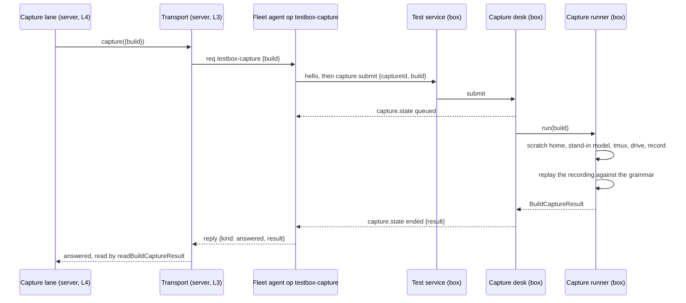
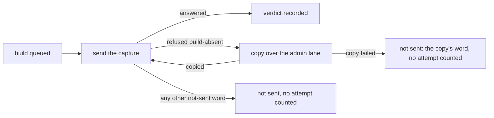

# Capture each new Claude Code build with no operator act

**Spec** · 2026-11-22 · Status: Draft · Owner: the overlord programme (issue #2491) · Linear: none · Related:
`docs/superpowers/plans/2026-11-11-new-build-capture.md` (D-8289), `docs/superpowers/plans/2026-11-11-live-probe-budget.md`
(D-8290), `docs/superpowers/specs/2026-10-28-test-box-design.md`, `docs/superpowers/specs/2026-11-07-test-box-connect-design.md`

## In short

ccrc trusts a Claude Code build only after the test box has captured it: recorded its hook payloads, its live status file
and its statusline JSON, and replayed them against the grammar ccrc reads (D-8289). The queue, the record and the verdict's
reader exist. The runner that does the capture does not, so every new build stays `capture-queued` and its children's
permission prompts stay untrusted. This spec designs that runner so that it needs **no credentials, no new egress and no
model spend**. The build runs against a **scripted stand-in model**: a small Messages API server on the capture's own
loopback that answers with fixed replies. Those replies make the build do everything a real turn does: a Bash tool call that
raises a permission prompt after a `cd`, a subagent, a compaction, a failed request and an exit. The build's bytes come from
the fleet's own copy of that version, copied read-only over the test box admin lane and checked by hash at both ends. They
are never downloaded. **No operator decision is needed.** Check §2.1's claim that the stand-in proves what trust needs, and
§2.6's list of what it cannot prove.

## 1. Context

This section says what exists today, and what is missing.

| Piece | Where | State |
|---|---|---|
| The record of captured builds and its decider | `shared/claudeBuildTrust.ts#buildTrustOf`, `claude_builds` in coord.db | Done (D-8289) |
| The queue: one job at a time, newest build first, retried hourly | `server/src/buildCaptureLane.ts#BuildCaptureLane` | Done (D-8289) |
| The verdict's one reader | `shared/claudeBuildTrust.ts#readBuildCaptureResult` | Done (D-8289) |
| The transport | `server/src/buildCaptureLane.ts#testboxCaptureTransport` | Stub: answers `no-test-box` or `no-runner` and never sends |
| A test box job kind that runs Claude Code | `agent/src/testbox/probeDesk.ts#ProbeDesk` | Desk only, no runner (D-8290) |
| A path in ccrc that fetches a Claude Code build | none | Measured absent by the coordinator on 2026-11-21 (mail 30048) |
| The capture runner and its replay suite | none | Open in the D-8289 plan |

Two operator rulings bind the design. SH-1 (2026-11-10): a build is trusted only after the test box records its output and
the replay passes. The ruling of 2026-11-10 on live tests: Claude Code tests run on the test box, never on the fleet. And the
ruling of 2026-11-22: a new Claude Code release needs no operator act.

## 2. Design

The capture is a test box job. The lane sends it, the fleet agent carries it to the box, the box runs the build against the
stand-in model in a scratch home, and the verdict comes back the same way.


*Figure 1. One capture job, from the lane's pass to the verdict. Every arrow after the first rides a connection that exists
today: the agent link and the test service's WebSocket.*

### 2.1 No credentials and no spend: the stand-in model

Every Claude Code build reads `ANTHROPIC_BASE_URL` and `ANTHROPIC_AUTH_TOKEN` (the documented gateway settings). The runner
points them at a Messages API server it starts on the capture's own loopback, with a fixed placeholder token. That server
answers each request from a short script, keyed on what the request carries, never on a model. No account is signed in, no
request leaves the box, and nothing is billed. *Judgement, from the documented settings; the first live capture on the box
measures it, and a build that ignores the setting fails its capture rather than passing.*

The script makes the build produce every event ccrc installs a hook for (`ccd/install-session-hooks.sh`'s `EVENTS_JSON`,
plus `PreToolUse`):

| Step | What the runner does | What the stand-in answers | Events and files recorded |
|---|---|---|---|
| 1 | Starts the build in its own tmux server | (no request) | SessionStart, statusline JSON, status file `idle` |
| 2 | Types the first prompt | a Bash tool call, `cd sub`, then a second, `touch ccrc-capture-mark` | UserPromptSubmit, PreToolUse, PermissionRequest, PostToolUse |
| 3 | (the recorder answers each permission prompt `allow`) | a short text reply after the last tool result | Stop, status file `busy` then `idle` |
| 4 | Types the second prompt | an Agent (Task) tool call, then the subagent's own text reply | SubagentStart, SubagentStop |
| 5 | Types `/compact` | a summary | PreCompact, PostCompact |
| 6 | Types a third prompt | an API error (HTTP 400, `invalid_request_error`: the build retries a 5xx, so only a 4xx ends the turn at once) | StopFailure |
| 7 | Types `/exit` | (no request) | SessionEnd |

*Table 1. The drive. The `cd` in step 2 is what proves the `cwd` fact: the write that follows it raises a permission prompt,
and that PermissionRequest's `cwd` must name `sub`, the shell's directory after the `cd` (the fact `ClaudeBuildRecord.cwd`
stores). The stand-in answers with a tool call only when the request offers that tool, so a side request (a title, a
summary) never gets one.*

The **recorder** is one small script set as the command of every hook and of the statusline. It appends what it was given to
the recording, with a copy of the live status file (`<config>/sessions/<pid>.json`) taken at that moment. As the
PermissionRequest hook it answers `allow`, so no human and no dialog is needed.

### 2.2 Where the build comes from: the fleet's own copy

A build waits for capture only because a fleet session runs it, so the fleet box already holds that exact build in its
versions directory. The runner never downloads it (slug `build-source-is-the-fleet`). The copy is a new `ccrc testbox-admin`
sub, composed by the server before the job, in the repair sub's three phases (`ccd/ccrc-testbox-admin`'s `_tba_run_repair`):

| Phase | On the fleet box | On the test box |
|---|---|---|
| verify | Reads the build file read-only: a regular file, not a link, under the size cap. Hashes it (SHA-256). | (nothing) |
| copy | Streams the bytes through the admin lane's one way to the box (`_tba_ssh`) into a stage | Hashes what arrived; a mismatch removes the stage |
| install | (nothing) | Moves the checked bytes to `<CCRC_TESTBOX_ROOT>/captures/builds/<version>`, read-only, owned by the service user |

*Table 2. The copy. The fleet side never writes the versions directory or the launcher, and the test box side installs only
under the test box's own root. No new egress and no new credential: the admin lane's paired key is the one Connect set up.*

**When the copy runs is decided in L1, never inside a transport.** The lane's decider in `shared/claudeBuildTrust.ts` reads
what the last try came to and names the next act; the lane (L4) only carries it out, and no L3 adapter sequences two ops.
The rule: send the capture first; copy only after the box refuses it `build-absent`, then send it again.


*Figure 2. Copy only after a `build-absent` refusal. A build the box already holds is never copied again, which is the
hash skip for free: the box answers `build-absent` only when it has no checked copy of that version.*

A failed copy sent no job, so it counts no attempt and needs a not-sent word of its own. The record's words today are
`no-test-box` and `no-runner`, behind a CHECK constraint on `claude_builds`, so PR 2 widens them by a table-rebuild
migration: words for a failed copy, and for what PR 1 folds into the two (the box's `build-absent` and `path-refused`, a
frame that never left the server and a fleet agent busy with another capture).

### 2.3 The scratch home and the guards

Each capture runs in its own directory, `<CCRC_TESTBOX_ROOT>/captures/<captureId>/`, as a child of the test service, on
its own tmux socket. Its environment is built from empty, the probe desk's rule (`agent/src/testbox/probes.ts#probeSpec`):

| Name | Value |
|---|---|
| `HOME` | `<capture>/home`, empty; the build runs from the builds store, `<CCRC_TESTBOX_ROOT>/captures/builds/<version>`, read-only |
| `CLAUDE_CONFIG_DIR` | `<capture>/config`, seeded with onboarding done, the capture folder trusted, every hook and the statusline set to the recorder |
| `ANTHROPIC_BASE_URL`, `ANTHROPIC_AUTH_TOKEN` | the stand-in on `127.0.0.1:<port>`, and a fixed placeholder |
| `DISABLE_AUTOUPDATER`, `CLAUDE_CODE_DISABLE_NONESSENTIAL_TRAFFIC` | `1`, so the build fetches nothing and reports nothing |
| `TMUX_TMPDIR` and the socket name | `<capture>/tmux` and `ccrc-capture`; never `default`, the fleet's own server |
| `PATH`, `LANG` | the box's system path and tools, `C.UTF-8` |

*Table 3. The capture's environment. No `TMUX`, `TMUX_PANE`, fleet `HOME` or account variable reaches it.*

The guards are the probe desk's, reused, not copied: the node's role must be the test box (`probeRole`), and every path the
capture writes passes `writeRefusal` against the fleet accounts' config directories. The test service's egress rules apply
to the capture as to the service: anything the build tries to reach outside the allowlist is dropped, so a build that
ignored the base URL fails its capture instead of reaching the model provider.

### 2.4 The replay: one grammar of the fields trust gates on

The replay is a pure L0 decider, `replayCapture(recording, build)`, in a new `shared/claudeBuildCapture.ts`. It checks the
recording against a table of the fields a build's trust gates on, and answers the `BuildCaptureResult` that
`readBuildCaptureResult` already reads. Trust gates children's permission prompts, so the table covers the permission-prompt
facts (`tool_name`, `tool_input`, `cwd`), the status file and statusline facts beside them, and every event name, tied to
`EVENTS_JSON`. It is not a census of every payload path ccrc's readers use: the session hook also reads `compact_summary`,
`tool_response.status`, `agentId`, `isAsync`, `tool_input.isolation` and the basename of `CLAUDE_CODE_EXECPATH`, and
`livestate.ts` acts on the status file's `status` values where the replay checks only that it is a string. None of those is a
trust input today; one that becomes one joins the table first. The table holds, per source:

| Source | ccrc's reader | Fields the table requires |
|---|---|---|
| hook payloads, every event | `ccd/session-hook.sh` | `session_id`, `transcript_path`, `cwd`, `hook_event_name` |
| PreToolUse, PostToolUse, PermissionRequest | `ccd/session-hook.sh` | `tool_name`, `tool_input` (PostToolUse also `tool_response`) |
| SessionStart, UserPromptSubmit | `ccd/session-hook.sh` | `source`, `prompt` |
| SubagentStart, SubagentStop | `ccd/session-hook.sh` | `agent_id`, `agent_type` |
| PreCompact, PostCompact | `ccd/session-hook.sh` | `trigger` |
| live status file | `server/src/livestate.ts` | `pid`, `sessionId`, `cwd`, `status`, `version` (and the optional fields as their types) |
| statusline JSON | `ccd/statusline-command.sh`, `server/src/pane/statusline.ts` | `session_id`, `model.id`, `workspace.current_dir`, `cost` |

*Table 4. The grammar of what trust gates on. A field ccrc reads as optional is checked only for its type when present.*

A capture **passes** when every event of Table 1 was recorded, each record fits the table, the status file's `version` names
the build, and the recording ends cleanly. It **proves `cwd`** when the PermissionRequest payload's `cwd` is the `sub`
directory. Anything else fails, with the replay output naming each missing or ill-formed field. A build that started but
did not raise a step's events within that step's deadline fails too, its output naming what was never recorded: a broken
contract must not wait in the queue for ever. So does a build that exits partway through the drive. A fault of the box is not
a fault of the build, and it never pushes the operator, so the cut at the SessionStart deadline is: a build that is not alive
and recorded nothing answers **no verdict** (the build stays queued and is tried again), while a live build with events
missing fails. A launcher that could not start the build (the stand-in or tmux failed) answers no verdict too, the lane's
existing rule. The automatic retry ceiling (three failed verdicts, then one item for the operator) covers what is left.
PR 2 builds this cut, before the runner is wired.

### 2.5 The job's path, end to end

The pieces in Figure 1, with their homes:

| Piece | Ring | Home |
|---|---|---|
| The frames `capture.submit` and `capture.state`, their readers, the refusal words | L0 | `shared/claudeBuildCapture.ts`, joined to the frame family in `shared/testbox.ts` |
| The drive's script, the seeded config, the environment | L1 | `agent/src/testbox/capture.ts` |
| The stand-in model | L3 | `agent/src/testbox/captureStub.ts` |
| The recorder | L3 | `agent/src/testbox/captureRecord.ts`, run compiled from `agent/dist/agent/src/testbox/captureRecord.js` |
| The runner: scratch home, launch, drive, read the recording, replay | L4 | `agent/src/testbox/captureRunner.ts` |
| The desk: one capture at a time, the role and the guards, the frames | L4 | `agent/src/testbox/captureDesk.ts`, dispatched from `service.ts` |
| The fleet agent op `testbox-capture`, the test box op family's sixth | L3 | `agent/src/testboxOp.ts`, `shared/agent-protocol.ts` |
| The transport adapter that sends the job | L3 | `server/src/testboxCapture.ts`, through `FleetIO.testboxCapture` |

*Table 5. Where each piece lives. PR 1 changes neither the lane, the record nor the decider; PR 2 widens the record's
not-sent words and adds the copy rule to the decider (§2.2).*

The transport maps the op's answers onto the port the lane already reads (`BuildCaptureAnswer`):

| The op answered | The port answers |
|---|---|
| `capture.state ended` with a result | `answered`, the result unread (the lane reads it) |
| no test box configured, or the box does not answer | `unavailable: no-test-box` |
| the box is not the test box (`not-test-box`) | `unavailable: no-test-box` |
| an agent without the op, or the box's desk has no runner (`no-runner`), or a box that predates the job kind (it closes on the frame) | `unavailable: no-runner` |
| the box refused `build-absent` or `path-refused` | PR 1: `unavailable: no-runner`, with a log line naming the real word; PR 2: its own word, and `build-absent` starts the copy (§2.2) |
| the frame never left the server (the agent link was down) | PR 1: `unavailable: no-test-box`, with a log line; PR 2: its own word |
| the fleet agent is busy with another capture | PR 1: `unavailable: no-runner`, with a log line; PR 2: its own word |
| the box refused `capture-id-used` (the id was already queued, running or ended) | `unavailable: unanswered` |
| the job was sent and no state came back before the deadline | `unavailable: unanswered` |

*Table 6. The transport's mapping. A sent job that brings back no verdict counts one attempt; a job never sent counts none,
the lane's existing rule. A box whose status says `down` is still sent the job: the box's own answer decides, where the stub
this replaces answered `no-test-box` and sent nothing.*

### 2.6 What the stand-in cannot prove

The stand-in proves the hook, status file and statusline contract, which is what trust gates. It cannot prove three things,
and none of them is a trust input today:

- **Rate-limit fields in the statusline JSON** (`rate_limits.five_hour`, `rate_limits.seven_day`) appear only for an
  account signed in to a subscription. ccrc reads them as optional, so the replay checks only their type when present.
- **The model's own streaming quirks.** The stand-in sends well-formed replies only.
- **The pane's text**, which ccrc's pane parsers read. Those readers stay on their own floor (the D-8289 plan's Open list).

One gap is ccrc's to close, in PR 3: nothing yet ties the PostToolUse that follows the write to the hook's `allow` decision,
the output side of the approval wait. The replay sees the prompt and the tool's run, not that the build obeyed the answer.

## 3. Decisions

Each decision is the worker's, under the operator's standing rulings; none is the operator's.

| # | Decision | Options considered | Chosen, and why | Status |
|---|---|---|---|---|
| D1 | How the build gets a model turn | A scratch subscription account; an API key with spend; a scripted stand-in model | The stand-in: no credential, no egress, no spend, and it reaches every event trust needs | Proposed |
| D2 | Where the build's bytes come from | A download from the distribution host; the fleet's own copy | The fleet's copy: the exact bytes the fleet runs, no new egress, and ccrc has no download path (coordinator, mail 30048) | Agreed |
| D3 | How the bytes reach the box | The service WebSocket in chunks; the git push channel; the admin lane | The admin lane, a new sub in the repair sub's phases, hashed at both ends: a bulk copy path that exists | Agreed |
| D4 | Where the capture runs | A new systemd unit; a run unit; a child of the test service | A child of the service, on its own tmux socket and scratch home: no new unit, so the box takes it with the tool sync alone; a unit of its own is later hardening | Proposed |
| D5 | Its own job kind, or a probe | A probe of a fixed name; a job kind of its own | Its own kind: a capture needs no account, no probe config directory and no budget, and it returns a result, not an exit status; the guards are the probe desk's, reused | Proposed |
| D6 | The replay's grammar | Recorded examples as the contract; a table of the fields trust gates on | The table, in L0, so the replay and any later event reader share one statement; it grows when a field becomes a trust input | Proposed |
| D7 | When the copy runs | Copy before every capture; copy only after a `build-absent` refusal | After the refusal, decided in `claudeBuildTrust.ts` (L1) and carried out by the lane: a held build is never copied again (coordinator, fix round 1) | Agreed |

## 4. Promise delta

```promise-delta
none - design of the test box capture runner behind an existing capture record; no Promise capability or scenario changes
```

## 5. Delivery and proof

The work lands in three pull requests, so each is small enough to review, and nothing is trusted before the last one.

| PR | What | After it lands |
|---|---|---|
| 1 (this wave) | The L0 contract and replay; the stand-in, the recorder and the runner, tested end to end with a fake build; the desk with its runner not yet wired; the fleet op and the transport sending a real job | The lane sends real jobs; the box answers `no-runner`, recorded as today |
| 2 | The admin lane's copy sub; the copy rule in the decider (§2.2); the not-sent words widened with their migration; the runner's verdict cut (§2.4: a build that exits mid-drive fails naming the missing events, a launcher failure and a dead build that recorded nothing answer no verdict); the runner's cleanup (`kill-server` on every path, the removal in its own try, `TMPDIR` under the capture, a sweep of stale captures at start) | The box holds the build's bytes; the desk still answers `no-runner` |
| 3 | The runner wired to the desk, after: `cwd` proved by the PermissionRequest of the write command, its constant moved to `shared/`; the deadline arithmetic (the op's fixed deadline against the steps, the exit wait and the queue); the tool-sync takeover counting captures as busy; sweeps of `captures/builds`; a tmux socket path that fits the socket limit under any root; the desk's refusal order pinned and the dropped detail logged; a test of the compiled recorder; and the replay tying the write's PostToolUse to the hook's `allow` (§2.6) | Builds are captured; a pass makes them trusted |

*Table 7. The delivery. PR 1 changes no verdict: the desk answers `no-runner` until PR 3. The spec's PR lands just before
PR 1 or with it.*

Proof, all on fixtures, with no Claude Code run anywhere:

- The replay: a passing recording, each event missing, each field missing or mistyped, the `cwd` fact present and absent, a
  recording for another build.
- The stand-in: real HTTP on loopback, each scripted reply, the error step, and a request it does not script.
- The runner: a fake build (a script that reads the seeded config, calls the stand-in, runs each hook command with fixture
  payloads and writes a status file) drives the whole runner to a pass, and broken variants to a fail or to no verdict.
- The desk, the op and the transport: each row of Table 6, red first, and each guard mutation-measured.

## Where things stand

### Agreed

- The build's bytes come from the fleet's copy, never a download (coordinator, mail 30048, 2026-11-21).
- The copy rides the admin lane and is checked by hash at both ends (coordinator, mail 30048).
- The copy runs only after a `build-absent` refusal, decided in the decider; the not-sent words widen in PR 2 (coordinator,
  fix round 1).
- A fault of the box never fails a build or pushes the operator: the SessionStart cut of §2.4 (coordinator, fix round 1).

### Waiting on you

- Nothing. The design needs no credential, no new egress and no model spend.

### Later

- The capture in a systemd unit of its own, with no network at all (after PR 3, as hardening).
- Captures of rate-limit fields, which need a signed-in subscription account (only if a trust input ever reads them).
- The live-status reader and the pane parsers moving onto `buildTrustOf` (the D-8289 plan's Open list).

---

*Written by Claude for the overlord programme. Diagrams are Mermaid text; the figures are unchecked on the rendered page.*
