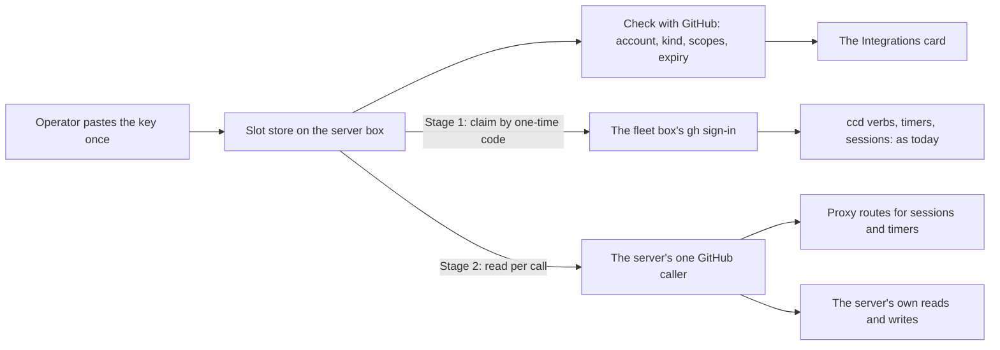

# A GitHub key stored in Settings, under Integrations

**Spec** · 2026-11-22 · Status: Draft · Owner: the settings work (the operator's direction of 2026-11-22) ·
Linear: none · Related: `docs/superpowers/specs/2026-11-22-settings-audit.md`,
`docs/superpowers/specs/2026-10-31-linear-central-key-design.md`,
`docs/superpowers/specs/2026-10-07-box-token-lifecycle-design.html`

## In short

ccrc holds no GitHub credential of its own. Every GitHub call that needs one runs the GitHub CLI (`gh`) on the fleet
box, as the fleet's one UNIX user, with whatever that user signed in by hand. The console cannot say which GitHub
account that is, what it may do or when it stops working. Every session on the box can run `gh` with the same
write token.

This spec puts the key in **Settings › Integrations**. The operator pastes it once, behind a step-up. It is stored
on the server box in a slot store shaped like Linear's and is never shown again. The card shows the account, the
kind of token, its scopes, its expiry and the last check. The work lands in two stages, and each buys a different
thing:

- **Stage 1, the key in the console.** ccrc signs the fleet box's `gh` in from the stored key. Set-up, rotation and
  the expiry warning move to the console. **Sessions can still read the token, exactly as today.** The step is
  one-way: the sign-in made by hand is replaced, and ccrc holds no copy of it (§2.8).
- **Stage 2, the GitHub proxy.** Sessions and timers reach GitHub's API through the server, as they reach Linear.
  The box's `gh` is signed out. Only then is the API token out of a session's reach, and only on a two-box fleet
  whose push credential cannot call the API (§2.7).

A stored key alone does not take write access away from sessions. The proxy does, and it is a programme of its own.
Two things change for the worse and are said plainly. From Stage 1 on, the server box, which holds no GitHub
credential today, holds a write key. And the standing rule that nothing but a missing credential stands between the
console and a merge is kept in letter only: its purpose passes to the server's own code (§2.12).
**Four decisions are the operator's** (§3.2); each carries a recommendation.

## 1. Context

### 1.1 What ccrc uses GitHub for today, and as whom

| Use | Run by | Kind |
|---|---|---|
| PR state, checks, queue position (`ccd pr-state`, `pr-train-prove`) | the server, through `ccd` | read |
| Landing checks: branch rules and protection (`ccd pr-landing`) | the server, through `ccd` | read |
| A repository's visibility and default branch (`ccd repo-visibility`) | the server, through `ccd` | read |
| Open a PR (`ccd pr-open`: `git push`, then `gh pr create`) | the server, through `ccd` | write |
| Open a template PR (`ccd pr-template`: a ref, a file, a PR) | the server, through `ccd` | write |
| Merge or enqueue a PR (`gh pr merge --match-head-commit`) | a coordinator session | write |
| Admin merge (`ccd pr-admin-merge`, the one door for it) | a coordinator session | write |
| Checks, runs and rules reads; re-run or dispatch a workflow | sessions | read, write |
| Push a branch (`git push`) | sessions, and `ccd pr-open` | write |
| The land probe's reads (`ccd/ccd-land-probe`) | a timer on the fleet box | read |
| Test box parity and test times (`gh pr list`, run artifacts) | fleet box tools | read |
| The `gh_auth` check of `ccrc doctor` | the operator's shell | read |
| Release lookups | the server, and `ccrc update` | read, no credential |

*Table 1. Every use of GitHub in the tree. All but the last row spend the fleet box's `gh` sign-in.*

Measured in the code on `main` (2026-11-22):

- **One identity, and ccrc does not choose it.** `gh` uses the fleet user's stored sign-in, or a `GH_TOKEN` if one is
  in the environment. `ccd` sets neither and reads neither. Shipped code names the variable only in comments and in
  one doctor message.
- **The token is write-scoped.** `agent/src/whitelist.ts#EXEC_WHITELIST` records its scopes as `gist`, `read:org`,
  `repo` and `workflow`. The README asks for `repo`, and `ccd/ccrc-doctor-checks#_check_gh_auth` fails without it.
- **The console reaches GitHub only through typed `ccd` verbs.** `gh` has no exec-whitelist entry, on purpose: one
  entry would be the only control between the console and `gh pr merge`.
- **The admin-merge door is bound to the identity.** `ccd/ccd#cmd_pr_admin_merge` lands only a PR whose author is
  the account `gh api user` answers, the one `ccd pr-open` opens as.
- **The session hook guards the word `gh`, not the credential.** Its merge deny lists what passes, and one entry is
  another HTTP client given `gh auth token`. No deny list names gh's own store.
- **The server holds nothing for GitHub.** `server/src/update/catalogue.ts` says so, and its release lookups send
  no token.
- **Only github.com.** `ccd/ccd#_gh_repo_slug` accepts no other host.

### 1.2 What the console knows today

No route reports the sign-in. Doctor's answer stays in the shell. Three existing reads hint at it: a project's
visibility reading (`measured`, or `failed` with the reason `unauthenticated`), a session's PR reading with the same
reason, and the test box's `gh-signed-out`. None of them names the account, a scope or an expiry.

### 1.3 The problem

1. **A hand sign-in per box.** A new fleet box works only after someone runs `gh auth login` in its shell. The
   settings audit's rule is that after set-up a user does nothing, and a machine fact is measured.
2. **The console is blind.** It cannot say which account is used, what it may do, or that it expires next week.
   A missing or expired sign-in shows up as scattered failures (§2.9), each worded on its own.
3. **One write token, reachable by every session.** Any session can run `gh auth token`. The hook, the skills and
   the door are rules a session follows. They are not a wall.

## 2. Design

### 2.1 Two stages


*Figure 1. One stored key, two ways it is used. Stage 1 keeps every caller as it is. Stage 2 moves the callers and
then removes the Stage 1 arrow.*

### 2.2 Where the key is stored: the server box

The key lives under `~/.ccrc/github/` on the server box, in a store built like `server/src/linear/store.ts`
(slug: D-8933, because it ends "the server holds none for GitHub"):

- `github.com.key`: the key, one line, mode 0600, written whole or not at all.
- `github.com.json`: the display record. It holds the account, the kind, the scopes, the expiry, the times of the
  save and the last check, the check's outcome, the key's last four characters and its digest. Never the key.
- No key is held in memory. The file is read at each call and dropped, as `readLinearSlotKey` does.
- Every write takes one lock. A check is recorded only while the key still has the digest that was checked.
- No backup copies the directory, as none copies Linear's. The directory joins `shared/api.ts#ACCOUNT_SECRET_PATHS`.

Why the server box and not the fleet box. The console's doors, the step-up and the account gate are on the server.
The fleet box is where sessions run as the one user, so a file there is readable by all of them. On a two-box
fleet the server box is the only place a session cannot read. On a single box it is the same user either way,
and the deny path is a guard against accidents only, which the Linear spec already says of its own store.

One slot, for one account. The box's `gh` has one active github.com account today, and the admin-merge door
assumes one fleet identity. A slot per repository owner is a later widening.

### 2.3 How the key is entered

| Route | Gate | What it does |
|---|---|---|
| `GET /api/github/connection` | session | The card's read. Never more of the key than its last four |
| `PUT /api/github/connection` | account gate, `cap: null`, step-up | Checks the key with GitHub, then stores it |
| `POST /api/github/connection/check` | account gate, `cap: null` | Checks the stored key; writes the record only |
| `DELETE /api/github/connection` | account gate, `cap: null`, step-up | Removes the slot |

*Table 2. The doors. They mirror the Linear workspace doors in `server/src/linear/routes.ts`, gate for gate.*

- The body of the `PUT` is the key, so the route takes `server/src/accounts/gate.ts#credentialBodyRoute`: a small
  body cap, `no-store` on every answer, and fixed words for a parse error, so no answer quotes the body.
- The key's shape is checked first: `ghp_` (classic), `github_pat_` (fine-grained) or `gho_` (OAuth). A `ghs_`,
  `ghr_` or `ghu_` token is refused in plain words: each is an app's token that lasts hours, or its refresh token,
  not a credential to store. *That a `ghu_` token expires within hours is from memory of GitHub's documentation.*
- **A key is stored only after GitHub answered for it.** The server asks `GET /user` with the key. Anything but a
  200 stores nothing and says why: refused, forbidden, or GitHub did not answer. The door's identity rule needs the
  account to be known before the key is used.
- **A stored key is used only after it passed the reads ccrc depends on** (§2.4, the probe reads). A key that is
  narrower than the sign-in it would replace stays stored and is never synced.
- Replacing a key takes the same door with `replace`. A key for a different account takes a second confirm that
  names both accounts and the consequence (§2.11).
- The routes register from their own file and consult no box token. `box-token-census.test.ts` reads that file as
  a lane source of its own, against a hand-kept list, in both directions, as it does for the other door families.
- There is no "Check again" button. The check runs when the page opens, once a day, and when a GitHub call fails
  as `unauthenticated`. The audit rules the same for Linear.

### 2.4 What the check measures

| Fact | How it is measured | On the card |
|---|---|---|
| Account | `login` in the answer of `GET /user` | "Signed in as `<login>`" |
| Kind | the key's prefix, read once at the save | Classic, fine-grained or OAuth token |
| Scopes | the `X-OAuth-Scopes` header (classic and OAuth tokens) | the list, and any scope a use needs and lacks |
| Fine-grained permissions | GitHub reports none | "GitHub does not report these", then the measured uses |
| Expiry | the `github-authentication-token-expiration` header | "Expires on `<date>`" or "No expiry reported" |
| Budget | the rate-limit headers of the same answer | "N of M calls left this hour" |
| Last check | the check's own time and outcome | "Checked N ago" |

*Table 3. One call measures all of it. Nothing here is typed by the operator. The two header names are GitHub's,
written from memory of its documentation; §5 lists them as owed a measurement. GitHub sends the expiry header only
for a token that expires, so its absence reads "No expiry reported", never a claim that the token lasts for ever.*

For a fine-grained token GitHub answers no list of what it may do. The card does not guess. It shows what ccrc has
seen work, from reads the console already has: "Reads repositories: worked N ago, for X of Y projects" from the
visibility readings, and "Reads pull requests: worked N ago" from the PR sweep. A write is "not measured" until
the first real one, because a test write is a write.

**The probe reads.** Whatever the kind, the check ends with the reads ccrc itself depends on, made by the server
with the key, before the key is ever used on the fleet box:

- the repository read of each project whose visibility is measured (the call `ccd repo-visibility` makes);
- one pull request read **with its check runs**, for a project that has a pull request (the call `ccd pr-state`
  makes), since that is the read a fine-grained token may not be able to make (§2.10).

A key that fails a probe is `too-narrow`, with the read that failed named on the card. It stays stored, since it is
the operator's to keep or replace, and it is never synced (§2.6). A fleet with no measured project or no pull
request has nothing to probe: the card says "not probed", and the sync waits for the first reading.

### 2.5 How the key reaches the code that calls GitHub

This is the hard part. Every caller in Table 1 but the last runs on the fleet box as the one user. Three ways
to get the key to them:

| Option | Where the token then is | Can a session read it |
|---|---|---|
| A. ccrc signs the box's `gh` in from the key | the fleet box, in gh's own store, as today | Yes, as today |
| B. The server sends it with each call | the agent link, and a child's environment | Yes: the same user reads `/proc` |
| C. The server calls GitHub itself | the server box only | No on two boxes; yes on one |

*Table 4. The three options. B is rejected: the box token never rides the agent link, which may be plain `ws://`
by the operator's choice, and a secret in a process environment is readable by the same user while the call runs.
A's hand-over still depends on that link for its one-time code, which §2.6 answers.*

**What a stored key improves on its own (option A, Stage 1):**

- Set-up is one paste in the console. No shell on the fleet box, and no `gh auth login` there.
- The console names the account, the scopes and the expiry, and says what stops working when the key is bad.
- Rotation is a paste. The warning comes 14 days before the expiry.

**What it does not improve:**

- Sessions run `gh` and `git push` themselves, as the same user. A token `gh` can use is a token they can read.
- So the write access of sessions, and the merge-past-the-hook route, are exactly as today.

**Is a proxy like Linear's the right end state? Yes, for the API.** Option C is the only one that takes the API
token off the fleet box. It also turns rules into checks: a merge becomes a named act the server re-measures, where
today it is a clause a session is asked to follow. It is not a small change. It moves every row of Table 1, and it
rewrites pinned skill clauses. So it is Stage 2, with a spec of its own. Stage 1 is useful without it.

### 2.6 Stage 1: ccrc signs the box in

The key moves to the fleet box the way the box token does, never on the agent link
(slug: D-8934):

1. On a save, a replace, or a fleet connect whose generation differs, the server sends the agent a `github-sync` op
   that carries a single-use code. The op has `token-sync`'s shape (`shared/agent-protocol.ts#TOKEN_SYNC_OP`,
   `agent/src/tokensync.ts`): the agent spawns one fixed verb, with the code and a newline on its standard input and
   an explicit environment. **The agent never holds the key.**
2. The verb, `ccd gh-signin`, claims the value once, over the server's own door, `POST /api/github/claim`. The door
   is exempt from the session gate and authenticates by that code alone, like `POST /api/token/claim`.
3. The verb first tries the key where it can do no harm: a scratch `gh` configuration directory (`GH_CONFIG_DIR`),
   where it signs in, asks `gh api user`, and repeats one probe read through `gh` itself. Only when those pass does
   it sign the box's own `gh` in: `gh auth login --hostname github.com --with-token`, the value on gh's standard
   input, with `GH_TOKEN` and `GITHUB_TOKEN` cleared for the child. The value is never an argument and never a file
   of ccrc's, and the scratch directory is removed either way. *That gh honours a scratch directory this way is from
   its documentation, not measured (§5).*
4. The verb asks `gh api user` again and answers the account it measured. The server compares it with the stored one.
5. The verb writes the key's generation id, a random id minted at the save, to `~/.ccrc/github-key-generation`. That
   file is a new entry of `NODE_FILES` (`shared/agent-protocol.ts`), beside `box-token-generation`, so the server
   reads it through the inventory's `readNodeFile` by path equality. It holds an id, never a key.

**The code is only as private as the link that carries it.** The box-token design names this attacker: a passive
reader of a plain `ws://` agent link sees each code and can race the fleet box to the claim. For the box token the
answer is to discard the value, because ccrc minted it and can mint another. That answer does not exist here: a
GitHub key that someone else claimed is a write key in their hands, and ccrc cannot retire it. So:

- **The sync is refused over an agent link that is not encrypted.** The server sends `github-sync` only when the
  URL it dials for the agent is `wss://`, or the install is a single box, where no link is crossed. It also refuses
  when the claim would cross plain HTTP. This departs from ruling R2 of the pattern it copies ("a plain-http
  install rotates"): R2 rests on the discard, and this key has none.
- **`code-used` is an incident, not a retry.** If the fleet box reports that its code was already used, someone
  else holds the key. The server marks the slot `disclosed`, uses it for nothing, raises one Waiting on you item and
  pushes once: "Another party claimed the GitHub key before the fleet box did. Delete that token on GitHub now, then
  paste a new one." Only a new key clears it.

Refusals, each a word the card shows. Before the box's own sign-in is touched: the agent link or the claim is not
encrypted; the key is `too-narrow` or not yet probed; `gh` is missing or too old; the scratch sign-in or its reads
failed; the scratch sign-in answered another account than the stored one; the agent predates the op. In each of
these the box keeps the sign-in it had, and the card says "Stored. The fleet box still uses its own sign-in", with
the reason. After it: the account `gh` answers is not the stored one, which the scratch step makes unlikely and
cannot rule out. The box then holds the new key, and the card says so and names both accounts.

Two things this is not. It is not a `gh` exec-whitelist entry: the op takes no arguments from the caller, and a
test pins its one command line. And `ccd gh-signin` is no session's verb: it joins the forbidden verbs, the hook's
deny and the child deny file, as an accident guard.

Stage 1 also adds the guard that is missing today (slug: D-8935): gh's store directory joins the
deny paths, and the hook refuses `gh auth token` and the token-printing form of `gh auth status`. A script file or
another interpreter runs past it, as with every rule of that list.

### 2.7 Stage 2: the proxy

Stage 2 is designed in its own spec. This one fixes its rules, so that Stage 1 builds nothing Stage 2 throws away.

- **One caller.** A single L3 adapter on the server calls GitHub over HTTPS. It reads the key from the slot at each
  call. A `single-definition` scan holds that nothing else reads the slot's key file.
- **Sessions use `ccrc-api github …`.** The verbs call box-token routes under `/api/github/proxy/`, built like
  `server/src/linear/proxyRoutes.ts`: the token first, then attribution, validation, the policy point and a journal.
- **Every write is a named act.** Merge at a named head, admin merge with the door's checks run on the server,
  re-run, dispatch, cancel, open a PR. There is no pass-through for writes, and no act writes rules, protection or
  repository settings.
- **The server's own reads and the timers move to the adapter**, verb by verb (slug:
  D-8936: while both exist they are two mechanisms for one job, and the recorded reason is a
  security boundary on another host).
- **Then the box's `gh` is signed out**, by ccrc, of the sign-in ccrc made. Doctor's check turns round: a write
  token in gh's store on a fleet box becomes the finding (slug: D-8940).
- **Git still needs a credential on the box, and it must be one that cannot call the API.** A push is git's
  transport, not the API. The candidate is a deploy key per repository: an SSH key, which can push and cannot call
  the API. A one-hour token minted per push by a GitHub App is **ruled out for a box sessions share**: Table 9 gives
  push and merge the same permission, so that token can call the merge API for its hour, and a session runs as the
  same user. It could serve only if the push itself moved off the fleet box. How pushes sign in today is not
  measured (§5), and the choice waits for that.

What Stage 2 does not give. The box token is one shared secret per box, so any session can call the proxy and name
another session. The proxy limits what can be done. It does not prove who asks. A push credential can still push to
a branch no rule protects, and, *reasoned and not measured*, a push that adds or changes a workflow file starts a
workflow whose own token can write through the API. The branch rules and the repository's workflow permissions are
the wall there, on every stage.

### 2.8 What it replaces, and the migration

| Step | The fleet box's `gh` | The stored key | Who acts |
|---|---|---|---|
| 0. Today | signed in by hand | none | nobody |
| 1. Shown | signed in by hand; the card shows it | none | nobody |
| 2. Stored | signed in by hand | stored and checked, not in use | the operator, one paste |
| 3. In use | signed in by ccrc, from the key | the source of the box's sign-in | ccrc, at the save |
| 4. Moving | still signed in; callers move to the proxy | read by the server per call | ccrc, by release |
| 5. Withdrawn | signed out | the only API credential | ccrc, when the last caller moved |

*Table 5. The migration. Steps 1 to 3 are Stage 1. Step 3 is one-way: it replaces the sign-in made by hand.*

- **Absence permits.** While no key has ever been synced, the box's own sign-in is used and shown, as today.
- **The first sync replaces a hand-made sign-in, and there is no way back to it.** ccrc holds no copy of the token
  it replaces, and takes none: a copy would be a second secret with no owner. What guards the step is that it is
  taken last: the key has passed the probe reads on the server (§2.4) and a scratch sign-in on the box (§2.6)
  before the box's own sign-in is touched. If it is for the same account, only the token changes. If it is for
  another account, the save's confirm names both, and ccrc signs the old one out so that one account is active.
- **After a Remove the box is signed out** (§2.11): the sign-in ccrc made goes with the slot, and the one it
  replaced no longer exists. The box works again after a new key is pasted, or after `gh auth login` by hand.
- **Step 2 is a real state after Stage 1 too:** an agent that predates the op, an agent link or a claim that is
  not encrypted, a key that is too narrow, a box without `gh`. The card says which.
- **The identity must not change by accident.** The admin-merge door lands only PRs the fleet identity opened.
  A key for another account strands the open PRs of the old one. The confirm says so.

### 2.9 What the console shows

The card is in Settings › Integrations, under Linear and Project linking. Its words live in an L1 words module,
and the component decides nothing.

| State | The card says |
|---|---|
| No key; the box signed in by hand | The box's account, scopes and expiry, and "Every session on the box can use it" |
| No key; the box signed out | "GitHub is not signed in", and the list of what stops working |
| Key stored and in use | Account, kind, key ending, scopes, expiry, last check, and "The fleet box uses this key" |
| Key stored, not in use | The same, and why the box still uses its own sign-in |
| Key stored, too narrow or not probed | The read that failed, or that nothing could be probed yet |
| Key claimed by another party | "Delete that token on GitHub now, then paste a new one." Nothing uses it |
| The box's account differs from the key's | Both accounts, and which one opens PRs |
| Key refused, expired or forbidden | Which, since when, and the list of what stops working |
| GitHub did not answer | "GitHub did not answer at the last check, N ago". Nothing is called broken |
| The box's sign-in could not be read | "Could not be read", with the reason. Never "signed out" |

*Table 6. The card's states. Absent, unreadable and refused stay three different answers at every seam.*

The box half of the card comes from a new read-only verb, `ccd gh-identity`: one `gh api -i user` and one
`gh auth status --hostname github.com`, never with the flag that prints the token. It answers the account, the
kind by the redacted prefix, the scopes, the expiry, and where `gh` said the token comes from (its store, or the
environment). It is a whitelisted `ccd` read with its own caps word, like `repo-visibility`.

What stops working when GitHub is not signed in, one list in L0 that the card and the warning both read:

| Use | What the operator sees today |
|---|---|
| PR state on a session | "GitHub CLI isn't logged in on the sessions box" on the PR button |
| A project's visibility | "Couldn't read" on its Project linking row |
| Open a PR, open a template PR | The act is refused with the reason |
| Landing checks | Unmeasured; the landing waits |
| A coordinator's merge | `gh` fails inside the session; nothing in the console |
| Test box parity | `gh-signed-out` |
| Release lookups and updates | Not affected: they use no credential |

*Table 7. The failures the card names in one place.*

### 2.10 Token kinds, and the least each use needs

| Kind | Reach | Expiry | Reports its scopes |
|---|---|---|---|
| OAuth token from `gh auth login` (today) | every repository the account reaches | none | yes |
| Classic token | the same | optional | yes |
| Fine-grained token | one owner, chosen repositories | optional; an owner may cap it | no |
| GitHub App installation token | the installation's repositories | one hour, minted on demand | not applicable |

*Table 8. The kinds. The fine-grained and App rows are from GitHub's documentation, read on 2026-11-22; the first
two rows are a judgement.*

| Use | Classic scope | Fine-grained permission |
|---|---|---|
| Visibility; the rules of a branch | `repo` | Metadata: read |
| PR list and view | `repo` | Pull requests: read |
| Check runs inside the PR read | `repo` | Not available: no Checks API for this kind |
| A branch (landing) | `repo` | Contents: read |
| Branch protection (landing, admin merge) | `repo` | Administration: read |
| Open a PR | `repo` | Pull requests: write |
| Create a ref and a file (template PR); push | `repo` | Contents: write |
| A push that changes a workflow file | `workflow` | Workflows: write |
| Merge a PR | `repo` | Contents: write |
| Runs and artifacts | `repo` | Actions: read |
| Re-run or dispatch a workflow | `repo` | Actions: write |

*Table 9. The least each use needs. The fine-grained column is GitHub's permissions page; the classic column is a
judgement from its scope list.*

Three things follow.

- **A fine-grained token may not be able to be the Stage 1 key.** GitHub's page lists the Checks API among what
  this kind cannot call, and the PR read asks for check runs. It also reaches one owner only. The design does not
  wait on that answer: the door accepts the kind, the probe reads (§2.4) measure each key, and a key that cannot
  read check runs is `too-narrow` and never replaces a sign-in that can. The card recommends a kind only from what
  the hand measurement of §5 finds.
- **No permission separates "may push" from "may merge".** Both are Contents: write. Branch rules do that job.
- **Stage 1 needs what `gh` itself asks for.** A classic key needs `repo` and `workflow`, and `read:org` because
  `gh` refuses a classic token without it. *Judgement, from gh's own help; PR 3 measures it on a fixture and the
  card names a missing scope before the sync is tried.*

### 2.11 Rotation and expiry

- **Expiry is measured, never typed.** Each check stores the date GitHub answers, or that it answered none.
- **One warning, 14 days ahead.** The server raises one Waiting on you item ("The GitHub key expires on `<date>`.
  Paste a new one in Settings › Integrations.") and pushes once. The item closes itself when a later check sees a
  later date or no expiry. It is raised the way the Linear lane raises its own items, with a verb of its own.
- **At expiry** the same item says the key has expired, and the card and the item carry Table 7's list.
- **Rotation is a paste.** The new key is checked, written over the old one under the lock, and synced to the box.
  ccrc then holds no copy of the old value.
- **ccrc never revokes a token on GitHub.** The card says, after a replace or a remove: "Delete the old token on
  GitHub. ccrc cannot."
- **Remove** takes a step-up and a confirm with its consequence. In Stage 1 it also signs the box out of the
  sign-in ccrc made, so no copy ccrc placed outlives the slot. The confirm says what that leaves: "The fleet box
  will have no GitHub sign-in. Pull request state, opening and merging stop until you paste a new key or sign in on
  the box." A sign-in ccrc did not make (a key stored and never synced) is left alone.
- **The box's own OAuth sign-in** reports no expiry. The card says so, and the warning never fires for it.

### 2.12 Threat model delta

| Threat | Today | Stage 1 | Stage 2, two boxes |
|---|---|---|---|
| A session reads the API token at rest | Yes | Yes; guarded against accident | No, with a deploy key for pushes |
| A session merges past the hook with another HTTP client | Yes | Yes | No token to give it, with a deploy key |
| A session uses the push credential on the API | Yes: one token does both | Yes | Deploy key: no. App token: yes |
| A session pushes a workflow file whose own token writes | If the rules allow | The same | The same; not measured |
| A session rewrites branch rules or protection | If the account may | The same | No act for it |
| A session pushes to an unprotected branch | Yes | Yes | Yes; the rules are the wall |
| A session names another session to the proxy | Not applicable | Not applicable | Yes: attribution only |
| The console reaches a merge | No credential on the server | **No code merges; the key is there** | A named act |
| The server box is taken | No GitHub credential there | **The write key is there** | The same |
| A reader of a plain agent link takes the key at the claim | Not applicable | No sync on a plain link | Never |
| The key between the boxes | Not applicable | Once per sync, by claim, over TLS | Never |
| The key in logs, mail or tickets | Masked by prefix | The same | The same |
| The token expires or is revoked | Scattered failures | Warned, and named on the card | The same |
| A single-box install | One user everywhere | The same | Accident guard only |

*Table 10. What changes. The bold cells are the two new exposures, and both hold from Stage 1 (PR 2) on. The Stage 2
column holds only with a push credential that cannot call the API (§2.7).*

The first new exposure, plainly: the server box gains a GitHub write token. Today a taken server box can drive the
fleet through whitelisted frames and cannot call GitHub. The mitigations are the Linear store's: a 0600 file, never
in memory between calls, never in an answer, a log or a backup, and writes behind a step-up.

The second (slug: D-8941). The standing rule is "`gh` has NO exec-whitelist entry,
deliberately", and its stated reason (`agent/src/whitelist.ts#EXEC_WHITELIST`) is that there is no second layer: one
entry would be the sole control between the console and `gh pr merge`. This design adds no entry, so the rule is
kept in letter. Its purpose is not kept. From PR 2 the server process holds a write key and an HTTPS client, so what
stands between the console and a merge is that no server code calls the merge endpoint: a property of code and of
review, not the absence of a credential. In Stage 2 the server gains a merge act on purpose, and its one adapter
and its table of named acts take over the whitelist's job. What holds the line meanwhile: one L3 adapter is the only
reader of the key file (a `single-definition` scan), its Stage 1 surface is `GET` only (a test fails on any other
method), and every act added in Stage 2 is a row with its own gate and its own test.

The claim race. A passive reader of a plain `ws://` agent link sees the one-time code and can reach the claim door
first. ccrc cannot revoke a GitHub key, so the box token's answer (discard the value) does not apply. The sync is
refused on a link that is not encrypted, and a `code-used` answer is treated as a disclosed key (§2.6). An active
party on an encrypted link is outside this model, as it is for the box token.

The masker already covers these tokens: `shared/redact.mjs#KNOWN_TOKEN_PREFIX` names `gh[pousr]_` and `github_pat_`.

### 2.13 Homes

| Piece | Ring | Home |
|---|---|---|
| Key shape, kinds, the record's one parser, the view, Table 7's list | L0 | `shared/github.ts` |
| The check's verdict: an answer and its headers in, the view out | L1 | `server/src/github/view.ts` |
| The slot store | L3 | `server/src/github/store.ts` |
| The one HTTPS caller | L3 | `server/src/github/client.ts` |
| The doors and the claim door | L4 | `server/src/github/routes.ts` |
| The daily check and the expiry item | L4 | a row in `server/src/laneSchedule.ts`, and its lane |
| The box's sign-in read and the sign-in act | `ccd` | `ccd gh-identity`, `ccd gh-signin` |
| The sync op | L3, and the agent | `github-sync`, beside `token-sync` |
| The card and its words | L4 and L1 | `GitHubCard.tsx`, `pwa/src/fleet/githubWords.ts` |

*Table 11. Where each piece lives. The store sits in the context the Linear store has. One writer per fact: the
store writes the slot, `ccd gh-signin` writes the generation file (`~/.ccrc/github-key-generation`, a `NODE_FILES`
entry), and nothing else writes either.*

## 3. Decisions

### 3.1 The worker's, under standing rulings

| # | Decision | Options considered | Chosen, and why |
|---|---|---|---|
| D1 | Where the key is stored | The fleet box; the server box | The server box: the doors are there, sessions are not |
| D2 | How many keys | One; one per owner | One: gh has one active account and the door one identity |
| D3 | When a key is stored | On paste; after GitHub answers | After a 200: the account must be known before use |
| D4 | The key with each call | Send it; never | Never: no secret rides the agent link or an environment |
| D5 | How the box gets it | Agent link; a claim by code | The claim, only over an encrypted link. Departs from R2 |
| D10 | A key narrower than the sign-in | Sync it and say so; refuse the sync | Refuse: it is probed first (§2.4) |
| D11 | The replaced sign-in | Keep a copy; keep none | None: a copy is a secret with no owner. One-way, said |
| D12 | The push credential at Stage 2 | Deploy key; an App token per push | Deploy key: it cannot call the API |
| D6 | A "Check again" button | A button; automatic | Automatic: on open, daily, on a failed call |
| D7 | Reading the box's sign-in | Infer it; relay doctor; a read verb | `ccd gh-identity`: measured and read-only |
| D8 | gh's own store | Leave open; guard it | Guard it as the account paths are: an accident guard |
| D9 | Revoking the old token | ccrc revokes; the operator does | The operator: ccrc has no way to, and says so |

*Table 12. The worker's decisions. Every one is Proposed. D5's departure: the box-token pattern rotates over a plain
link (R2) because a value someone else claimed is discarded; a GitHub key cannot be.*

### 3.2 The operator's

| # | Decision | Options | Recommendation |
|---|---|---|---|
| O1 | Is the proxy the end state, with a merge act on the server? | Yes; stop at Stage 1 | Yes |
| O2 | Stage 1 first: security unchanged, and one-way? | Yes; wait for the proxy | Yes |
| O4 | Whose account? | Today's; a bot account; an App | Today's account for Stage 1; an App at Stage 2 |
| O5 | May a key have no expiry? | Refuse it; accept and say so | Accept and say so |

*Table 13. The operator's decisions. The reasons follow. O3 (which kind of token) was withdrawn: nothing in the
build changes with its answer, so it is a measurement owed in §5, not a ruling.*

- **O1** buys Table 10's last column: only the proxy takes the API token from sessions. It costs three things.
  Every row of Table 1 moves. The coordinator's pinned landing clause is rewritten. And the standing rule "`gh` has
  no exec-whitelist entry" changes meaning: the server, which today cannot reach GitHub at all, gets a merge act of
  its own, and the control becomes that act's gate and tests (§2.12). Saying yes to O1 is saying yes to that.
  Without O1 the third problem of §1.3 stays as it is, and this spec says so.
- **O2** puts a copy of the key on the fleet box by ccrc's own act. That is where a write token already is, so
  nothing gets worse for sessions, and nothing gets safer. Two costs come with it. The server box holds a write key
  from then on. And the step is one-way: the sign-in made by hand is replaced and cannot be put back, and a Remove
  leaves the box signed out until a new key is pasted or someone signs in by hand (§2.8). The alternative leaves
  the card read-only until the proxy lands.
- **O4** matters because the door lands only PRs its own identity opened. A bot or an App changes who opens PRs,
  how reviews and required checks see them, and what the admin-merge door compares. That change belongs with the
  proxy, where the server makes the merge. An App also ends rotation: its tokens last an hour and are minted.
- **O5** is about the rule "after set-up a user does nothing". An expiring key is one paste each time it runs out,
  with a warning first. A key with no expiry is no act, and a leaked one lives until someone deletes it.

## 4. Promise delta

```promise-delta
none - a design spec for review that ships no behaviour, and the build plan carries any Promise change
```

## 5. Delivery and proof

| PR | What | After it lands |
|---|---|---|
| 0 (in flight) | The Integrations section; a read-only GitHub card in words | The card says what is used |
| 1 | `ccd gh-identity`, its caps word and whitelist row; the card's box half | The card shows the box's sign-in |
| 2 | The slot store, the four doors, the check and its probe reads, the card's key half | A key is stored, not used |
| 3 | The `github-sync` op, the claim door, `ccd gh-signin`, the generation file | The box's `gh` follows the key |
| 4 | The daily check, the expiry item and its push, Table 7's list on the card | A warning 14 days before expiry |
| 5 | The guard on gh's store: the deny path, the hook's arm, the classifier's rows | `gh auth token` is refused |
| 6 on | The proxy, in its own spec, if O1 is yes | Stage 2 |

*Table 14. The delivery. PRs 2 and 3 ship in one release, so a stored key is in use the day it is pasted. If O2 is
no, PRs 2 to 4 wait and land with the proxy.*

Proof, all on fixtures. No test holds a real token, and none runs the real `gh`: the suites keep the poisoned `gh`
of `ghContainedEnv`, and a stub `gh` of their own where a verb must be seen to call it.

- **The check:** a fake GitHub on loopback. Each outcome (200, 401, 403, no answer), each kind, a scope missing, an
  expiry present and absent. The verdict is pure and is tested without a socket.
- **The store:** key first, record second; a crash between them; a check recorded only for the digest it checked;
  absent, unreadable and placeholder kept apart; mode 0600 from birth.
- **The doors:** each gate removed in turn turns a test red; no answer and no log line carries the key, measured by
  scanning both for the fixture's value; the census lists hold in both directions.
- **The check's probes:** a key that reads `/user` and fails the pull request read with check runs is `too-narrow`
  and is never synced; a fleet with nothing to probe says "not probed" and does not sync.
- **The sync:** the code is single use; two claims in one tick give one 200; a plain `ws://` agent link and a plain
  HTTP claim are each refused, and nothing is sent; the agent's spawn carries the code and never the key; the value
  is on no argument list, measured from the stub's record; a scratch sign-in that fails leaves the box's own store
  untouched, measured by its bytes; `code-used` marks the slot `disclosed`, raises one item and stops every use.
- **The server's reach:** the adapter is the key file's only reader, and a test fails on any method but `GET`
  until a Stage 2 act adds its own row.
- **The expiry lane:** one item, not one per day; it closes on a later date; no item when no expiry is reported.
- **The guard:** each refused form, and each form listed as passing, as the merge deny's tests do.
- **The card:** every row of Table 6 in both skins and at each width; words from the words module only.

Not measured for this spec, and owed before the PR that needs it:

- How `git push` signs in on a fleet box: an SSH key, or gh's credential helper. Nothing in the tree sets either.
  PR 3 needs it, because a sync must not break pushes. Stage 2 needs it to choose the push credential.
- Whether a live box's unit environment carries `GH_TOKEN`. If it does, it wins over gh's store, and
  `ccd gh-identity` reports it as the source.
- How `gh auth login --with-token` treats a second account on the box's gh version, and which scopes it demands of
  a classic token.
- The two header names of Table 3, and whether a fine-grained token can read check runs through the PR read. Both
  are measured once, by hand, with a real token, before PR 2 merges. No test holds a real token. This was decision
  O3: the answer decides which kind the card recommends, and nothing in the build.
- Whether `gh` signs in and reads through a scratch `GH_CONFIG_DIR` without touching its own store (§2.6, step 3).
  PR 3 measures it on a fixture; if it does not, the scratch step becomes the server's probe alone.
- Whether a deploy key with write access can push a workflow file, and what that workflow's own token may then
  write. Stage 2's choice of push credential needs both.
- That a `ghu_` token always expires within hours (the door refuses it on that ground).

## Where things stand

### Agreed

- The GitHub key is stored in Settings › Integrations (the operator, 2026-11-22).
- After set-up a user does nothing, and a machine fact is measured, never typed (the operator, 2026-11-22).
- `gh` has no exec-whitelist entry, and none is added (standing rule). Kept in letter: its purpose, that only a
  missing credential stands between the console and a merge, passes to the server's own code from PR 2 and to its
  table of named acts in Stage 2. That is part of O1 and O2, not something this line settles.
- The box token never rides the agent link, and neither does this key (the box-token lifecycle design).
- Identity on the fleet is attribution, not authentication (standing rule).

### Waiting on you

- **O1.** The proxy as the end state, which gives the server a merge act of its own. Recommended: yes.
- **O2.** Stage 1 first: sessions' reach unchanged, the server box holds a write key, and the step is one-way.
  Recommended: yes.
- **O4.** Whose account. Recommended: the same account as today for Stage 1; an App at Stage 2.
- **O5.** A key with no expiry. Recommended: accept it and say so.

### Later

- The proxy's own spec: its acts, the push credential, the skills' new clauses, the sign-out.
- Sign in with GitHub by a device code, with no token to make by hand. It needs a registered OAuth app.
- A slot per repository owner, for a fleet whose fine-grained tokens cover one owner each.
- Release lookups sent with the key, for the larger hourly budget.
- A GitHub host other than github.com.

---

*Written by Claude for the settings work. Diagrams are Mermaid text; the figures are unchecked on the rendered page.*
