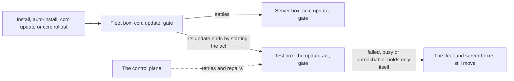
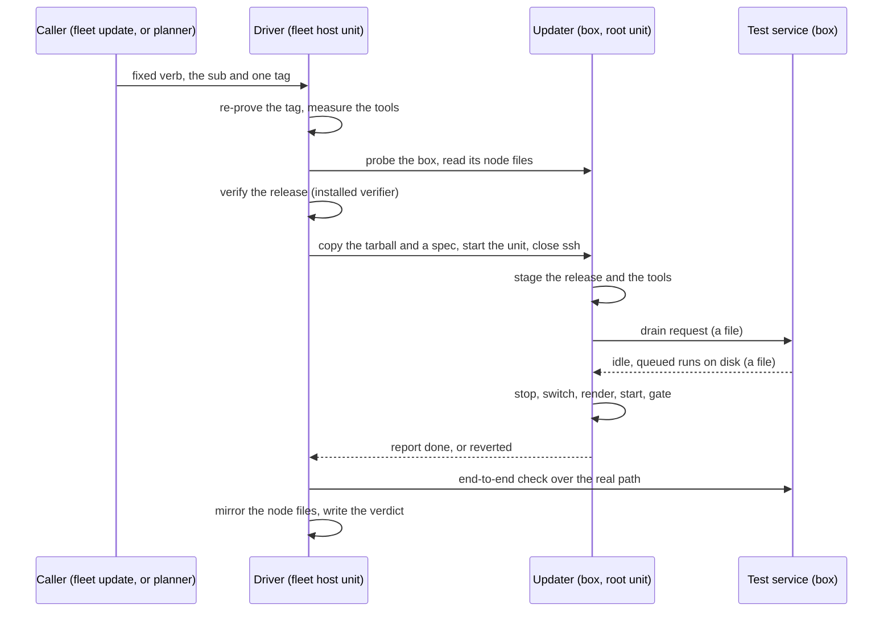

# The test box is a managed node: three nodes, one update act

**Spec** · 2026-11-22 · Status: Draft, for the operator · Owner: the overlord programme · Linear: none · Related:
`docs/superpowers/specs/2026-09-20-centralised-update-management-design.md` (the update control plane),
`docs/superpowers/specs/2026-09-18-release-rollout-design.md` (releases and `ccrc rollout`),
`docs/superpowers/specs/2026-10-28-test-box-design.md` (the test box),
`docs/superpowers/specs/2026-11-07-test-box-connect-design.md` (Connect, rulings C1 to C16),
`docs/superpowers/programs/overlord/testbox-sync-home.md` (the last hand fix),
`docs/superpowers/specs/2026-11-22-build-capture-runner-design.md` (a feature that waits on the box).
Docs only: no code ships with it.

## In short

The operator ruled on 2026-11-22: the test box's update scheme is not acceptable. It needs manual updating and
manual handling. A test box must be updated exactly as the fleet box and the server box are. A deployment that
uses one has three managed nodes, not two nodes and a machine fed by hand.

Today the two nodes move by one act with a verified release, a health gate, an automatic restore, a rollback,
kept versions and a row in the inventory. The test box has none of that. Nine separate acts touch it, only one
of them brings a new release, and that one runs the box's old code to fetch the new code. On a real deployment
the fleet moved 38 releases ahead while the box stayed on its first one, and nothing said so in plain words.

This spec makes the test box the third managed node:

- **It follows the fleet node.** Its target is the release the fleet node finished moving to, with the six tool
  versions measured on the fleet host. It has no channel and no setting of its own. One Install moves all three.
- **The fleet's own update starts it.** Every gated update or rollback of the fleet host ends by starting the
  box's act. So the box follows with no person, no server and no agent in the path. The control plane retries
  and repairs.
- **One act moves it.** The fleet host verifies the release, copies it to the box, and starts the new release's
  own updater there as a short-lived root unit. Nothing from the box's old release runs, so a box with a broken
  updater is healed by the same act as a healthy one.
- **The same guarantees.** The updater re-renders units and firewall, switches, checks health, and restores the
  previous release by itself when the check fails. It keeps previous releases, writes the same report, and has
  a hard deadline at every step.
- **It never blocks the other two.** The box has its own lease and its own halt. A failed, busy or unreachable
  box never stops a move of the fleet box or the server box.
- **One fact, and the operator is told.** "The box is on the fleet's release and usable", or one line saying
  why not, computed once and read by every feature that waits on the box. A box that stays behind past a bound
  raises one item and one push.

Tool sync as a release mover, **Apply release to box**, **Repair**, **Bring tools up to date** and the
`tools-home` fix all go. The ruling of 2026-11-22 settles two questions an earlier draft asked (O1 and O3).
Five decisions remain the operator's (section 6): O2, O4, O5, O6 and O7. PRs 1 to 3 need none of them. PR 4 is
the first that changes behaviour, and it is the one that meets the requirement. It needs O2, O4 and O7.

## 1. Measured

Measured on `origin/main` at `b33a9ae13`, and on a real deployment over two days. Paths are relative to the
repository root.

### 1.1 Two nodes are managed, the box is not

| Property | Fleet box and server box | Test box today |
|---|---|---|
| The act | `ccrc update --to <tag>`, from the console or `ccrc rollout` | Nine acts, from four places |
| What brings a release | The act itself | Tool sync only, run by the box's old release |
| Units and firewall | Re-installed on every update | Only when an operator re-runs the installer |
| Health gate | Yes, per role (`_upd_gate_probe`) | None |
| Automatic restore | Yes, three arms (`_upd_restore`) | None; the previous release is deleted at start |
| Kept versions, rollback | `~/ccrc-versions`, `ccrc rollback` | None |
| Inventory row | `GET /api/updates`, re-measured every minute | None; a block at `GET /api/testbox` |
| Follows a fleet rollback | Yes | Only one by re-install; a rollback by flip sends nothing |
| Deadlines | Server deadline, lock, watchdog | None on the admin acts |

*Table 1. The gap. The inventory sweep names exactly two producers, `sweepOwn` and `sweepFleet`
(`server/src/update/inventory.ts#sweepInventory`), and no file under `server/src/update/` names the test box. A
rollback by re-install runs `cmd_update`, which signals the box; `cmd_rollback`'s flip arm does not.*

### 1.2 Failures seen on the deployment

Each one needed a hand fix or a new release. The last column says what ends it here.

| # | What failed | Ended by |
|---|---|---|
| 1 | The service exited at once: its entry check compared a symlinked path | Gate and restore (2.7) |
| 2 | The reflink probe wrote where only root may | Spine run twice in tests (2.5) |
| 3 | The service token write failed over an existing token | Spine run twice in tests (2.5) |
| 4 | The installer's mirror config failed on a second run | Spine run twice in tests (2.5) |
| 5 | A retry's egress probe ran outside the firewall's cgroup sets | Every fetch in the root unit (2.5) |
| 6 | An ssh session open during the firewall load froze for about 304 s | Reads hold during a load (2.5) |
| 7 | Tool sync refused until the fleet host had a Chrome path set | The measurer looks; never a refusal (2.6) |
| 8 | Chrome's libraries, tmux and python3 did not match the distribution | One comparison (2.6) |
| 9 | The tools unit had no `HOME`, so every sync that changed the release died | No old code runs (2.8) |
| 10 | A parity act hung for 23 hours holding the admin lock | A deadline on every act (2.9) |
| 11 | The fleet moved 38 releases ahead; nothing said so in plain words | The row counts it; an item (2.10) |
| 12 | Features that need the box waited on it silently | One fact, one line (2.10) |
| 13 | With `HOME` fixed, the sync's release download still failed: the allowlist names the release host, and the download redirects to an asset host it does not name | The fleet host carries the release (2.5) |

*Table 2. Thirteen failures. Failure 9 is the important one: a box on an old release could not fetch the release
that fixes its own sync script, because the script that fetches is the old one. Failure 13, measured the same day
after this spec's first draft, means a box has never fetched a later release by itself: every release it has run
was pushed to it by the fleet host.*

### 1.3 What the code already gives

| # | Fact | Where |
|---|---|---|
| M1 | Rows are data: every reader starts from `CoordStore.nodes()` | `server/src/coord/store.ts` |
| M2 | `NodeRole` is a closed union of three; a stored role outside it reads `null` | `shared/node-role.ts` |
| M3 | `dispatchRank`: fleet 0, server and both 1, `null` 2 | `shared/api.ts#dispatchRank` |
| M4 | One halt and one lease for all rows | `dispatch.ts#fleetGate` |
| M5 | A move's transport is binary: the fleet link, or a local spawn | `dispatch.ts#planDispatch` |
| M6 | Every move is refused without the `detach` cap word | `dispatch.ts#moveRefusal` |
| M7 | After a fleet move lands, every idle row of rank not 0 is requested the tag | `dispatch.ts#followSteps` |
| M8 | A typed agent op already carries admin subs to one fixed verb | `shared/testbox-admin.ts` |
| M9 | The verb verifies a tag on the fleet host; the box checks `MANIFEST` only | `_tba_cx_verify`, `_tba_cx_copy` |
| M10 | The verb's detached unit holds the lock for its life, with no time limit | `_tba_detach`, `_tba_unit` |
| M11 | The installer runs over an open ssh session, firewall load included | `_tba_cx_install` |
| M12 | Tool sync already sources `ccd/ccrc` with its paths re-pointed | `tools-sync#_tbt_release_fetch` |
| M13 | The gate probe refuses any role but the three | `ccd/ccrc#_upd_gate_probe` |
| M14 | The parity gate binds the host key, the box file and a stale mark, not the release | `parityArmable` |
| M15 | The tools unit's firewall set has no registry row; npm rides a proxy | `ccrc-testbox.nft` |
| M16 | A row is retired only by naming an heir; nothing removes one | `store.ts#rekeyNode` |
| M17 | `ccrc testbox-admin` is not among the heads forbidden to sessions | `approvalguard.ts` |
| M18 | Three wire readers refuse a whole document for one field or word they do not name | See the caption |
| M19 | The lease acquire refuses while any live row is busy, and a rollback with no request | `store.ts#dispatchNode` |
| M20 | `ccd/ccrc` builds its paths from `$HOME` as it is sourced, under `set -u` | `ccd/ccrc`, its first lines |
| M21 | The gate reads its unit through `systemctl --user`; lock and report paths re-point | `_svc_is_active` |
| M22 | The service refuses to start with no token; Connect writes it after the install | `main.ts#readToken` |
| M23 | The box's firewall drops loopback traffic to the service's port | `ccrc-testbox.nft` |
| M24 | One function already decides which version difference makes a run fall back | `versionRowDiffers` |
| M25 | The lane already reads the box over root ssh, every six hours while connected | `testboxLane.ts` |

*Table 3. Facts the design rests on, each read in the code at `b33a9ae13`. `dispatch.ts` is
`server/src/update/dispatch.ts`; a `_tba_` name is in `ccd/ccrc-testbox-admin`; `parityArmable` is in
`shared/testbox-admin.ts`; `versionRowDiffers` is in `shared/testbox.ts`; `main.ts` is
`agent/src/testbox/main.ts`; the firewall file and `tools-sync` are under `deploy/testbox/`; `approvalguard.ts`
is in `server/src/coord/`.*

Notes on the facts that shape the design most:

- **M1.** The PWA's node list already maps N rows. Not every reader is as free: the lease, the halt, the
  deadline step and the token rotation gate each read every row, and each needs the lane rule of 2.4.
- **M6** is why an older server can never move the box by mistake (2.2).
- **M18.** The three readers are the status answer's (`shared/testbox.ts#readStatusAnswer`), the `testbox` op
  reply's (`shared/agent-protocol.ts#readTestboxOpReply`) and the admin status's
  (`shared/testbox-admin.ts#readTestboxAdminStatus`, which also checks every act's sub and phase against a
  closed map). So nothing new may ride any of the three (section 5).
- **M20 and M21** were read to the end for this spec, because failure 9 was this class. `_upd_lock` takes a
  `flock` on `$BOX_UPDATE_LOCK` and `_upd_phase` writes `$BOX_UPDATE_JSON`: both re-point, though their
  sentences still say `~/.ccrc`. `_upd_gate` reads its window through `_ccrc_knob`, which reads the environment
  and then `$BOX_ENV_FILE`, and gives the default when that file is absent. `_upd_gate_probe` reads its unit
  through `_svc_is_active`, which asks the user manager, so the box's arm cannot reuse that read (2.5).

The test box spec chose its service's home so that the box would ride "the update lane that already rolls the
agent" and avoid "a second update lane" (its §2.9, Option A). Today's separate lane departs from that spec's own
reasoning. This design returns to it.

## 2. Design

### 2.1 The target: three nodes, one act


*Figure 1. One apply. The box moves after the fleet box, because its tools must equal what the fleet host ended
up with. It does not wait for the server box, and the server box does not wait for it.*

| The operator has | For all three nodes |
|---|---|
| One screen | Updates lists three rows, each with its release, state and last report |
| One act | Install, or auto-install, or `ccrc rollout` when the console is down |
| One verified release | Checksum, Sigstore provenance and `MANIFEST`, verified before anything is placed |
| One safety net | A health gate, an automatic restore, kept releases, a rollback |
| One record | The same report file format and the same inventory |

*Table 4. What "identical" means here.*

The box is not the same in every respect. Each difference the operator can see is listed once, with its reason:

| The test box | Why |
|---|---|
| Has no Install, channel or auto setting on its row | Its release and tools must equal the fleet host's |
| Has no rollback button; it rolls back when the fleet does | The same reason |
| Never halts the other two, and needs no acknowledgement | A test machine must not block a fleet update |
| Retries by itself; a wait is `deferred`, not a failure | The same reason; nothing else can retry it |
| Is moved by a verb on the fleet host, not by `ccrc update` on the box | No ccrc install on the box (D-7424) |
| Is reached through the fleet host | The server never reaches the box |
| Is verified on the fleet host only | No old code in the path (O2) |
| Its target is a release and six tool versions | Tests must run on the fleet host's tools |
| Its gate reads a unit, a ready file, the firewall and two tools | Its service has no `/health` to ask locally |
| Does not go below its first managed release | Older releases carry no updater |
| Has no coordinate in `ccrc rollout` | The operator's machine need not reach it |

*Table 5. Every difference the operator can see. Its files are also root's and system-wide, which the operator
does not see. Anything not in this table is the same as for the other two nodes.*

### 2.2 What a node is, and how the box becomes one

The update design defines a node as "any box running ccrc software", keyed by an id the node keeps. The box runs
ccrc software, so it is a node. It becomes one in five steps.

**A role.** `NodeRole` gains `testbox`, and one L0 table states what differs per role, so no caller tests the
role word itself:

| Role | Rank | Lane | Intent | Transport |
|---|---|---|---|---|
| `fleet` | 0 | core | its own channel and auto setting | the agent link (as today) |
| `server`, `both` | 1 | core | its own channel and auto setting | a local spawn (as today) |
| `testbox` | 3 | follower | follows the fleet node | the carrier: the fleet host |

*Table 6. `NODE_ROLE_TRAITS` in `shared/node-role.ts` (a proposed name, like every new name here). `dispatchRank`
reads the rank from it. Rank 2 stays the unnamed role's.*

`testbox` is never a `CCRC_ROLE`. A second list, `INSTALL_ROLES` (server, fleet, both), is what `ccrc install`,
`server/src/config.ts` and the bash whitelists accept. The box never runs `ccrc install` and has no `ccrc.env`
of the fleet's kind (D-7424's boundary, kept).

**An identity and the seven node files.** The box updater keeps the same seven files every node keeps
(`build.json`, `installed`, `ccrc-caps`, `floor`, `previous`, `node-id`, `update.json`) in one root-owned,
world-readable directory, `<tools>/node-state/`. It is their only writer. Beside them it writes `tools.json`:
the six tool versions it measured itself, as root, after the switch. The files hold versions and phases, never
a secret. The node id is minted once and never rewritten.

**A measurement that does not depend on the service.** The server reads a node's files through that node's
agent. The box has no agent, so the carrier reads for it. The admin verb on the fleet host reads the box's node
files over its root ssh path, as its `read` sub already reads the box's settings (M25). It writes them as one
file on the fleet host, `~/.ccrc/testbox-node.json`: the seven files' text, `tools.json`, and, for a box no act
has moved yet, the tag of its old layout. The agent's node-file allowlist gains that name and
`testbox-update.json`.

The inventory gains a third producer, `sweepTestbox`, beside `sweepOwn` and `sweepFleet`. It splits the mirror
into the same seven raw reads and feeds the same validators (`measurementFrom`, `applyMeasurement`), so each
file keeps its one reader. The inventory declares the port; the test box lane implements it. The server still
never reaches the box.

The mirror is refreshed at the end of every act, by the `read` sub on its schedule, and at the start of every
act, which reads the box first and ends at once when the box is already where it should be. So a stale mirror
costs one short read, never a wrong move.

The service's status answer is not a source for any of this. The service is the thing being updated and runs as
an unprivileged user, so what it says about itself is shown and never decides a move. The row therefore has a
release and a count of releases behind for a box whose service will not start, and for a box no act has moved
yet. The old layout's tag has this one reader, the carrier's read, for one reason: a box from before this design
has no node files.

**The act's verdict.** The driver on the fleet host writes `~/.ccrc/testbox-update.json` in the report's own
format. It copies the box's report into it as it follows the act, and adds its own verdict: the end-to-end
check, or restore arm 2. Each act has an id, minted by the driver and handed to the updater, and both reports
carry it. A pure function reads the pair: for the same act id the driver's terminal verdict outranks the box's,
and a box report with another id belongs to an earlier act. No time from one host is ever compared with a time
from the other, the rule the sweep already keeps (D-3405).

**A row that exists only while a box is connected.**

- The row appears, under the label `testbox`, when an admin status that was read says a box is connected. It
  is re-keyed to the box's node id at its first measurement, as the fleet row is.
- Disconnect retires it. The retire is driven only by an admin status that was read and says
  `connected: false`. A status that could not be read changes nothing. The lane folds an unread status into
  "not connected" for the card; the sweep must not.
- A row still keyed by its label was never measured and holds nothing: it is removed. A row keyed by a node id
  is retired with the fixed heir word `retired`, so every reader that skips a superseded row skips it.
- When the same box connects again, its node id revives its row, with the lease, verdict, request and retry
  columns cleared. A rebuilt box has a new id and gets a new row.

Nothing retires a row without an heir today (M16), so the sweep, the one writer of measurement, gains these
writes.

**Safe against an older server.** The box's caps file carries words of its own. `sweepTestbox` drops the core
words (`detach`, `update-gate`, `rollback`) from a follower row before it is stored, whatever the file says. A
server from before this design reads the role as `null` and refuses every move of that row with `no-detach-cap`
(M6), so a rolled-back server can never spawn a local update in the box's name.

### 2.3 The box follows the fleet node

The box has no channel, no pinned tag and no auto-install setting.

**The target** is the fleet node's settled release. That means: the fleet row is idle, its stamp was read, and
its last report is not in flight and names the stamp's tag as `done`, or there is no report. A stamp alone is
not a target. The stamp is written at install, before the fleet's own gate, and any session on the fleet host
can write the file. On a single box, where one row has the role `both`, that row is the one followed.

**What starts an act.** Every trigger of root code on the box, with its bound:

| Trigger | Who starts the act | Bound |
|---|---|---|
| A gated update of the fleet host, however it began | The fleet host's own update, at its end | One per update |
| A rollback of the fleet host by the operator | The fleet host's own rollback, at its end | One per rollback |
| An act that was deferred, or whose start failed | The planner | 5, 15, 60 min, then hourly |
| A release that failed the box's gate | The planner | Twice more, at 1 h and 6 h |
| A box with no healthy release | The planner | The deferred schedule |
| A service that does not answer, on the right release | The planner (O6) | Once per tag and cause |
| A tool difference that makes runs fall back | The planner (O6) | When the mirror has the version |
| Connect, a box settings edit, Retry | The operator | Their own tap |

*Table 7. What starts an act. "However it began" covers Install, auto-install, a hand `ccrc update` and
`ccrc rollout`. The first two rows are acts, not measurements. Rows 3 to 5 retry a move the fleet already made.
Rows 6 and 7 start from a measurement alone, which is new, and are asked as O6.*

**The first caller is the fleet host itself.** `cmd_update`, after a gate that passed, and `cmd_rollback`, after
either of its arms, start the act on a `fleet` or `both` box with a connected test box. In `cmd_update` that is
where `_upd_testbox_signal` is called today, moved below the write of `done`, so the verb's own check of the
fleet host's report passes (2.5). The call is detached, prints one line, never changes the update's exit code
and never runs from a restore. So the box follows with no server and no agent in the path. A hand move is
followed because the move itself starts the act, not because a measurement changed.

**The planner retries and repairs.** For a follower row the resolver answers:

- **Converged** means two things hold: the box runs the target, and no tool differs at the depth that makes a
  run fall back (2.6). Health is not part of it.
- **The kind** is `update` when the target is at or above the box's floor. The same tag is a re-apply, which
  the follower's rule allows; the core rule `not-newer` is not asked of a follower.
- **A move down** is `rollback`: the target is below the box's floor. The planner emits it only when the
  control plane's own record says the fleet row's last settled move was an explicit rollback to that tag (O7).
  A lower release with no such record shows a line and waits. `ccrc rollback` on the fleet host is the act
  that moves both.
- **Below the first managed release** the box does not go, because those releases carry no updater. The row
  says so, remote runs fall back to local runs, and the box follows again when the fleet moves forward.
- **Health.** A service that does not answer while the box is on the right release gets one re-apply per tag
  and cause (O6). A reason an update cannot cure never reaches the planner: a held run user, a failed pristine
  install, a missing mirror, no reflink on the run root. Those are `unhealthy` in the one fact (2.10).

A follower takes no request. `POST /api/updates/apply` with `all` and the PWA's `planMove` name core rows only.
`POST /api/updates/intent` refuses a scope that names the box, and `POST /api/updates/rollback` refuses the
box's row: it rolls back when the fleet does. `followSteps` leaves the role out (M7). The one control on the
box's row is Retry, the existing ack, which starts the schedule again. Nothing needs it.

The consent is the fleet node's (O3, ruled). Nothing moves the fleet unattended unless the operator turned
auto-install on, and the box moves only to a release the fleet finished moving to.

### 2.4 The apply order, and a box that cannot follow

The planner keeps two lanes. The **core lane** is the fleet and server rows, with today's one lease and today's
halt, computed over core rows only. The **follower lane** is the box, with a lease and a halt of its own.

Order of one apply:

1. The fleet node moves and settles. Unchanged. Its update ends by starting the box's act.
2. The server node moves and settles. Unchanged. It does not wait for the box.
3. The planner looks at the box on a dispatch run where the core lane has no move to make and holds no lease,
   and no box act is in flight.

The planner's op is never sent while a core move is in flight, so a server restart never cuts the send. The
rule that matters most:

| Situation | The fleet and server boxes | The test box |
|---|---|---|
| The box fails its gate and restores | Move as if the row were not there | Retries twice, then holds (2.7) |
| The box is busy with an act | Move; the core lease never reads the box | Finishes, then follows again |
| The box or its admin lane is unreachable | Move | Deferred, retried, never a failure |
| The fleet row is busy, halted or has a request | As today | Waits: no settled release to follow |
| The server row is halted | As today: waits for an ack | Still follows the fleet row |
| The fleet agent or verb predates the act | Move | `carrier-missing`, said on the row |

*Table 8. Who waits for whom. No state of the box appears in the core lane's halt or lease. An emergency move of
the other two is always possible.*

The single lease and the single halt live in more places than the gate. Each gets the lane rule, in the PR that
first creates the box's row:

| Where the rule lives | Today | With lanes |
|---|---|---|
| `fleetGate`, `isHaltingUpdate`, `haltingRowSql` | One halt and lease over all rows | Per lane |
| `store.ts#dispatchNode`, its busy clause | Refuses while any live row is busy | Any row of the same lane |
| `store.ts#dispatchNode`, its rollback clause | A rollback needs the operator's request | Core rows only (O7) |
| `store.ts#leaseFollowsLabel` | A busy row of another label releases | Another label of the same lane |
| `converge.ts#runDispatch`, the deadline step | A late busy row fails, and halts | A late follower is deferred |
| `token/policy.ts#rotationGate` | Holds while any row is busy | Core rows only |
| `followSteps`, the PWA's `planMove` and halt banner | Every row of rank not 0 | Core rows only |

*Table 9. Where the one lease and the one halt live. The lane is read from the role table, never from the role
word. The halt predicate stays one rule; what changes is its scope. The store's SQL twin gains the same filter
in the same PR, and `halting-parity.test.ts` pins the two. The box holds no box token, so its acts never hold
the token rotation.*

A follower rollback acquires its lease with no request on the row. That amends D-3376, "a move down is never
automatic", for a follower only (section 4, O7).

**A server rolled back below the lanes** reads the box's row as a row with no role. An idle row is harmless
there. A row that was busy makes that server wait, then fail the row at its deadline; a `failed` or `reverted`
row halts it until one ack. The new server leaves the box's row idle at rest: a deferral is idle, and a hold
ends by retry. So the exposure is a server rollback during the minutes of a box act, or while a hold stands. It
is stated here and pinned by a test, not designed away (section 7).

### 2.5 The update act, step by step

One act moves the box: `ccrc testbox-admin update` on the fleet host (and `rollback`, its twin). Every caller
ends in it: the fleet host's own update and rollback, the planner, Connect's install phase and a box settings
edit.


*Figure 2. One act. Only re-measurement settles the row, as for every node; the op's reply never does.*

| # | Step | Runs on | As | What crosses the wire |
|---|---|---|---|---|
| 1 | Start: the fleet's own update, or the planner's op | Fleet host, or server | the caller | The sub and one tag |
| 2 | Re-prove the tag, measure the tools, lock, detach | Fleet host | the fleet user | Nothing |
| 3 | Probe the box, read its node files | Fleet host to box | root, one short call | The files' text |
| 4 | Verify: checksum, provenance, `MANIFEST` | Fleet host | the fleet user | The release, once per tag |
| 5 | Copy the tarball, a spec, and a token when pairing | Fleet host to box | root, by the access key | Those files |
| 6 | Write a runtime unit, start it, close ssh | Box | root, by the access key | One unit file |
| 7 | The updater's spine | Box | root, in the unit | Tool downloads |
| 8 | Follow the report | Fleet host to box | root, short reads | The report file's text |
| 9 | Check from the fleet host | Fleet host to box | the service token | One status call |
| 10 | Mirror the node files, write the verdict | Fleet host to box | root, one short call | The files' text |
| 11 | Settle | Server | the sweep | The mirror, through the agent |

*Table 10. Who does what. Root on the box is held by the fleet host's access key, as today (Connect ruling C3),
and by the one unit that key starts. The service user gains nothing and loses its only root unit (2.12).*

Notes on the steps:

- **Step 1.** The planner's op rides the agent link, or the server's local arm on a single box, as the admin
  subs do today. The server sends the sub and a tag and nothing else. An agent or a verb from before the act
  answers a typed refusal, and the row says `carrier-missing`.
- **Step 2, the tag.** The verb refuses a tag, for either sub, that is not the fleet host's own settled
  release: its stamp, and a report that says `done` for it or no report. So what a compromised server can cause
  is bounded on the fleet host.
- **Step 2, the tools.** One measurer. `readHost`'s probes become one module that the agent calls in process
  and the verb runs as a fixed entry of the installed tree. Every caller carries the versions, and no caller,
  page or server names one.
- **Step 3.** One short ssh call before anything is downloaded. An unreachable box ends `deferred` here, having
  cost nothing. A box that is already converged ends here too.
- **Step 4.** The verified tarball is kept on the fleet host per tag, for the current and the previous target
  only, so a retry never downloads or verifies twice.
- **Step 5.** The stage is a root-owned directory on the box. The box compares the tarball's digest with the
  value sent, which is new (M9), and checks `MANIFEST`, as Connect does today.
- **Step 6.** The unit file is written under `/run/systemd/system` from the verified tree's template, with the
  tools firewall set, a `RuntimeMaxSec`, and `HOME` set. The `tools-home` drop-in is the precedent. It is gone
  at reboot. The session that starts the unit is closed before the spine begins.
- **Step 7.** The updater is the staged release's `deploy/testbox/bin/box-update`. It absorbs the installer's
  phases and the tool sync's steps as one spine, run whole on every update, so "works on a second run" is
  exercised by every release and by a fixture test that runs the spine twice (failures 2, 3 and 4).
- **Step 8.** The updater writes the phase `firewall` before it loads a changed firewall file. A read that is
  open at that moment can freeze as in failure 6. So every read has a 60-second `timeout`, and a read that
  times out while the last phase seen is `firewall` is no information. Three timed-out reads in a row at any
  other phase mean the box is unreachable.
- **Step 9.** The check is the wrapper's own client (`agent/src/testbox/client.ts`), run by the driver as a
  fixed entry that reads the token file itself. The token is never in argv, a unit file or a log. The server
  is not in the check's path, so a server that is restarting cannot fail it.

**The token.** The service refuses to start without its token, and Connect today writes it after the install
(M22). The gate needs the service up, so the act takes the token before its gate. On a first Connect, and on a
Connect after a Disconnect, the driver puts a new token in the stage as a root-only file beside the spec. The
spine moves it into place by a temp file and a rename, before the service starts. Connect's `pair` phase keeps
its other half, after the gate: the fleet host's own settings for the box. An act on a box that has no token,
with none in its stage, refuses before any write.

The updater's spine, in order:

1. Take the box's update lock. Settle the last act if it left no terminal report (2.8).
2. Refusals, before any write: the spec file's shape, each version against its format; the box file; the
   stage's ownership; the floor for an `update`; a token, in place or in the stage; and the unit's own place in
   the firewall's tools set.
3. Stage. Place the release tree root-owned. Install its dependencies with `npm ci --omit=dev
   --ignore-scripts`. Fetch node, npm and Chrome into new directories. Download the system packages without
   installing them. Nothing a run uses has changed yet.
4. Drain (below).
5. Stop the service. Install the downloaded packages. Flip `current` and `release/installed`, write `previous`.
6. Render the token when pairing, then units, drop-ins, the polkit rule, the firewall file and the egress names
   from the new tree. Each is written only when its bytes differ. The firewall reloads only when its file
   changed, after the phase `firewall` is written.
7. Start the service. Gate (2.7).
8. Write `done`, measure the tools into `tools.json` and prune. Or restore and write `reverted`.

Every step refreshes the report at least every two minutes, so the server's deadline never ends a live act.

**The drain.** The updater cannot ask the service over its socket. The service does not listen on loopback and
the firewall drops loopback traffic to its port, on purpose: a prepare or install unit shares the box's
loopback (M23). No port and no socket is added. The drain is two files:

- **The request.** Root writes `/run/ccrc-testbox-drain/request`, in a root-owned directory the service can
  only read: the act's id and a deadline.
- **The answer.** The service writes `/run/ccrc-testbox/drain`, in its own runtime directory: the act's id,
  `idle`, and how many queued runs it put on disk. Root reads it as data, without following a link, at a
  bounded size.

The service polls for the request. While one stands with its deadline ahead, the service closes admission, lets
the runs in progress end, writes its queue to `<root>/handover/` (the hand-over of D-7426 and D-7559) and
answers. It stays up. Only the updater stops it.

The request is a lease. When it is withdrawn, or its deadline passes, the service reopens admission by itself
and queues the handed-over runs again, in their order. So an updater that is killed in mid-drain leaves a box
that takes runs again within the deadline, and a drain that runs out of time is `deferred` with nothing changed.

The updater goes on only on its own measurement: no run, prepare or install unit is active, and the answer says
the queue is on disk. A service that never answers within the drain's bound is a deferral. The restore and the
settling paths never drain: there the service is already down, or is on a release that failed its gate.

**Shared code.** The updater shares the update lane's own code for the parts that are the same job: the report
writer (`_upd_phase`), the lock function (`_upd_lock`) and the gate loop (`_upd_gate`), sourced from its own
tree with the paths re-pointed, as the tool sync sources them today (M12). It sets `HOME` itself before it
sources that file, and the unit sets it too (M20). The gate's `testbox` arm reads the system unit itself (M21).
Its install steps are its own. That is the recorded "legitimately different" reason: another host, root and
system scope, and D-7424's boundary (decision A2).

**The lock** is `/run/ccrc-testbox-update/lock`, in a directory only root can enter. A lock file any user can
open can be held by any user, and the box runs submitted code under other users.

### 2.6 Tools parity, inside the same act

The box's target is a pair: the release tag and the six tool versions measured on the fleet host (node, npm,
Chrome, python3, git, tmux). Both ride one act and one spec file.

- **One comparison.** Two tool sets are equal when `versionRowDiffers` finds no difference (M24): node
  major.minor, npm major, tmux major, git major, python3 major.minor and Chrome major. That is the test box
  spec's §2.4 row, which stays the one owner of "does this run go remote". Convergence, the row's line and the
  one fact all ask that function. A smaller difference, a patch or a build, is shown as detail and is not drift.
- **Hard tools.** node and npm, at the exact version. The service runs on them, they are part of the gate, and
  a failure to install them fails the act before the switch.
- **Soft tools.** Chrome, python3, git and tmux. The updater asks for the exact version. When the mirror does
  not have it, the updater takes the mirror's own version if that is equal by the comparison. This ends
  failure 8: an exact package version no longer decides anything.
- **A soft tool that cannot be made equal** stays where it is. The act still ends `done`. The one fact reads
  `tools-differ`, which is not ready, because runs fall back. The line names the tool, both versions and the
  remedy.
- **No drain for nothing.** The mirror is asked in the stage step. An act that finds nothing it can change ends
  before the drain. A tool that cannot be made equal is asked for again on the deferred schedule, which costs
  one read of the mirror's lists. After a day the fact reads `needs-operator`: the box is not on the fleet
  host's distribution release and must be rebuilt.
- **Chrome's path.** The measurer uses `CCRC_CHROME` when it is set, and otherwise looks for Chrome on the
  `PATH` it already reads. A tool it still cannot measure is left out of the spec and the box keeps its
  version. It never refuses the move (failure 7). When that makes runs fall back, the fact reads
  `needs-operator` and names the setting.
- **Measured, not copied.** After the switch the updater runs each tool, as root, and writes `tools.json`. The
  service reads that file for its status answer. Today the box's `versions` file is a copy of the spec and
  nothing on the box measures.
- **Switched together.** node, npm and Chrome's binary sit behind the `current` link. python3, git, tmux and
  Chrome's libraries are system packages: they are downloaded in the stage step and installed after the drain,
  when no run is in progress. So release and tools change in one window, and restore in one window.
- **Tools-only drift.** When a tool changes on the fleet host with no release change, the row stops being
  converged and the same act runs for the same tag (O6). The release steps do nothing; the service restarts
  only when node changed.

Every caller measures through the one measurer, so `ccrc rollout` and a hand update carry the tool versions as
a move from the console does.

### 2.7 The health gate and the automatic restore

**The gate.** The shared loop runs for `CCRC_UPDATE_HEALTH_S` (default 90 s). The `testbox` arm passes when all
hold:

- the system unit `ccrc-testbox.service` is active and has stayed up;
- the ready file names the target release and the unit's main pid. The service writes
  `/run/ccrc-testbox/ready` after it binds, and root reads it without following a link. This is the box's form
  of "`/health` answers the staged version", with no token and no network;
- the firewall table is loaded and the egress timer is active;
- node and npm, run by the updater, answer the versions in the spec.

The ready file is what the service says. The unit's state and its main pid are the system manager's, and the
fleet host's own check follows.

**Kept releases.** The box keeps three release trees and their tool sets (`CCRC_TESTBOX_RELEASES_KEEP`), the
default the other nodes use (`CCRC_VERSIONS_KEEP`). A release is pruned only after a newer one passed its gate,
and never the previous one. The start-up step that deleted the previous release before the new service had
proved anything goes.

**Restore, three arms, as on the other nodes.**

1. **The updater flips back.** It stops the service, re-links `current` and `release/installed` to the
   previous release and set, re-pins the packages, renders units and firewall from that tree, starts, and gates
   the previous release. The row reads `reverted`. No download, no fleet host.
2. **The fleet host flips back.** When the updater's unit ended with no terminal report, which includes a unit
   killed at its bound, or the box says done and the end-to-end check fails within its two minutes, the driver
   re-links the two names itself and starts the previous tree's own render as a root unit. This code is the
   fleet's gated release, so it does not depend on any updater on the box.
3. **A full re-install.** When neither arm leaves a healthy box, the row ends `failed`, and the planner starts
   a full install on the deferred schedule. That act begins by settling (2.8).

**A previous release from before this design.** On a box's first managed move, the previous release is the old
one. It writes no ready file, has no render entry, and its service's start step removes the release that its
takeover file names. So a restore to it has its own form. The updater removes a stale takeover file, renders
with that tree's own `install.sh --reapply --force`, and gates with a legacy arm: the unit is active and has
stayed up, and node and npm answer. The driver's end-to-end check is the proof that it serves.

**Moving down.** A rollback is the same act with the kind `rollback`, run by the target release's own updater.
When the box still keeps the release, the stage step finds the tree and the tools already there. When it does
not, the release is copied and installed in full, exempt from the floor, as `ccrc rollback` re-installs on the
other nodes.

**After a failure.**

| The act ended | Meaning | Next, by itself | The operator is told |
|---|---|---|---|
| `deferred` | Nothing on the box changed | 5, 15, 60 min, then hourly | At the bound below |
| `reverted` | The release failed its gate; the previous one serves | Twice more, at 1 h and 6 h | When it holds |
| `failed` | No release passes the gate; the box is down | A full install, 5 min to hourly | At once |
| `done`, tools differ | On the release; runs fall back | The mirror is asked hourly | After a day |

*Table 11. After a failure. None of these halts the other two nodes, and none needs a tap. A new fleet release
is tried at once, whatever the row holds. Retry on the row starts the schedule again.*

- **Deferred** covers: the box unreachable, the admin lock busy, an operator's hold (2.9), a drain that ran out
  of time, a mirror that did not answer, a driver or unit that died before the switch, and `carrier-missing`.
- **`deferred` is not a new update state.** The row stays `idle` and carries the reason, the count and the next
  try in additive columns. An older server reads `idle`.
- **Held.** A release that failed the box's gate three times is held for that tag. The box serves the previous
  release, remote runs fall back, and the operator gets an item with the gate's reason.
- **The bound.** A box that has not converged for six hours, or is five fleet releases behind, raises one
  Waiting on you item and one push (`CCRC_TESTBOX_BEHIND_ALERT`). Both clear when it converges.

System packages are the one thing a flip cannot restore exactly: python3, git, tmux and Chrome's libraries are
system-wide. A restore re-pins them, and a version the mirror no longer has is judged by the same comparison.

### 2.8 A box whose installed updater is broken

This is failure 9, and the reason the design is shaped as it is. The rule: **no code from the box's installed
release runs in the update path.** The fleet host verifies with its own installed verifier, which its own gated
update put there. The updater that runs is the target release's, taken from the verified tarball. So a box many
releases behind, or one whose service will not start, or one whose old sync script dies, is moved the first
time the fleet host finishes an update to a release with this act. The first act needs only root ssh, `tar`,
`sha256sum` and systemd on the box.

**Adopting a box that is already connected** needs no operator step. The staged updater reads the old layout
(the release tree, the `installed` link, the marker, the sets), mints the node id, writes the node files and
records the old release as previous. Two things differ on that first move, once per box:

- The old service cannot be asked to drain. The updater measures the run, prepare and install units itself, as
  the admin verb does today, and stops the service when none is active. A run that starts in that window falls
  back to a local run.
- The old firewall gives the root unit no registry row (M15). The updater uses the service's proxy when it
  answers. When it does not, no run is in progress, and the updater loads the staged firewall file first.

Adoption stays in the updater for good. A box that is still on an old release when the old movers are retired
is adopted by the first act after that.

**One mover per box, from its first act.** Adoption is the hand-over, and it is one-way. The render removes the
tools unit, its entry in the polkit rule and the `tools-sync` step at the service's start. The new service
answers a `tools.sync` frame as it answers one with nothing to do, and starts nothing. The fleet host's signal
is replaced by the call of 2.3 in the same PR. So an older fleet host's signal, and an older card's button, are
no-ops on a managed box, and the old sync never prunes a release the node files name.

**Settling.** Every act begins by looking at the last one. A report still in flight whose unit is gone means
the box may be half switched. The updater first leaves the box on a release whose gate passes, the installed
one if it passes and the previous one if not, with the legacy forms of 2.7 for an old release. Only then does
it go on. So a new release's updater repairs what an older, broken one left.

### 2.9 Deadlines and the lock

No act holds a lock for hours. Every bound is enforced by systemd or by `timeout`, not by the act's own care.

| What | Bound | Enforced by |
|---|---|---|
| The op's spawn on the fleet host | 30 s (today's bound for a long sub) | The agent |
| The driver unit, in total | 56 min | `RuntimeMaxSec` on the detached unit |
| The probe; verify; copy | 1 min; 4 min; 3 min | `timeout` |
| Each ssh call | A connect deadline and keep-alives; reads 60 s | ssh options and `timeout` |
| The box's update unit, in total | 40 min | `RuntimeMaxSec` on the runtime unit |
| Stage, in total; each download | 12 min; 4 min | `timeout` |
| The drain | 15 min (`CCRC_TESTBOX_UPDATE_DRAIN`) | The updater, and the request's own deadline |
| Packages, switch and render | 7 min | `timeout` |
| The gate; restore arm 1 | 90 s (`CCRC_UPDATE_HEALTH_S`); 3 min | The shared loop; `timeout` |
| Restore arm 2 | 5 min | `timeout` in the driver |
| The end-to-end check | 2 min | The driver |
| The server's view | 15 min with no report, 60 min in all | `deadlineExpired`, unchanged |
| Parity | 60 min in all, 15 min a leg | `RuntimeMaxSec` and `timeout` |
| Connect; a box settings edit | 58 min; 6 h waiting for idle, then the act | `RuntimeMaxSec` |

*Table 12. Deadlines. The box's unit is the sum of its parts: 12, 15, 7, 1.5 and 3 minutes, inside 40. The
driver is the sum of its own: 1, 4, 3, 40, 5 and 2 minutes, inside 56 and inside the server's 60. So a unit
killed at its bound still leaves the driver time for arm 2 and the check. A deadline in the follower lane is
`deferred`, never a halt.*

- **One table.** `TBA_DEADLINE_S` in the verb, mirrored in `shared/testbox-admin.ts`, gives every long sub a
  limit, and `_tba_detach` passes it to the unit. A test goes red for a long sub with no row.
- **Who ends a hung act.** systemd kills a unit at its bound and the kernel frees its lock. That is new, and it
  ends failure 10. `_tba_reap` keeps today's job: it records an act whose lock is free as interrupted.
- **The lock says who.** The fleet host's admin lock stays the one lock for every act on the box. Its state
  records the sub, the start and the deadline, so `busy` names the holder and the latest time it can end.
- **The operator's acts come first.** Disconnect, Replace, key-rotate, key-revoke and a host-key confirm never
  wait for an automatic act. Each stops the running driver, takes the lock, and sets a hold that the planner
  and the fleet's own call honour until the operator's act ends. The box's own unit ends by itself inside its
  bound; Disconnect stops it first. The next act settles whatever was left.
- **Two locks, two hosts.** The box's own update lock guards its spine against a second updater. The admin lock
  guards the fleet host's acts against each other. Neither is the core nodes' `update.lock`, so a box act never
  delays a fleet or server update.

### 2.10 What the operator sees, and what features read

**The row.** The Updates screen lists the box as the third node. Its line is one of:

| The box is | The line |
|---|---|
| Converged | `test box · follows the fleet box · <tag> · tools match` |
| Moving | `updating to <tag>: <phase>` |
| Waiting on runs | `waiting for <n> runs to end, then updating to <tag>` |
| Waiting on the fleet | `waiting for the fleet box to settle on <tag>` |
| Behind | `<n> releases behind: <why>; next try at <time>` |
| Not yet managed | `on <tag>, <n> releases behind; it is adopted at the next update` |
| Unreachable | `unreachable since <time>; it follows when it answers` |
| Restored | `<tag> failed its health check; on <previous>; next try at <time>` |
| Held | `<tag> failed its health check three times: <why>; on <previous>` |
| The fleet moved down | `the fleet box is on <tag>, below the test box; ccrc rollback moves both` |
| Tools differ | `on <tag>; tools differ: <tool> <fleet> vs <box>; <remedy>` |

*Table 13. The row's lines. "Behind" is counted against the fleet's settled release, from the release catalogue
and the carrier's read, so it is known for a box whose service is down and for one no act has moved yet. The
card keeps Connect, settings, parity and the switch, and shows this same line.*

**One fact.** `testboxReady` in `server/src/testbox.ts`, a pure function over the fleet row, the box row and the
box's status. It answers `ready`, or one word with one plain line: `not-connected`, `unreachable`, `behind`,
`updating`, `tools-differ`, `unhealthy`, `reverted` or `needs-operator`. It is published as an additive block
on `GET /api/testbox` and on the box's row.

| Reader | Today | With the fact |
|---|---|---|
| The build capture lane | Stays `capture-queued`, silently | Shows the line as why it waits |
| The parity precheck | Starts against any box | Refuses with the line when not ready |
| The card and the switch | "tools differ (release X vs Y)" | The line, and how far behind |
| Waiting on you, and one push | Nothing | An item at the bounds of 2.7, and for `needs-operator` |

*Table 14. Who reads the fact. It does not replace the wrapper's per-run fallback table (test box spec §2.4),
which stays the one owner of where a run goes.*

`needs-operator` is a closed list of measured conditions, each with its own line: a changed host key; the access
key refused; a tool that could not be made equal for a day (the box's distribution release differs); no reflink
on the run root; no room on the box's disk for a stage; and a Chrome path the measurer cannot find, when that
makes runs fall back.

### 2.11 What is deleted or folded

| Today | Becomes |
|---|---|
| `_upd_testbox_signal` and its call in `cmd_update` | Replaced by the call of 2.3, at the same place |
| `POST /api/testbox/tools-sync`, `ccrc-api testbox tools-sync` | Retired; a typed no-op for one release |
| `TestboxLane.toolsSync`, `toolsHome`, `toolsSyncNeedsHome` | Deleted |
| The agent op `testbox-tools-sync`, `syncTestboxTools` | Deleted; `readHost`'s probes become the measurer |
| The `tools.sync` frame and the box's sync driver | A no-op on a managed box, then deleted |
| `deploy/testbox/bin/tools-sync`, `ccrc-testbox-tools.service` | Functions move into the updater; unit deleted |
| `tools-sync --takeover-ended` at service start | Deleted; kept releases replace it |
| The `takeover` file as the service's signal | The drain request and its answer (2.5) |
| `deploy/testbox/install.sh` | A thin wrapper over the updater, for the hand-install recovery path |
| Admin subs `apply-release`, `repair`, `tools-home` | Other names for `update`, then deleted |
| Admin sub `settings-box` | Writes the box file, then runs the same act |
| Connect's install phase | The first update, by the same function |
| The marker file, `sync-report`, the cached marker tag | The node files, read by the carrier |
| The polkit rule's `tools` unit | Removed; the service user starts no root fetch |
| The release host's row in the tools firewall set | Removed; the release comes from the fleet host |
| **Bring tools up to date**, **Apply release to box**, **Repair** | Removed; the row has one Retry |
| The admin lane's egress probe from an ssh session | Removed; the updater's first fetch proves egress |

*Table 15. What goes. A box's release is recorded in one set of files, as on every node, where today nine
places record it and disagree after every tool sync. The installer stays untouched until the PR that switches
Connect to the act.*

**Parity and updates.** The parity gate binds the box's host key, its box file and a stale mark, not its
release (M14). C8 ruled that a release roll does not expire parity, at a time when a release could not change
the run units or the firewall without the operator's Apply (C7). Now it can. So the updater's render reports
which files it changed, and a change to a run-shaping file marks parity stale: the run, prepare, install and
clean units, their drop-ins and slices, and the firewall file. A release that changes none of them keeps the
record, as C8 ruled. Parity also gets a deadline (2.9), and its precheck reads the one fact (2.10). Whether it
then runs by itself is O5.

### 2.12 Threat model: what changes

The test box spec's goals stay: no carry-over between runs, no fleet secret on the box, no reach back.

| | Property | How |
|---|---|---|
| Kept | The server never reaches the box and holds no key | One typed sub with one tag, through the agent op |
| Kept | No reach back | Intent is pushed by the fleet host; the box pulls nothing |
| Kept | No agent, no `ccrc install`, no user units on the box | The updater is the box's own entry (D-7424) |
| Kept | Egress by cgroup | Every fetch runs in the root unit, in the tools set |
| Kept | The service user has no root path | The polkit rule is not widened |
| Kept | Host key pin, strict checking, `from=` on the key | Unchanged; a changed key still blocks every act |
| Kept | Rebuilt, never reused; step-up for key acts; the switch | Unchanged |
| Kept | A release never vouches for itself | The verifier is the fleet host's installed one |
| Kept | No port and no socket is added on the box | The drain is two files |
| Kept | The token is never in argv, a unit file or a log | A root-only file in the stage; a fixed entry reads it |
| Tighter | The service user can start no root unit that fetches | The `tools` unit leaves the polkit rule |
| Tighter | The root unit no longer reaches the release host | Its row leaves the tools set |
| Tighter | The box token causes no write on the box | The `tools-home` departure is withdrawn |
| Tighter | Sessions cannot run the admin verb by accident | Every writing sub joins the forbidden heads |
| Tighter | What the service says about itself moves nothing | Root reads the node files (2.2) |
| Changed | Units and firewall are applied automatically | Reverses C7 (ruled 2026-11-22) |
| Changed | Later releases are verified on the fleet host only | Amends D-7424 (O2) |
| Changed | The access key is used on every release and every read | It was used on operator acts and the 6 h read |
| Changed | The root unit may reach the npm registry | It rode the service's proxy (O4) |
| Changed | A measurement can start a root act | Two bounded triggers (O6) |
| Changed | The box moves down with no tap of its own | Only behind an explicit fleet rollback (O7) |
| New | The service reads a root-written request file | A deadline and an act id; it is never executed |
| New | Root reads two files the service writes | As data, no link followed, at a bounded size |
| New | `<tools>/node-state/` is world-readable | Versions and phases only, no secret; the lock is not there |
| New | Up to three release trees stay on the box | Root-owned, each verified when placed |

*Table 16. The delta. Root code on the box starts from two places after this: the fleet host's access key, and
the update unit that key starts. Today the service user can also start a root unit that fetches from the network.*

**How long the tighter rows hold.** They hold from a box's first managed release on. One case undoes them for a
time: a restore to the release from before that renders that tree's units and its polkit rule, with the `tools`
unit, until the next act. The service's own firewall row for the release host is not touched: by default it is
the host the service fetches repositories from.

**The verifier change.** Today each later release is verified twice in effect: the fleet host verifies its own
copy, and the box verifies again with its installed verifier. The box's verifier was itself placed by the fleet
host, which holds root on the box, so the second check protects nothing the fleet host could not already
override. What it costs is failure 9: old code in the path of every update. The update design's decision 12,
"the verifier that verifies a download is the installed one", holds in full: the fleet host downloads, and the
fleet host's installed verifier verifies. The box still checks the digest and `MANIFEST` of what arrived. A
compromised fleet host can place any tree on the box, as it can today.

**What a session on the fleet host can cause.** Every file the fleet host's update keeps is writable by every
session there, and sessions process untrusted input. With this design the most such a session can cause on the
box is a move to another release that the fleet host's own verifier accepts, never below the box's floor, and a
tool version that passes its shape check and comes from the pinned hosts. That is why a stamp alone is never a
target (2.3) and why a move down needs the control plane's own record (O7).

**The registry.** Today the service's proxy is the one thing on the box with egress to the npm registry: it is
read-only and serves a tarball only when it matches its integrity value. With O4 the root unit reaches the
registry itself. Its rules are restated, not dropped: GET only; `npm ci` keeps `--ignore-scripts`; npm itself is
still checked against its `dist.integrity`. Two gaps are carried as they are: node's signature is not checked
(D-7425) and Chrome has no hash (D-7422).

**The ledger.** Every act on the box is recorded with an actor, as the connect spec rules. The acts `update`
and `rollback` join the ledger's closed vocabulary. The actor is a fixed word for the fleet host's own update
and for the planner, and the operator's session for Retry, Connect and a settings edit. A row is written when
an act is first seen and when it settles. A run of deferrals writes one row when it starts and one when it
ends, not one per try.

**The session guards** are accident guards, like those on `ccrc update`: a classifier row, the child deny file
and the hook. They cover the head `ccrc testbox-admin` for every sub that writes, because Connect and a
settings edit end in the same act as `update` does; the read subs stay open. `env -u`, a script file or another
interpreter runs past them.

### 2.13 The operator's acts

**Once, as today.**

1. Prepare the box: a clean image of the fleet host's distribution release, the private network, an XFS
   reflink run root. ccrc still never formats a disk or joins a network (C10, C11).
2. On the card: the address, port and login; the one access line; the host key fingerprint; the repository
   row; step-up; Connect. Connect's install is the first update.
3. Turn the switch on. With O5 ruled, parity has already run; without it, run parity first.
4. Confirm a changed host key if the box is ever rebuilt. This stays manual on purpose (C9).

For a box that is already connected: nothing.

**Never again.**

- Bring a box up to the fleet's release, or press Bring tools up to date, Apply release to box or Repair.
- Run an admin sub to free a stale box, or set anything on the fleet host before a release will move.
- Clear a stuck lock, or wait on a hung act.
- Find out by accident that the box is behind, or work out why a feature is waiting.
- Acknowledge a box failure before the fleet box or the server box can move.
- Tap anything to make the box try again after a failure.

**Still the operator's, each said as an item when it arises.**

- Rebuild the box when it is not on the fleet host's distribution release (the first act of step 1, done late).
- Set `CCRC_CHROME` on the fleet host, once, when Chrome is where the measurer does not look and runs fall
  back because of it.
- Look at a release the box could not run three times. Nothing waits on the look: the next release is tried.
- With O5 ruled "no": run parity after a release that changed a run-shaping file.

## 3. Approaches

Three designs were weighed. All three agree on the third row, the follower rule, the fleet host as carrier, the
new release's updater in a root unit, and a lane of the box's own. They differ in what runs on the box.

| Approach | What runs on the box | For | Against |
|---|---|---|---|
| A real `ccrc update` role | `ccrc update --role testbox` | One mover, most literal | Spine is user-scope |
| An attached node | `install.sh --update`, with its own gate | Smallest change | Two gates, two restores |
| A follower node (chosen) | Its own updater, sharing the lane's code | One report, lock, gate | A second spine |

*Table 17. The choice. The first is the cleanest end state and is kept under Later. Its one large PR would move
a 30,000-line file's `$HOME`, `systemctl --user` and `systemd-run --user` assumptions to root in one step, which
is not reviewable and breaks D-7424. The second leaves two implementations of gate, restore and keep.*

Taken from the first: the role table (2.2), the same seven node files, the gate arm in `_upd_gate_probe`, and
the fleet host's own update as the first caller. Taken from the second: the `deferred` class (2.7), the ready
file (2.7), the write-if-changed render (2.5), the end-to-end check, and `INSTALL_ROLES` (2.2).

## 4. Amendments to earlier specs and rulings

**Test box connect spec (2026-11-07).**

- **C7 is reversed** by the ruling of 2026-11-22. It ruled: tool sync automatic, the installer re-run offered
  on the card, "never run automatically". Its reason was that a root re-run restarts the service and reloads
  the firewall, so the operator picks the moment. The new ruling is that the operator picks no moment. The
  reason is answered by the drain, the write-if-changed render, the gate and the restore.
- **That spec's M20 and its §2.4's last line are reworded.** "Later releases come only through tool sync"
  becomes "only through the update act". The rule it protects, one release mover on the box, is kept, and is
  now true: today the installer, the tool sync and Repair all place a release.
- **§2.9 Upgrades, Repair and §5.1's "Apply release after tool sync"** are replaced by 2.5 and 2.7.
- **§2.5's order** changes in one step: the service token is placed before the gate, inside the act (2.5).
- **C3 is widened.** The access key is kept after install, as ruled. It is now used on every release and every
  read of the node files, with fixed content. No page input reaches the box.
- **C13 is kept and generalised.** "Apply when idle" becomes the drain every act asks for.
- **C8 is amended.** A release that changes no run-shaping file does not expire parity, as ruled. One that
  changes such a file marks it stale (2.11). **C16** is amended only if O5 is ruled.
- **§2.10 and T10** (every act recorded) gain the acts `update` and `rollback` (2.12).
- **T5** (first-install trust: verified on the fleet host) becomes the trust of every install.

**Test box spec (2026-10-28).**

- **§2.10 "How the box gets a new test-service release"** is replaced. Its steps 2 to 6 move into the updater;
  its step 1, verification by the box's installed tree, is replaced by verification on the fleet host (O2).
- **§2.10's "a tool changed outside the lane shows up at the next poll"** stays true, and with O6 it also
  starts an act.
- **§2.7's one write, `testbox.tools-sync`,** and the card's Bring tools up to date are retired.
- **§2.0's egress table** loses the tools set's release row and gives that set the registry row (O4).
- **§2.3's polkit rule** loses the `tools` unit.
- **§2.9 Option A** stands, and is now true: the box rides the update lane.
- **D-7424** is amended in one clause: later releases are no longer verified by the box's installed tree. Its
  other clause, no ccrc server, agent or user units on the box, is kept.
- **D-7426 and D-7559** (the takeover) are kept in what they protect: queued runs survive a release change.
  The channel changes from a frame and an exit to a request file and a stop by the updater.

**Update management spec (2026-09-20).**

- **§3 Node** gains: a node may be reached through a carrier, another node's host.
- **Decision 6** (nodes, not a pair): the third producer exists. The pairwise skew views stay the core pair's.
- **Decision 7** (converged by pull) does not apply to a follower: the box can reach nothing, so its target is
  pushed. The row and the re-measurement are unchanged.
- **Decision 8** (moving down is never a resolver outcome) is amended for a follower only: its resolver emits
  `rollback`, and only behind the operator's explicit rollback of the fleet node (O7). D-3376 is amended with
  it.
- **Decision 9** (install on consent): a follower has no consent of its own (O3, ruled).
- **Decision 13** (what a node reports about itself is taken) is amended for the box: its report is read by
  root through the carrier, not relayed by its unprivileged service, and the sweep drops core cap words.
- **Decision 14** (the same verb from every caller): for the box that verb is `ccrc testbox-admin update`.
- **Decision 15** (the box token never writes intent) is kept, without the `tools-home` exception. What it
  guards against is widened knowingly in one place: a measurement on the fleet host can start an act (O6).
- **§10** gains the lanes of 2.4.
- **Decisions 1, 12 and 17** are kept as written.

**Others.** The release rollout spec's `ccrc rollout` gains one printed line for the box and no step: the fleet
host's own update starts the act. The `testbox-sync-home` note's three departures
(`box-token-runs-fixed-repair`, `recovery-dropin-second-writer`, `tools-home-recorded-as-repair`) are withdrawn
when `tools-home` is deleted. The capture runner spec's D4 reads "with the update act" where it says "with the
tool sync".

## 5. Decisions

These are the author's, under the operator's ruling of 2026-11-22. Each takes a number from the allocator in
the plan; none is invented here.

| # | Decision | Chosen, and why | Number |
|---|---|---|---|
| A1 | What the box is | A third node, role `testbox`, in the one inventory | D-8917 (testbox-node-role) |
| A2 | What runs on the box | Its own updater sharing the lane's report, lock and gate | D-8903 (box-updater-own-spine) |
| A3 | Where its target comes from | The fleet node's settled release; no intent | D-8902 (box-follows-fleet) |
| A4 | Halt and lease | A follower lane; core never reads it | D-8909 (follower-lane) |
| A5 | Whose updater runs | The target release's, never the installed one | D-8913 (no-old-code-in-path) |
| A6 | Who measures the tools | One measurer on the fleet host, for every caller | D-8915 (one-tool-measurer) |
| A7 | Which tool difference matters | The one a run falls back on; one function | D-8914 (one-tool-comparison) |
| A8 | The measurement path | Root reads the node files; mirrored on the fleet host | D-8904 (carrier-reads-node-files) |
| A9 | A second report file | The driver's verdict, matched by act id | D-8905 (carrier-report) |
| A10 | Order | The fleet, then the server and the box apart | D-8900 (box-after-fleet) |
| A11 | Retry | Deferred, bounded retries; nothing waits for a tap | D-8906 (deferred-class) |
| A12 | Deadlines | One table, enforced by systemd, summed | D-8899 (admin-deadlines) |
| A13 | The one fact | `testboxReady`, in `server/src/testbox.ts` | D-8918 (testbox-ready) |
| A14 | Caps | Words of the box's own; the sweep drops core words | D-8901 (box-caps-own-words) |
| A15 | No manual rollback of the box | It rolls back when the fleet does | D-8911 (no-box-rollback-door) |
| A16 | The first caller | The fleet host's own update and rollback | D-8908 (fleet-update-starts-act) |
| A17 | New wire content | Never on a frame an exact reader reads | D-8912 (no-new-field-on-exact-frames) |
| A18 | The drain's channel | Two files; the request is a lease | D-8907 (drain-by-file) |
| A19 | The token and the gate | Placed inside the act, before the gate | D-8919 (token-before-gate) |
| A20 | The operator's acts and the lock | They stop an automatic act | D-8916 (operator-acts-first) |
| A21 | Health and convergence | Apart; one repair per tag and cause | D-8910 (health-not-convergence) |

*Table 18. The author's decisions. A2, A9 and A16 each add a second mechanism and record why it is legitimately
different: another host and root scope for A2; a witness that outlives the service for A9; for A16, a caller
that works with the console down and that makes a hand move an act, not a measurement.*

**Wire rule (A17).** Three readers refuse a whole document for one field, sub or phase they do not name (M18),
so "additive" is not enough. Nothing new rides the status answer, the `testbox` op reply or the admin status:

- The node files, the measured tools and the driver's report ride two new node-file names. An older agent
  refuses a name it does not list, and the row reads `carrier-missing`. An older server never asks.
- An `update` or `rollback` act never appears in the admin status's `act` or its list of ended acts. Its
  progress is the driver's report. An older server sees no act and is answered `busy`, a word it knows.
- The subs `update` and `rollback` are sent by the server only when the fleet row carries a cap word for them.
- A sub or a phase that is retired stays in the reader's map as a word it can read: the list of ended acts
  holds old acts for long.
- The role word, the follower columns on the row, and the `ready` block are additive where the reader is not
  an exact one. The plan checks each reader, the ledger's included, and relaxes one that is exact a release
  before it is sent a new word.

**What a rolled-back peer sees.** A fleet host below the act reads the box's status answer as before, so runs
go remote as before; its signal and its card's buttons are no-ops on a managed box; the box stays on its
release; and the server's row reads `carrier-missing`. A server below the row reads the admin status as
before, so its card works, and its Repair and Apply release reach the verb as other names for `update`. The
box still follows, because the fleet host's own update starts the act. Both cases have a test.

`FLEET_PROTO` and the test box protocol number are not bumped. `nodes.role` is free text, so the role needs no
migration.

## 6. Decisions for the operator

| # | Decision | Recommended | Status |
|---|---|---|---|
| O1 | Apply units, firewall and polkit automatically, inside the act | Yes | Ruled 2026-11-22 |
| O2 | Verify later releases on the fleet host only | Yes | Asked |
| O3 | The box follows the fleet node, with no setting of its own | Yes | Ruled 2026-11-22 |
| O4 | The root update unit may reach the npm registry | Yes | Asked |
| O5 | Parity runs by itself | Yes | Asked |
| O6 | Two measurements may start an act with no fleet move | Yes | Asked |
| O7 | The box moves down with the fleet's rollback, with no tap of its own | Yes | Asked |

*Table 19. Seven decisions, two of them ruled. O1 and O3 are read from the ruling of 2026-11-22: "auto-updated
identically" and "included in that set". They are listed so the operator can correct the reading. O1 reverses
C7, which was the operator's own ruling of 2026-11-10.*

- **O1 (ruled).** Units, firewall and polkit are applied inside the act, and the access key is used on every
  release. Keeping C7 would mean the operator applies each installer change by hand, which the ruling rejects.
- **O2.** Options: (a) the fleet host verifies, and the box checks the digest and `MANIFEST`; (b) the box's
  installed verifier verifies too. Recommended **(a)**: (b) keeps old code in every update, which is failure 9.
  A "no" keeps the rest of the design, with that failure still possible.
- **O3 (ruled).** The box follows the fleet node. A setting of its own would be a separate thing to keep in
  step by hand. What the consent covers is rows 1 to 5 of Table 7: the box moves only to a release the fleet
  finished moving to.
- **O4.** Options: (a) the root update unit reaches the registry itself, by GET, with `--ignore-scripts` and
  the integrity check kept; (b) only through the service's proxy. Recommended **(a)**: the proxy is down
  exactly when a box needs healing. It is the one widening of the egress allowlist in this design.
- **O5.** Options: (a) parity runs by itself at the end of Connect, after a run-shaping settings edit and after
  a release that changed a run-shaping file; (b) keep the button. With (a), the switch stays the operator's
  one tap after Connect, because it is the consent that sends the fleet's test runs to the box. A pass later
  leaves the switch as the operator left it. A fail turns remote runs off and raises an item. Recommended
  **(a)**. What it means: the fleet host's `gh` sign-in is used, and each repository row's test command runs
  on the fleet host as the fleet user, with nobody at the console. With (b), a release that changes a
  run-shaping file leaves a hand step.
- **O6.** Two triggers start a root act on the box from a measurement alone, with no fleet move: a service that
  does not answer on the right release (one re-apply per tag and cause), and a tool difference that makes runs
  fall back (when the mirror has the version). Options: (a) both start the act, bounded as Table 7 says; (b)
  both are shown with Retry, as a difference is shown today. Recommended **(a)**: (b) leaves a hand step on a
  box that is on the right release and cannot be used. What it means: the tool versions are read from the
  fleet host's user environment, which any session there can change. The bound is that each version passes a
  shape check and is fetched only from the pinned hosts.
- **O7.** Decision 8 of the update design says a move down is never automatic. Options: (a) the box moves down
  by itself, and only when the fleet node was rolled back by an explicit rollback; (b) a rollback of the box is
  a second tap on its own row. Recommended **(a)**: a box left on the release the fleet just rolled away from
  gives answers the fleet cannot use, and (b) is a hand step in the middle of an incident. A lower stamp with
  no rollback behind it never moves the box.

## 7. Rejected

- **A ccrc agent on the box.** A second trust edge, and a secret on the box. The fleet agent's op is enough.
- **The box pulls its intent.** It can reach neither the server nor the fleet host, by design.
- **Keep tool sync, and run Apply release after it automatically.** Two movers remain, the box's old script
  still fetches the release, and there is still no gate and no restore.
- **`ccrc install --role testbox` on the box, in this wave.** See Table 17. It stays under Later.
- **A third coordinate for `ccrc rollout`.** The operator's machine need not reach the box. The fleet host does.
- **A box channel or pin.** A box on another release than the fleet gives answers the fleet cannot trust.
- **A core halt on a box failure.** It would let a test machine block a security update of the fleet.
- **The node files in the service's status answer.** Its reader refuses a field it does not name, and the
  service cannot be the witness to its own update.
- **The fleet's stamp as the target.** It is written before the fleet's own gate, and any session can write it.
- **A socket or a port for the drain.** The box forbids loopback to the service on purpose.
- **Lease columns of the box's own,** so that an older server reads the row as idle whatever it holds. It would
  fork the store's measurement writer for one row. The exposure it removes is stated in 2.4.
- **The planner alone as the caller.** A hand update would then be followed from a measurement, and the box
  would not follow at all with the console down.

## 8. Promise delta

This spec is a design for review, and it ships no behaviour. Each build pull request carries any delta of its
own.

```promise-delta
none - a design spec for review that ships no behaviour, and the build plan carries any Promise change
```

## 9. Delivery and proof

| PR | What | After it lands |
|---|---|---|
| 0 | This spec and its plan | Nothing changes |
| 1 | Deadlines and the lock | No act hangs (failure 10) |
| 2 | The box updater, as new files | Nothing calls it; the installer is untouched |
| 3 | The service's two files | Nothing asks for them yet |
| 4 | The act, started by the fleet's own update | **The box follows every fleet update by itself** |
| 5 | The control plane: the row and the lanes | The row shows the box, and how far behind |
| 6 | The planner, live | Retries, repair and tools drift need nobody |
| 7 | The readers | Waits say why; the operator is told |
| 8 | Retirement | The old movers' code is gone |

*Table 20. Nine pull requests. PRs 1 to 3 change no behaviour and wait for no ruling. PR 4 meets the
requirement, with no server change, and needs O2, O4 and O7. Between PR 4 and PR 6 a deferred act is tried
again at the fleet's next update, not on a schedule. The plan may cut PR 4 in two; the call lands with the
first half.*

What each carries:

- **PR 0.** The spec, the plan, the issued numbers and the rulings on O2 and O4 to O7.
- **PR 1.** The deadline table, `RuntimeMaxSec` on every detached act, a bound on each parity leg, and `busy`
  naming the holder and its latest end.
- **PR 2.** Characterization tests over the installer and the tool sync. Then the spine as new files: the node
  files, kept releases, the gate's `testbox` arm and its legacy arm, restore arm 1, adoption and settling. The
  installer and the tool sync are not touched, so nothing calls the new code.
- **PR 3.** The service reads the drain request and answers it, reopens by itself, writes the ready file, reads
  `tools.json`, and answers `tools.sync` as a no-op on a managed box.
- **PR 4.** The subs `update` and `rollback`, the driver, the measurer, the node mirror and the verdict,
  restore arm 2, and the call at the end of the fleet host's update and rollback, which replaces the signal in
  the same PR. Connect's install and a settings edit through the same function, with the token placed before
  the gate; the installer becomes the wrapper here. The operator's acts first. The ledger acts and the session
  guards.
- **PR 5.** The role and its table, `INSTALL_ROLES`, `sweepTestbox`, the row on `GET /api/updates` and its
  retire and revive, every row of Table 9 with the SQL twin, `testboxReady`, and the PWA's third row.
- **PR 6.** The follower rule in the resolver, the carrier transport, the schedules of Table 11, and the two
  triggers of O6.
- **PR 7.** The capture lane, the parity precheck and the card read the one fact. The item and the push at the
  bounds. The card loses its three buttons. Parity by itself, if O5 is ruled.
- **PR 8.** Every remaining row of Table 15, with the README, `CLAUDE.md` and the census tests. It waits for no
  box: adoption stays in the updater.

PR 2 and PR 4 move code. Per the repository's rule, characterization tests pin the installer's and the tool
sync's inputs and outputs first, green on `main`; a move commit changes only what the tests import; each
behaviour change (measured versions, kept releases, drain before switch) is a commit of its own.

Proof, all on fixtures, with no real box and no real root:

- **The spine**, through the installer's `TB_SYS` seam: run twice, the second run changes nothing; a failed gate
  flips back; a dead unit is settled by the next act; a legacy layout is adopted; each step ends at its bound;
  it runs with an empty environment.
- **The first move.** A box with no token file passes Connect's gate. A legacy box is adopted, its gate is made
  to fail, and the box is back on the old release and serving.
- **The drain.** An updater killed in mid-drain: admission reopens at the deadline and the queued runs are
  queued again in order. A managed box given a `tools.sync` frame changes nothing.
- **The act**: a tag that is not the fleet host's settled release is refused, for both subs; a stale installed
  tree is never executed (a fixture tree whose every script fails still updates); the unit file is the
  verified tree's; an unreachable box costs no download; two reports with one act id are never ordered by time.
- **The planner**: characterization tests pin today's outputs for the two core roles first. Then each row of
  Tables 8 and 9. In the store: a busy box row does not stop a fleet acquire; a follower rollback acquires
  with no request; a late follower is deferred. The census, in PR 5: a follower row never appears in `haltedBy`
  and never holds the core lease. A reason an update cannot cure never plans an act.
- **Older peers**: each of the three exact readers, from the release before, reads a new peer's output in every
  state, an act in flight included. A server from before the row refuses the box `no-detach-cap` and never
  spawns; the same test pins what it reads for a busy and a failed box row.
- **Deadlines**: a hung parity tool frees the lock at its bound; a long sub with no row in the table is red;
  the table's parts sum inside their totals.
- **The guards**: each is mutation-measured, red when the guard is removed.

One rehearsal on a real box is part of PR 4, before it merges: a box left on an old release, with a sync script
known to fail, is moved by one fleet update and no hand fix. The same rehearsal measures the one fact of
section 10 that could not be read from the code. The update design's W5 rehearsal is the precedent.

## 10. Risks and what was not verified

- **Not measured: the runtime unit joins the firewall set.** A unit file under `/run/systemd/system` with
  `NFTSet=` should join the set as the static tools unit does: the setting belongs to the unit, not to where
  its file sits, and the firewall matches at cgroup level 2, where a system service sits. It needs one command
  on a real box, which this spec's author could not run. The design does not rest on it: the spine's second
  step refuses, with nothing changed, a unit that is not in the set, and the fallback is the same file under
  `/etc/systemd/system`, removed at the act's end. It is measured in PR 4's rehearsal, before PR 4 merges.
- **Not verified: where the fleet host's tests find Chrome** when `CCRC_CHROME` is not set. The measurer's
  search is a proposal; the plan fixes the names it looks for. A miss is `needs-operator`, not a refusal.
- **A second spine.** The updater's install steps are not `CCRC_INST_SPINE`'s. A change to one does not reach
  the other. The shared report, lock and gate keep the contract the same; the steps can still drift.
- **A broken updater in a new release.** Arm 1 is the same code that failed. Arm 2 and settling cover it, but
  the box can be down until the next release. Remote runs fall back to local runs meanwhile, as today.
- **The drain.** A box with back-to-back runs may defer for long. The row says how many runs it waits for, and
  the bound of 2.7 tells the operator.
- **A fleet update during a box act.** The driver runs from a release the fleet host then leaves, and the new
  update's own call is answered `busy` and deferred. The box's unit is autonomous and a retry is idempotent,
  but this path needs its own test.
- **A server rolled back below PR 5** reads a busy or failed box row as any unnamed row (2.4). An ack clears it.
- **ssh is now the routine lane.** A private-network outage leaves the box behind. It is said on the row and
  halts nothing, but the box cannot heal without the fleet host.
- **More than one fleet node.** The box follows the node whose host holds its connection. Several fleet nodes
  on different releases are not designed for here.
- **Disk.** Three release trees and tool sets stay on the box, and a stage beside them during an act. A box
  with no room refuses before any write and reads `needs-operator`.
- **A hold of six hours on one release.** The retries of a release that fails the box's gate each cost a drain
  and a restart. Two is a judgement, not a measurement.

## Where things stand

### Agreed

- The test box is updated as the other two nodes are, with no manual act after Connect (the operator,
  2026-11-22).
- Read from that ruling, and listed so the reading can be corrected: units, firewall and polkit are applied
  inside the act, which reverses C7 (O1); and the box follows the fleet node with no setting of its own (O3).
- The server never reaches the box; the box reaches nothing back; no agent on the box (kept from the test box
  and connect specs).
- A box that cannot follow never blocks a move of the fleet box or the server box.

### Waiting on you

- **O2.** Later releases verified on the fleet host only. Amends D-7424. Recommended: yes. Needed by PR 4.
- **O4.** The root update unit may reach the npm registry. Recommended: yes. Needed by PR 4.
- **O7.** The box moves down with the fleet's explicit rollback, with no tap of its own. Amends decision 8 of
  the update design. Recommended: yes. Needed by PR 4.
- **O6.** A service that does not answer, and a tool difference that makes runs fall back, each start an act
  with no fleet move. Recommended: yes, bounded. Needed by PR 6.
- **O5.** Parity runs by itself, with the fleet host's `gh` sign-in and its test commands unattended. The
  switch stays your one tap. Recommended: yes. Needed by PR 7.

### Later

- The box's install steps as a role column of `CCRC_INST_SPINE`, once the spine has a layout table (Table 17).
- A hold control for the box, if a deployment ever needs to keep it off a release.
- A launchd arm: macOS nodes are still not centrally managed (decision 17).
- Several fleet nodes with one box.

---

*Written by Claude for the overlord programme. Names of new files, functions and settings are proposals for the
plan to fix. Diagrams are Mermaid text; the figures are unchecked on the rendered page.*
