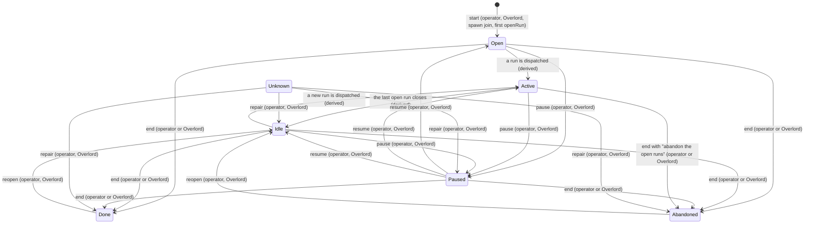

# Programme lifecycle: one end fact, derived activity, joined at spawn, ended by decision (design)

Date: 2026-11-24. Plan: `docs/superpowers/plans/2026-11-24-programme-lifecycle.md` (D-8983..D-8993, issued).
Read against `origin/main` at `6965b6d83`; the seams R11 touches re-read at `fffa89aba`. Context: Coordination
(programmes, runs, coordinators, the ledger doors).

This spec says what a programme is, which states it can be in, who owns it, who moves it between states, what each
move records, and what the console shows at each state. It is written so that a reader can answer, for any programme
on any day: why does it read what it reads, who leads it, who put it there, and when.

## 1. The operator's rulings of 2026-11-24

| # | Ruling | Overturns |
|---|---|---|
| R1 | Every coordinator joins a programme at spawn. Every session the operator starts, by any route, is a coordinator (spec 2026-10-17 §8, D-5301; D-8142). It joins the programme picked at creation, or a provisional one that it files into the right business objective on its first turn. A new objective gets a new programme. | D-8142's conditional "when your work belongs to a programme" in the start card; spec 2026-10-17 §8's "coordinator-ness is derived from claims" (the lighter run kind stays out of scope: a binding replaces the need for it) |
| R2 | A programme is a business objective that can hold diverse work. It is not one feature, one code change or one session. No rule ties one session to one programme. (Its last sentence is overturned by R11.) | — |
| R3 | The Overlord can start and end programmes, as the operator can. Amended the same day: the Overlord has every programme act the operator has, at maximum autonomy, with no acknowledgement queue or other admin burden for the operator; the history records its acts like anyone else's. | — |
| R4 | The coordinator proposes an end, with evidence against the definition of done; the operator or the Overlord confirms it. An end is a decision with a recorded reason, never a side effect. The auto-retire at zero open runs goes. A finished run moves the programme to Idle, not Done. | D-51 (the auto-retire); the coordinator's `plan close` as an end (skill clause 22) |
| R5 | States: Open (a coordinator exists, nothing dispatched yet); Active (has an open run); Idle (not ended, nothing running); Paused (the operator's hold); Done and Abandoned (only by decision; the operator can reopen). | D-26's "exactly one `active` row" reading of `soleActiveCoordinator`; D-8558's "NOT `programs.state`" in `programmeLive` |
| R6 | No Waiting-on-you item for an idle programme. The console makes idle programmes easy to jump to. | The `PROGRAMME_ENDED_SENTENCE` rule (a tick is refused whenever no run is open) |
| R7 | A coordinator that exits does not end its programme. The programme shows "no coordinator", and it can be handed to a new coordinator or ended. | — |
| R8 | Each programme's page tells its whole story: its start (when, by whom), every state change (who, why), its waves, its end. | — |
| R9 | The backfill is decided programme by programme by the operator: 13 programmes with open runs become Active, 4 stay Paused, 6 become Idle, 32 Done, 1 Abandoned. The per-programme list is operator data, applied from a private file or a console act, never committed. Live coordinators with no programme get one through the spawn rule or a one-time pass over live sessions; exited sessions are left alone. | — |
| R10 | The role code's `plain` role conflicts with R1 and is aligned with it. | Overlord spec 2026-11-09 §3.3.9's `plain` row, and W1a's "auto memory for plain sessions" Settings row |
| R11 | (2026-11-24) Coordinators manage long-term context well enough for one coordinator to own a programme and for a programme to be owned by one coordinator: a 1:1 relationship. At any one time a live programme has exactly one coordinator, and a coordinator owns exactly one live programme. A coordinator whose programme has ended may be given a new one, still one at a time. There are no members. | This spec's earlier design choice "one lead and any number of members" (`programme_members`, D-8986 as first written); R2's "no rule ties one session to one programme" |

## 2. What `main` does today (measured)

Measured on the fleet on 2026-11-24: 57 programme rows, the reserved `linear-sync` row (migration 59, always present)
among them, 1 with `planEnd` set, 8 reading `done` or `abandoned` while they hold open runs.

- **Two "ended" facts with two writer sets.** `programs.state` is written by the D-51 auto-retire in
  `CoordStore#closeRun` (`done`, or `abandoned` when the closing run failed, whenever the open-run count reaches 0) and
  by `ledgersRoutes.ts#endProgrammeByOperator`. `programs.planEnd` is written by `planStore.ts#closePlan`, from the
  coordinator's `POST /api/programmes/:slug/plan/close`, the operator's end act and the Linear migration put-back.
  Gates read `planEnd` (`programmeLive`, `planGate`, the timer lanes, the close lanes); Linear and
  `soleActiveCoordinator` read `state`. A programme can read `active` with its plan closed, and `done` with a wave open.
- **Nothing moves a programme back.** `openRun` inserts with `ON CONFLICT(slug) DO NOTHING`, so a programme retired by
  D-51 stays `done` when its next wave opens. That is the 8 rows above.
- **No programme exists at spawn.** No create route, no kickoff and no ccd verb writes a `programs` row. A row first
  appears at `openRun` or at `plan put`.
- **No coordinator fact.** A programme's coordinator is derived from its runs' `claimedBy`, whose one writer is
  `CoordStore#reclaimProgram` (reached from the reclaim door and from D-8199's `reclaim.ts#moveClaims`, the archive and
  stop doors' hand-over and release). With no open run, nothing names one, `claimsProgramme` answers no, and the end act
  and ticks are refused. `runs` stores `claimedBy` only: the `claimedByUuid` a `POST /api/runs` sends is checked
  against the registry at open (D-5298) and not kept.
- **One direction of 1:1 only.** `openRun` refuses a second claimant for a programme (`claimed-by-another`, read from
  the programme's lowest claimed run), so one programme has one claimant. Nothing stops one session claiming runs in
  several programmes. Measured read-only on the live server's `coord.db` on 2026-11-24: 43 open runs in 13 programmes,
  claimed by 12 sessions; no programme's open runs have two claimants, and **1 session claims open runs in two
  programmes**. So 11 programmes pair with one session unambiguously, and 1 conflict (2 programmes) breaks R11.
- **Idle reads as ended.** A tick is refused when no run is open; the PWA's `programmeIsLive` marks such items ended;
  the portfolio drops the programme; the Programmes card folds it under "Finished" seven days after its last close.
- **No history.** `run_events` covers runs. Who started a programme, and who changed its state, is not recorded.
- **The system writes `paused` too.** Migration 59 seeds the reserved `linear-sync` row `paused`, and the Linear
  migration creates a backlog programme `paused` (`applyPlanChangesInTx`'s `newRow`).
- **The `plain` role.** `roleOf` answers `plain` for a non-child session that claims no open run and declared no
  intent, and `PROFILE_OF_UNDECIDED` maps an unmeasured reading to `plain`.

## 3. The model: decisions are stored, activity is derived

**Stored, one writer each** (the writer is `server/src/coord/programmeLifecycleStore.ts`, L3, called inside the
store's transactions; nothing else in the tree writes these columns or tables, a census test pins it, and the one
named exemption is the migration's own SQL in `schema.ts`):

| Fact | Column | Values | Written by |
|---|---|---|---|
| The decision state | `programs.state` (existing) | `active` (live: not held, not ended), `paused`, `done`, `abandoned`, and `unknown` (an existing member of `ProgramState`); any other stored value is out of vocabulary | `decideInTx` |
| The end's record | `programs.planEnd`, `planEndWhy`, `planEndAt` (existing) | set by an end, cleared by a reopen, in the same transaction as the state; `planEnd` always equals an ended `state` | `decideInTx` |
| The coordinator (the owner) | `programs.coordinator`, `coordinatorUuid`, `coordinatorSince` (new) | a session id with the uuid of its incarnation, or null; null on every ended programme and every filed or withdrawn placeholder; a uuid null only on a binding the migration seeded, until the first registry pass measures it (§13). A partial unique index on the expression `(coordinator, IFNULL(coordinatorUuid, ''))` where `coordinator` is not null makes a second binding of one incarnation a constraint failure (R11); the `IFNULL` is there because SQLite treats NULLs as distinct in a unique index, so two null-uuid bindings of one session id collide too. The index is checked per statement, so every path that moves a session from its placeholder to a real programme clears the placeholder's binding first, in the same transaction | `bindCoordinatorInTx` |
| A pick at creation | `programme_picks` (new): `session`, `program`, `at` | the programme a create route was asked to start a coordinator for, until the join completes or it expires | `pickInTx` |
| Placeholder | `programs.placeholder` (new, TEXT, null for a real programme), `programs.filedInto` (new) | `unfiled`, `filed` (with `filedInto`), `withdrawn` | `mintInTx`, `fileInTx` |
| The story | `programme_events` (new, append-only, never deleted) | one row per decision, mint, coordinator change, filing, withdrawal, end proposal, coordinator exit; a coordinator change carries the incoming session and uuid in its `session` and `sessionUuid` columns, and so does a migration event that names a claimant (§13), which is what "this incarnation has been a coordinator" is read from (§7) | every writer above, in the same transaction |

`CoordStore#setProgramState` and `planStore.ts#closePlan` stop being writers: they become private steps of
`decideInTx`, or are deleted. `openRun`, `applyPlanChangesInTx` and `reconstruct` create rows only through `mintInTx`.

**One coordinator fact, one path.** The binding is the programme's coordinator; a run's `claimedBy` is that run's
claimant. `CoordStore#reclaimProgram` stays their one mover: it becomes keyed on the programme (its run id argument
resolves to the run's programme, as today), moves `claimedBy` on every claimed run of the programme, finished ones
included, exactly as it does on `main` (D-8199 chose that so no finished row keeps naming a displaced session), and
calls `bindCoordinatorInTx` in the same transaction; for a programme with no claimed run it moves the binding alone.
The hand-over door, the reclaim door, `moveClaims` (hand-over and release) and a takeover of a programme whose
coordinator is measured absent (a pick or a filing, §7) all go through it, so a run's `claimedBy` always equals the
binding; a release clears both. Who led each wave stays readable from the `coordinator` events and reclaim's existing
`run_events` attribution rows, not from `claimedBy`. The heir rule is reclaim's own (D-3012, D-3028), never a second
one; R11 adds one rung to it (rule 4 below).

**The ladder, keyed on the programme.** `reclaim.ts#reclaimRun` is keyed on a run id today: rung 1 refuses
`unknown-run`, rung 2 `no-claimant`, rung 3 `heir-is-a-worker` (with the Overlord-body refusal and the measured
`coordProject` stamp beside it) and rung 4 `claimant-alive` unless the caller passes `displacing` (D-8199). It becomes
`reclaimProgrammeTo(slug, heir, opts)`, with the run-keyed door resolving its run to the programme first, and each
caller's rungs are stated, never implied:

| Caller | Rung 1 | Rung 2 | Rung 3, Overlord-body, `coordProject` | Rung 4 `claimant-alive` | R11 rung |
|---|---|---|---|---|---|
| The reclaim door (`POST /api/runs/:id/reclaim`, ungated, D-282) | `unknown-run` | asked | asked | asked: it stays the door's guard | asked |
| The hand-over door (operator, Overlord) | `unknown-programme` | skipped: a programme with no binding and no claimed run is a binding-only move | asked | skipped, as `displacing` names the current coordinator: a hand-over is the decision to take the programme off a live one, recorded with its why behind a step-up (the Overlord: its rung cell). The displaced session is mailed "<programme> was handed to <heir>: its runs are no longer yours" | asked |
| `moveClaims` (archive and stop doors) | as today | as today | as today | skipped through `displacing`, as today | asked (hand-over only; a release names no heir) |
| A pick or a filing (§7) | `unknown-programme` | skipped, as the hand-over | asked | asked as the coordinator line: only `no-coordinator` is taken | asked |

A join (§7) whose ladder refuses after `joinDecision` answered `join-picked` drops the pick and is treated as
`pick-taken`: the sweep mints the placeholder and its mail names the refusal, so a refused pick never loops.

**Ownership: one coordinator, one programme (R11, D-8993).** In plain sentences, these are the whole rules:

1. A live programme (not Done, not Abandoned) has at most one coordinator. A coordinator owns at most one live
   programme. An ended programme is owned by nobody. There are no members: a session either owns the programme or has
   nothing to do with it.
2. Owning is the binding (`programs.coordinator` with `coordinatorUuid`), and nothing else. A run's `claimedBy` follows
   the binding; a session id reused by a new incarnation (another uuid) owns nothing.
3. A session becomes a programme's coordinator in exactly these ways: it is started with that programme picked, and the
   programme has no live coordinator (§7); it is given a placeholder at spawn (§7); it files its placeholder into a
   programme with no live coordinator, or as a new programme (§7); it opens the first run of a programme that does not
   exist yet, while it owns only its unfiled placeholder or has never been joined (§5, start by first run); the operator
   or the Overlord starts a programme naming it, or hands a programme to it (§5); the reclaim door, or an archive or stop
   door's hand-over, names it the heir (§9).
4. A session that already owns a live real programme, or claims an open run in a programme it does not own (a migration
   conflict's party, §13), cannot be given another one: every way in rule 3 refuses `owns-another-programme`, naming
   that programme, and the partial unique index stops any path this list forgot. An unfiled placeholder does not count
   here: when its coordinator takes a real programme, the placeholder's binding is cleared first and the placeholder is
   filed into it (a new programme the session started) or withdrawn (a programme it was given), in the same
   transaction. The one exception is the conflict's own resolution: the hand-over door may give a conflict's party one
   of the programmes whose runs it holds (§13).
5. A programme that has a live coordinator cannot be given another one except by a hand-over, which takes it off the
   first (§5). Picking it when starting a session, or filing into it, is refused `programme-has-coordinator`, naming
   the coordinator, and nothing else changes owner. "Live" is the coordinator line's `led`, or open runs claimed by a
   registry-present session that is not the binding (a migration conflict, §13: the refusal names that claimant); a
   programme whose line is `no-coordinator` and whose open runs no present session holds can be taken, and one whose
   line is `unmeasured` is refused `coordinator-unmeasured` with nothing written, never guessed either way.
6. A coordinator stops owning its programme when the programme is handed to another session, when the programme ends,
   or when the operator releases it (the archive or stop door's release). It is never given a new programme
   automatically, and it cannot take one itself: opening the first run of a new programme is refused
   `not-your-programme` ("you own no programme now"). It is shown as a **coordinator with no programme**, and the
   operator or the Overlord archives it, starts a programme naming it, hands it one, or starts it again with a programme
   picked (a revival, §7).
7. A coordinator that exits keeps its binding (R7): the programme shows "No coordinator" until it is handed over, picked
   by a new session, or ended.
8. Opening a run never changes who owns a programme, with one exception, the first run of a programme that does not
   exist yet (rule 3). Only the programme's coordinator opens runs in it.

**What "open run" means**, one vocabulary for every guard in this spec: a run whose state is not terminal
(`TERMINAL_RUN_STATES`, the store's existing `TERMINAL_RUN_STATES_SQL` predicate, which `programOpenRunCount` reads).
`planned`, `awaiting-review`, `merging`, `closing` and `unknown` runs are open. The dispatch cap's
`ACTIVE_RUN_STATES` is a different question (who holds a fleet slot) and is not used here.

**Derived, never stored.** One pure L0 function, `shared/programmeLifecycle.ts#lifecycleOf` (a new file: `shared/api.ts`
is at its growth cap), is the only place the shown state is decided. Every server read and the PWA call it.

```
lifecycleOf(stored, placeholder, runs) where runs = { open: count of open runs,
                                                     dispatched: some run of the programme has a run_events row
                                                                 whose toState is `dispatched` or `working` }
```

`dispatched` reads `run_events`, not `runs.dispatchedAt`, because a resumed dispatch leaves that column null.

| Stored `state` | `runs.open` | `runs.dispatched` | Shown lifecycle |
|---|---|---|---|
| `active` | > 0 | yes | **Active** |
| `active` | any | no | **Open** |
| `active` | 0 | yes | **Idle** |
| `paused` | any | any | **Paused** (with "n runs still open" when `open` > 0) |
| `done` | any | any | **Done** |
| `abandoned` | any | any | **Abandoned** |
| `unknown`, or out of vocabulary | any | any | **Unknown** (shown as unreadable, never as live or ended) |

A placeholder that is `filed` or `withdrawn` has no shown lifecycle: it is listed nowhere and counted nowhere, and its
page redirects to the target (filed) or shows its story (withdrawn). The reserved `linear-sync` row
(`LINEAR_SYNC_PROGRAMME`) is not a programme: every lifecycle read, list, count, the migration and the backfill skip
it by that one constant.

So wave N+1's `planned` run, opened before wave N closes, keeps the programme Active, and a programme whose only runs
were planned and never dispatched (including one whose planned run was abandoned) shows Open. `isEnded(stored)` (`done`
or `abandoned`) is the one end predicate; every gate that read `planEnd` reads it instead.

**Why Idle is derived.** The runs are its only witness. Storing it would need a second writer inside `openRun` and
`closeRun`, which is the D-51 drift: a stored state that stops matching the runs. Derived, it cannot drift, and the 8
stuck rows read correctly the moment their stored state is a decision again (§13).

**The coordinator line** is derived by `coordinatorLineOf(binding, registry)`: `led` (the bound session is present in
the registry with the bound uuid, or with any uuid while a migration-seeded binding's uuid is still null, and is not
archived), `no-coordinator` (no binding; the session id is absent from the
registry; its row carries another uuid, which is a new incarnation; or it is archived, so it cannot take mail until
restored), or `unmeasured` (the registry or the row's uuid could not be read, or the row is mid-swap or mid-roll in the
registry lane's existing carry reading). `unmeasured` is never folded into `no-coordinator`. Hibernated and held rows
are present: they take mail when idle, as today.

**Open means a coordinator exists** (R5) for every start path that names one: the start door naming a session, the
spawn mint, the first run and a filing as a new programme bind it in the start's own transaction (§5). Three starts do
not, and say so rather than bending R5 silently: the operator's start sheet, whose programme is unbound until the join
sweep completes its pick (two registry passes, §7); the Linear backlog mint, which is Paused, not Open; and
`reconstruct`, which has no claimant to bind. Each shows the "No coordinator" line until it is bound, exactly as a
programme whose coordinator later exits (R7's case, not a different state).

## 4. The states



Resume, reopen and a repair to `active` write stored `active`; which of Open, Active and Idle the programme then shows is
the runs' answer. A reopened programme with no dispatched run shows Open, not Idle. An end (Done or Abandoned, by any
door, a repair included) releases the binding in the same transaction (R11 rule 6), so a reopened programme comes back
with "No coordinator" and is handed to one, or picked by a new session, before its next run opens. Done needs no open run, so a
programme holding only `planned` runs reaches Done after its coordinator closes or abandons them, and Abandoned through
`abandonRuns`.

## 5. Transitions: who, through which door, under which guard, and what is recorded

Every stored transition goes through `decideInTx`. A target equal to the current stored state writes nothing (which is
what makes a re-run of the backfill safe). Every row below that is not "derived" and not "pick" writes the
`programme_events` rows its last column names, in the same transaction. Every edge but `file`, `withdraw` and the coordinator exit refuses a
placeholder (`programme-provisional`). The credential each door takes is in §14.

| Edge | From → to | Who | Door | Guard (refusal code) | Recorded |
|---|---|---|---|---|---|
| start | none → Open | operator, Overlord | `POST /api/programmes {slug, title, why, coordinator?}` | slug free and well-formed (`slug-taken`); why required; `coordinator` names a live top-level session that passes R11 rule 4 (`owns-another-programme`, naming the programme; an unfiled placeholder it owns is withdrawn), or is absent only for the operator's start sheet, which records the pick for the session it starts next (§7; until the join sweep ships, the door refuses an absent `coordinator` with `coordinator-required`, so no start is left unbound with nothing to bind it); the Overlord must name one (`coordinator-required`) | row (`active`); event `started` (actor, why); event `coordinator` only when a session is named (a start-sheet start writes it at the join) |
| start (spawn) | none → Open | the join sweep (§7) | the sweep | §7's decision answers `mint-provisional` | row (`active`, `placeholder` `unfiled`); events `started` and `coordinator` |
| start (first run) | none → Open → Active | the coordinator | `POST /api/runs` (`openRun`) on a slug that does not exist yet | today's guards; the claimant passes R11 rule 4 (`owns-another-programme`, naming the programme it owns or whose open runs it claims); the claimant owns its unfiled placeholder or has never been joined (§7), else `not-your-programme` ("you own no programme now", R11 rule 6) | row (`active`); event `started`, actor the claimant, why "first run opened"; the claimant is bound (event `coordinator`); its unfiled placeholder, if any, is unbound and filed into the new programme (event `filed` on both rows) |
| pick | (no change until the join) | operator | `POST /api/sessions {programme}`, `POST /api/projects/:project/workspaces {programme}` (not a child), the start sheet | real, not ended (`programme-ended`), not a placeholder (`programme-provisional`); not led by R11 rule 5's reading, and no unexpired pick (`programme-has-coordinator`, naming the coordinator, the claimant or the pick's session, which the console then opens instead of starting one); line not `unmeasured` (`coordinator-unmeasured`); on a revival of an existing registry row, that session passes R11 rule 4 (`owns-another-programme`) | a `programme_picks` row reserved before the start and keyed by the session id ccd answers (§7); dropped at once if the start fails; nothing on the programme until the join sweep binds the session |
| dispatch | Open/Idle → Active | derived | `openRun`, `advance` | `openRun` refuses an ended (`plan-closed`, the existing code, its words now "the programme has ended"), paused (`programme-paused`), unknown (`programme-unknown`) or placeholder (`programme-provisional`) programme; a claimant that is not the bound coordinator: `claimed-by-another` (today's code, naming the coordinator) when a binding names someone else, measured absent included, and `not-your-programme` (the ledger doors' existing code) when the programme has no binding, so a free programme is taken first by a pick, a filing or a hand-over, never by a run (R11 rule 8) | nothing new: `run_events` records the run; an open end proposal is withdrawn in the same transaction (system, why "run <id> opened") |
| run closes | Active → Idle | derived | `closeRun` | — | nothing new: `run_events` records the close; no programme write (D-51 deleted) |
| pause | Open/Active/Idle → Paused | operator, Overlord | `POST /api/programmes/:slug/state {edge:'pause', why}` | not ended (`programme-ended`); not unknown | `state` `paused`; event with why; open runs keep running |
| resume | Paused → live | operator, Overlord | same door, `edge:'resume'` | was paused (`not-paused`) | `state` `active`; event with why |
| propose end | (no change) | the bound coordinator | `POST /api/programmes/:slug/end-proposal`, and `plan close` (§8) | caller is the bound coordinator (`not-coordinator`); not ended; no open run (`programme-runs-open`); no open proposal (`already-asked`); evidence given (`evidence-required`) | an `operator_items` decide row, `action:'end-programme'`; event `end-proposed` with outcome, evidence, item id |
| confirm end | Open/Idle/Paused → Done or Abandoned | operator, Overlord | `POST /api/items/:id/act {programme}` on the proposal | proposal open; no open run (`programme-runs-open`, and the proposal stays open) | `state`, `planEnd`/`planEndWhy`/`planEndAt`; the binding released (R11 rule 6); item closed; event `ended` with outcome, why, evidence, item id and the coordinator it released |
| decline end | (no change) | operator, Overlord | `POST /api/items/:id/decline` | proposal open | item closed; system mail to the coordinator bound at that moment (none when there is none: the decline stays in the history); event `end-declined` with why |
| withdraw proposal | (no change) | the bound coordinator | `POST /api/items/:id/withdraw` (the existing coordinator door) | proposal open | item closed; event `end-withdrawn` |
| end (direct) | Open/Idle/Paused → Done or Abandoned; Active → Abandoned | operator, Overlord | `POST /api/programmes/:slug/state {edge:'end', outcome, why, abandonRuns?}` | why required; open runs refuse (`programme-runs-open`) unless `abandonRuns:true`, which ends them first through the abandon door's own decision on the coordination serialiser, and then the outcome is always Abandoned | as confirm (the binding released), plus each abandoned run's own `run_events`; an open proposal is closed with the end |
| archive end | as direct end with `abandonRuns`, outcome Abandoned | operator, Overlord (its new archive row, §10) | `POST /api/sessions/:id/archive {programme:'end'}` | today's archive guards | as direct end, why "archived with programme end" |
| reopen | Done/Abandoned → live | operator, Overlord | `POST /api/programmes/:slug/state {edge:'reopen', why}` | was ended (`not-ended`) | `state` `active`; `planEnd` fields cleared; no coordinator (it was released at the end); event `reopened` with why and the end it reverses |
| repair | Unknown → `active`/`paused`/`done`/`abandoned` | operator, Overlord | `POST /api/programmes/:slug/state {edge:'repair', to, why}` | stored value is `unknown` or out of vocabulary (`not-unknown`); `done` and `abandoned` follow the end's guards | `state` (and `planEnd` fields for an end); event `repaired` with the unreadable value in `detail` |
| hand over | (no change) | operator, Overlord; the reclaim door; `moveClaims` | `POST /api/programmes/:slug/coordinator {session, why}`; `POST /api/runs/:id/reclaim`; the archive and stop doors | not ended; the heir passes reclaim's heir rule as §3's ladder table states it per caller, whose new rung is R11 rule 4 (`owns-another-programme`, naming the programme; an unfiled placeholder it owns is withdrawn instead; a conflict's party may be given a programme whose runs it holds, §13); all through `CoordStore#reclaimProgram` (§3) | binding and every claimed run's `claimedBy` together; event `coordinator` with from, to, why; the previous coordinator, if live, is mailed and now owns nothing and is shown as a coordinator with no programme (R11 rule 6); an open end proposal stays open and now names the heir |
| file | placeholder → target | the placeholder's coordinator; operator or Overlord (re-file) | `POST /api/programmes/:slug/file`; `POST /api/programmes/:slug/refile` | placeholder `unfiled` (`not-provisional`); `{into}` names a live real programme; `{name, title}` takes a free slug; `{into}` a programme whose coordinator line is `unmeasured` is refused `coordinator-unmeasured` with nothing written | `{name, title}`: a new programme it owns, `started` and `coordinator` on it. `{into}` a programme with no coordinator, or one measured `no-coordinator` whose open runs no present session holds: the session becomes its coordinator (bound through `reclaimProgram`, which moves any claimed runs to it), event `coordinator` with why "filed from <placeholder>". Either way the placeholder's binding is cleared first, then `placeholder` `filed` with `filedInto`, in one transaction, and event `filed` on both rows. `{into}` a programme led by R11 rule 5's reading: answered 409 `programme-has-coordinator`, naming the coordinator or the claimant, and in the same transaction the placeholder is `withdrawn` (why "its objective is led by <session>"); the answer's words tell the session to mail its work to that coordinator; it then owns nothing, and archiving it is the operator's or the Overlord's (R11 rule 6, never automatic) |
| withdraw placeholder | `unfiled` → `withdrawn` | operator or Overlord (re-file door, `{withdraw:true, why}`); the sweep | as file | placeholder `unfiled` | `placeholder` `withdrawn` and its binding cleared; event `withdrawn` with why; it is never ended, so it never counts as Abandoned |
| coordinator exit | (no change) | system | the registry measure (§9) | bound incarnation measured `no-coordinator` on two consecutive passes | event `coordinator-gone`, once per incarnation; `coordinator-back` if the same incarnation reads `led` again |

**What every event row holds** (`programme_events`): `id`, `program`, `at`, `edge`, `fromState`, `toState`,
`actorKind` (`operator`, `overlord`, `coordinator`, `system`, `backfill`, `migration`), `actor` (a session id, the
signed-in device, or `unmeasured`), `why`, `session` and `sessionUuid` (on a `coordinator` event, the incoming
coordinator, null for a release; on a migration's `migrated` event that names a claimant, that claimant with a null
uuid, §13; null on every other edge; indexed, because the join sweep asks them, §7), and `detail`
(JSON: evidence lines, item id, coordinator from and to, the placeholder or target slug, the migration rule or
conflict, `flag-off` when sign-in was dark). The actor and why are never null;
an act done while sign-in is dark records actor `unmeasured` and `flag-off` in `detail`.

## 6. What the console shows at each state

| Shown | Programmes list | Programme page | Waiting on you | Ticks and items |
|---|---|---|---|---|
| Open | under its chip, "Open: nothing dispatched yet"; "Unfiled" badge on an unfiled placeholder | goals, coordinator line, End and Pause buttons, history | the end proposal while one is open; nothing else | a tick mails the bound coordinator; with none it is refused `no-coordinator` with Hand to coordinator offered |
| Active | under its chip, current wave and runs as today | runs, waves, history | as today (runs' items) | as today |
| Idle | under the Idle chip, "Idle since <last close>"; the Fleet header's "n idle" links there | goals, last wave, coordinator line, End and Pause buttons, history | the end proposal while one is open; **nothing for idleness** (R6) | a tick mails the bound coordinator (no longer refused); with none, `no-coordinator` |
| Paused | under its chip, "Paused by <actor>: <why>" ("Paused while sign-in was off" for an `unmeasured` actor; "Paused by the Linear map: backlog" for a backlog row), plus "n runs still open" | Resume and End buttons, history | the end proposal while one is open | ticks mail the coordinator; runs cannot open |
| Done / Abandoned | folded under "Finished" (keyed on the decision, not on the last run's close) | the end's outcome, who, why, evidence; Reopen button | nothing | refused `programme-ended`; dismiss works |
| Unknown | shown with "state unreadable" and the stored value | Repair button, history | nothing | refused, with the stored value shown |

The Programmes screen has chips with counts: **Active · Idle · Open · Paused · No coordinator · Unfiled**, and a
Finished fold. "No coordinator" and "Unfiled" cut across states. The portfolio (`portfolioStore.ts`'s listing) keeps
every real programme that has not ended, Idle included, and no placeholder.

The **coordinator line** on every row and page: "Led by <session>" (`led`), "No coordinator" with **Hand to
coordinator** and **End** (`no-coordinator`), or "Coordinator unmeasured" (`unmeasured`, no actions offered on it).
While sign-in is dark those two buttons cannot act; the line then says "sign-in needed to hand over or end", and the
dark ways forward are the reclaim door (ungated, D-282) for a programme with open runs and, for one without, a session
the operator starts with this programme picked (R11 rule 3). A programme whose open runs are claimed by a session that
does not own it (a migration conflict, §13) says so on its line: "Open runs held by <session>, which also holds runs in
another programme: hand it over", with **Hand to coordinator**; a pick of it is refused, naming that session.

Below the list, **Coordinators with no programme** (R11 rule 6): every live, settled coordinator whose incarnation owns
no live programme and has been a coordinator before (handed over, its programme ended, its placeholder withdrawn, or
released), each with why it has none and since when, and three acts: **Start a programme** (the start door naming it),
**Hand it a programme** (the hand-over door from a programme's side) and **Archive** (the existing archive door). A
coordinator that is a migration conflict's party is listed in that conflict, not here. Nothing on this list is
archived or given a programme automatically.

**Starting a session on a programme** (the create sheet and the start sheet): the picker shows each programme's
coordinator line. Picking a programme that is led (R11 rule 5's reading) does not start a session: the route answers
`programme-has-coordinator` naming the coordinator or the claimant, and the console opens that session instead, with
"<programme> is led by <session>; opened it". Picking one with "No coordinator", or none, starts the session, and it
becomes the coordinator when it is joined (§7). Picking an `unmeasured` one is refused with "could not tell whether
<programme> has a coordinator; try again".

## 7. Joining at spawn (R1)

**Who joins** is §12's rule, not a second list: a registry row joins when `roleOf` answers `coordinator` for it (not a
child, not the Overlord, not an auditor, not a replay). A held or hibernated coordinator joins too; joining writes only
server rows and acts on no session.

**The decision** is L1, `server/src/coord/programmeJoin.ts#joinDecision(row, history, pick)`. Its inputs are
measured by the sweep:

- **A settled spawn**: the row's uuid is present, and the sweep has seen the same session id and uuid with no `.child`
  marker on two consecutive passes. `ccd ws-add` writes the registry row before `.child`, and that write is warn-only
  on failure, so a single pass cannot tell a dispatched worker from a coordinator. An unreadable uuid or marker
  answers `skip unmeasured`.
- **History**: whether this incarnation (session id and uuid) has ever been joined, which is: a programme's binding
  names it now (by id alone while a migration-seeded uuid is null), or a `coordinator` event ever named it as the
  incoming coordinator, or a migration `migrated` event named it as a claimant (`programme_events.session`,
  `sessionUuid`; a null `sessionUuid` matches by id alone). A later incarnation reusing such an id is then read as
  joined and listed as a coordinator with no programme rather than minted one: the safe direction, since a
  placeholder the operator did not ask for is what rule 6 rejects. And whether it is the `claimedBy` of an open run.
- **The pick's programme**, re-measured at the join: R11 rule 5's reading, and whether it is still real and live.

The answer, in this order: `skip <reason>` (not a coordinator, not settled, unmeasured, or it claims an open run while
owning no programme: a migration conflict's party, §13, which the operator resolves); `join-picked <slug>` (a pick
exists for this session, its programme is real, live and not led by anyone else, and the session owns no live real
programme; a pick completes for a session that has been joined before and owns nothing, because a pick is the
operator's explicit act, not the automatic gift rule 6 rejects); `pick-taken <slug>` (the pick's programme gained a
coordinator, a claimant or an end since the pick, or the ladder refused, §3); `already-joined` (it has ever been
joined, and no pick for it stands); `mint-provisional` (otherwise). `skip` on an `unmeasured` pick line waits for the
next pass. `pick-taken` for a session that has been joined before mints nothing: the pick is dropped and the
session stays a coordinator with no programme, told why by mail.

Keying on "this incarnation has never been joined", not on what it owns now, is what keeps the join once per
incarnation (R9's one-time semantics): a coordinator that handed its programme over, whose programme ended, or whose
placeholder was withdrawn is never minted a new one; it owns nothing and is listed as a coordinator with no programme
(§6) for the operator or the Overlord. A reused session id with a new uuid is a new incarnation and is joined.

**The act** is L4 and has one site, the join sweep. The create routes only record a pick:

| Route | What changes |
|---|---|
| `POST /api/sessions` (`server.ts`) | optional `programme` in the body (additive); before the `CcdArgv` start, the route asks §5's pick guard and either refuses (`programme-has-coordinator` naming the coordinator, which the console opens; `coordinator-unmeasured`; `programme-ended`; `programme-provisional`; `owns-another-programme` on a revival of a row that owns one) and starts nothing, or `pickInTx` reserves the pick with no session id, so a second pick of the programme is refused while the start runs. On ccd's answer the route keys the reservation by the session id ccd started (a plain `ws-add` carries no id until ccd chooses it; a revival is its `knownId`); a start ccd refuses drops the reservation at once, so a failed start blocks nothing |
| `POST /api/projects/:project/workspaces` when not a child | the same field, guard and record |
| The start-programme sheet | passes its picked slug in the body; the kickoff stays mail-only |
| The join sweep | completes a pick, or mints, for every settled live row the decision answers; it is how `ccd start` by hand, `cc <wrapper> <project>` and a hand-run `ccd ws-add` are joined. It acts on live registry rows only, so exited sessions are left alone |
| `ccd supervise` resume, a swap, a roll | nothing: the session id and uuid are kept, so the binding is kept |
| Dispatched children | nothing: a child is a worker or reviewer, never a coordinator |

No ccd verb is added; the server writes the rows. The sweep extends the existing lane that re-measures the registry
for the coordination store (the plan names it after measuring; a second poller needs a recorded reason). A pick
expires after one hour unjoined, and a reservation that ccd's answer never keyed expires after the route's own start
deadline; an expired pick is dropped with no event.

**Joining means becoming the coordinator (R11).** There is no other kind of join. `join-picked` binds the session to
the picked programme through `reclaimProgram` (§3's ladder, pick row), so any claimed runs move to it with the binding
(event `coordinator`, why
"picked at start", plus "previous coordinator measured absent" when the binding named one). Clause 8's one coordinator per programme stands, and now holds
in both directions.

**Minting.** On `mint-provisional`, the sweep mints a placeholder `p-<base36 ms>` (never the session id), stored
`active`, `placeholder` `unfiled`, and binds the session to it, so it shows Open and Unfiled. On `pick-taken` for a
session never joined before, it mints the same way, and the join mail adds "<programme> is now led by <session>: mail your work to it, or file this
placeholder into another objective"; the operator, who picked, sees the same on the session. Every join queues one
system mail naming the programme and whether it is a placeholder. When a session with an unfiled placeholder takes a
real programme by any way in R11 rule 3, the placeholder's binding is cleared first and the placeholder is filed into
it (a programme it started) or withdrawn (one it was given), in the same transaction.

**A child found late.** When a `.child` marker appears for a session the sweep joined, the sweep releases its binding
through `reclaimProgram` (event `coordinator` to none, why "the session is a dispatched child") and withdraws its
unfiled placeholder.

**The start card** (`ccd/session-hook.sh#_hook_role_card`) becomes unconditional for a coordinator: "You are the
coordinator of one programme, and the only one. Read it with `ccrc-api GET /api/sessions/<id>/programme`, then its
goals and definition of done. If it is provisional, file it on your first turn: into the business objective your work
serves, or as a new programme for a new objective. If that objective already has a coordinator, the filing is refused:
mail your work to that coordinator." For a coordinator with no programme, the read answers `none` with why (handed
over, ended, withdrawn, released), and the card and the mail that tells it say: "You own no programme now. The operator
or the Overlord will give you one or archive this session; open no runs until then." The card's existing suppressions are unchanged: card-off, a child, a held session (the hold card prints
instead) and a start whose anchor slot printed (the anchor replaces the role card). For those starts the join mail
carries the same sentence, so no coordinator depends on the card alone.

**Filing.** A placeholder exists only to be filed, so every write keyed by a programme slug refuses an `unfiled`
placeholder (`programme-provisional`) through one L1 predicate, `programmeWritable(row)`: `openRun`, `plan put`, the
ledger item doors, `/remaining`, `/spec`, `/calls`, `/modifications`, the portfolio rank and goals ratify, the state
and hand-over doors. A census test lists every slug-keyed write door and fails on one that does not ask it. So a
placeholder holds no run, plan, item, statement, pin or rank, and is never deleted: filing marks it `filed` with
`filedInto`, its events stay (the store is append-only), and the target's history reads its own events and those of
every placeholder filed into it. `{into: slug}` takes an existing objective that has no live coordinator; into one that
has, it is refused and the placeholder withdrawn, as §5's file row says. `{name, title}` mints a new one (`started`,
actor the coordinator, why "new objective filed from <placeholder>"), which the session owns.

## 8. Ending (R4)

- **The proposal.** `POST /api/programmes/:slug/end-proposal {outcome: 'done'|'abandoned', why, evidence[]}` takes the
  box token, then attribution, then ownership (`claimsProgramme`). `evidence` is required (`evidence-required` when
  empty). With a `doneWhen` pin, each pinned line is answered by an evidence entry or listed as "no evidence given";
  with no pin (a programme filed with `{name, title}`, a migrated row), the evidence is free lines and the item says
  "no definition of done was pinned", so the decider sees it. It raises an `operator_items` decide row with
  `action:'end-programme'`, modelled on `endRequest.ts`: its why is the coordinator's case, its how is the evidence
  against the pinned definition of done, and its two options are "End the programme" and "Keep it open". This is the
  one Waiting-on-you item the lifecycle raises: it asks for a decision, not for attention to idleness.
- **`plan close` becomes a proposal.** `POST /api/programmes/:slug/plan/close` raises the same proposal with the
  close's own outcome (`parsed.close.outcome`, `done` or `abandoned`), its why, and its `evidence[]` (a new body field,
  additive, under the same `evidence-required` rule). It no longer writes `planEnd`. Skill clause 22 changes from "the
  programme ends with `plan close`" to "the programme's end is proposed with `plan close`, with evidence against the
  definition of done; the operator or the Overlord confirms it".
- **The proposal belongs to the programme, not to the proposer.** A hand-over keeps it open and names the heir on it; a
  decline mails whoever is bound when it is declined, or nobody, and the history keeps it either way; the bound
  coordinator may withdraw it (the existing `POST /api/items/:id/withdraw`) and propose again. A run opened while it is
  open withdraws it in `openRun`'s transaction, as the end-request mender settles an end request whose run moved on.
  Confirm re-checks "no open run" and refuses while one is open, leaving the item open.
- **Who decides.** The operator always; the Overlord when it is at the `full` rung (§10). Below `full`, or with the
  Overlord off, a proposal waits on the operator alone, and the item says so.
- **Confirm and decline** are the existing item doors. Confirm runs `decideInTx` (`ended`), which releases the binding
  (R11 rule 6): the coordinator that proposed the end owns nothing afterwards and is told so by system mail; decline
  mails through the existing system mail.
- **Direct ends** by the operator or the Overlord take the state door (§5); an end over open runs names
  `abandonRuns:true` and is always Abandoned. Nothing ends a programme as a side effect of anything else.
- **The archive door's `{programme:'end'}`** calls `decideInTx` explicitly (Abandoned, "archived with programme end")
  after abandoning the open runs, where today it relied on D-51.
- **Linear.** `planPolicy.ts#programmeEnd` reads the decision: Done syncs as the Linear end it maps `done` to today,
  Abandoned as the one it maps `abandoned` to, and a live state syncs as not ended, so a reopen syncs back. Its
  `state === 'done'` inference from epics goes (that was D-51's reading). The Linear migration put-back calls
  `decideInTx` with actor kind `system` and the map's reason, and a backlog programme it creates is minted `paused`
  through `mintInTx` with actor kind `system`, actor the map and why "backlog": a hold like any other, which the
  operator or the Overlord resumes when its first wave is wanted.

## 9. The coordinator binding (R7)

- **One fact, both directions (R11).** `programs.coordinator` with `coordinatorUuid` names the programme's coordinator,
  and the same binding is the coordinator's one programme: `programmeOf(session, uuid)` reads it from the other side
  (at most one live row, by the partial unique index). `claimsProgramme(session, slug)` reads the binding and compares
  the caller's attributed uuid as the attribution gate compares `claimedByUuid` today (D-5298), so a reused session id
  owns nothing; a migration-seeded binding with a null uuid compares the id alone until the registry lane stamps the
  uuid it measures (§13). `openRun` never binds, except the first run of a programme that does not exist yet (R11
  rule 3), and refuses a claimant that is not the coordinator: `claimed-by-another` (the code, and every skill text and
  `nestFleet.ts` word that names it, stay) when the binding names another, `not-your-programme` when there is none.
- **Moves.** Only `CoordStore#reclaimProgram` moves it between sessions (§3), from the hand-over door, the reclaim
  door, `moveClaims`, and a pick or filing that takes over a programme measured `no-coordinator` (§7), each through §3's
  ladder table. Reclaim's heir rule gains one rung, R11 rule 4: an heir that owns another live real programme, or claims
  an open run in one it does not own, is refused `owns-another-programme` (its unfiled placeholder is withdrawn
  instead). `bindCoordinatorInTx` itself is called from a closed list, pinned by a census: `reclaimProgram`, `mintInTx`
  (the spawn mint, the first run and a filing as a new programme), `fileInTx` (clearing a filed or withdrawn
  placeholder's binding: every withdraw path calls it, the re-file door's withdraw, the led-programme refusal, the heir
  and start paths that take a session off its placeholder, and the child found late), `decideInTx`'s end release, the
  registry lane's uuid stamp and seeded-binding release (§13), and the boot re-measure (§15). A release (`moveClaims`'s release choice) clears the binding with the claims, and an end clears
  the binding (§4); the next coordinator then takes the programme by a pick, a filing or a hand-over, never by opening a
  run. Every move and release that leaves a live session owning nothing tells it by one system mail ("You own no
  programme now", §7), and it is listed as a coordinator with no programme (§6).
- **Exit.** A coordinator that exits writes nothing to the programme's state. The coordinator line derives
  `no-coordinator` (§3). The registry lane writes one `coordinator-gone` event per bound incarnation, after two
  consecutive passes read it `no-coordinator` (a swap or roll reads `unmeasured`, never absent), and `coordinator-back`
  if the same incarnation reads `led` again (an archive restored).
- **Mail.** `soleActiveCoordinator` resolves `toId:'coordinator'` mail with no run id to the bound coordinator of the one
  programme that shows Active, and to nothing when zero or several do. That keeps D-26's intent (an unambiguous
  answer, no guessing) on the derived state. Opening wave N+1's `planned` run before closing wave N keeps the
  programme Active (§3), so that rule still protects run-less mail.
- **The kept-worker rule** on the unmerged branch that keeps a worker in its programme's box (D-8980..D-8982)
  reads `isEnded(state)` for "a done or abandoned programme keeps no one", whichever of the two lands second.

## 10. The Overlord (R3)

- A new cell in `shared/overlord-ladder.ts#RUNG_CELL_MAP`: `programme-lifecycle: {chat:'refuse', advise:'refuse',
  full:'allow'}`, the `link-team` pattern. That cell is the Overlord's whole permission for these acts, as the operator's
  sign-in is the operator's: no decision-model row is added.
- Rows in `server/src/coord/overlordDoors.ts` for every programme edge the operator has: start, pause, resume, end
  (direct), confirm, decline, reopen, repair, hand over, and re-file or withdraw a placeholder. Each records
  `actorKind:'overlord'`, the designated session and its why. So the Overlord can resolve a coordinator with no
  programme as the operator can: start a programme naming it, or hand it one. R11's rules bind the Overlord's doors
  exactly as the operator's.
- **An archive row** (new: `overlordDoors.ts` has no archive door on `main`): the Overlord archives a session through
  `POST /api/sessions/:id/archive`, under the same `programme-lifecycle` cell, for two cases only: a coordinator with no
  programme (it owns no live programme and claims no open run, re-measured at the act), and archive-end of a
  programme's coordinator (`{programme:'end'}`, §5). Today's archive guards apply unchanged; an archive of any other
  session stays the operator's.
- **The pick is the operator's, deliberately.** A pick starts a new session, which spends an account and a pane: that
  is a fleet act, not a programme act, and the Overlord has no session-start door. The Overlord gives a programme to an
  existing session instead (start naming it, or hand-over), so R3's "every programme act" holds without it.
- **No acknowledgement queue** (R3 as amended 2026-11-24: maximum autonomy, no unnecessary admin burden). An Overlord
  programme act is not written to the D-8126 call record and waits for no Seen. It is recorded in the programme's
  history (§11) with its actor and why, exactly as the operator's own acts are, and the history is where the operator
  reads it if and when they choose to.
- **No step-up for the Overlord.** The step-ups in §14 are the operator's sign-in check on the operator's own doors; the
  Overlord's door is gated by its rung cell alone. A coordinator still cannot confirm its own end: the confirm is the
  operator's or the Overlord's door, never a coordinator's.

## 11. The programme's story (R8)

`GET /api/programmes/:slug/history` (session-gated; the box token for the programme's own coordinator) merges
`programme_events` (the programme's own, and every placeholder's filed into it) with the programme's runs and their
`run_events` into one timeline, oldest first: start (when, by whom, from which route or placeholder), every coordinator change
(who led it from when, and why it changed), pause, resume, hand-over, filing, coordinator exit and return, end proposal, withdrawal, decline, end, reopen and repair
(who and why), and each wave (opened, dispatched, closed, by whom). The Programme page
(`pwa/src/ledgers/ProgrammeScreen.tsx`) renders it as a History section. Rows written by the migration or by the boot
re-measure (§15) say so.

## 12. The role code (R10)

- `server/src/roleOf.ts#roleOf` decides a top-level session's role from its markers: a session that is not a child,
  not the Overlord, not an auditor and not a replay is `coordinator`. `claimsOpenRun` and `declaredIntent` drop out of
  the decision. An unreadable child marker keeps today's handling.
- Removed: `ROLE_AMBIGUITIES['coordinator-or-plain']`, its `PROFILE_OF_UNDECIDED` arm, and `plain` from `FleetRole`
  and `FLEET_ROLES`. The card renderer and compaction text that auditor and replay reuse keep working: they are a
  renderer, not the role.
- A persisted reading of `plain` revives as `coordinator`.
- `POST /api/coord/plain-auto-memory` stays registered for one release and refuses `role-retired`; its Settings row
  goes. Its stored value stays readable for a rollback.

## 13. Migration and backfill (R9)

**The migration** (the next `coord.db` slot when the build PR lands; 123 is the newest on `main` today) refuses to
start rather than open empty, as every migration does, names no programme, and skips the reserved `linear-sync` row:

1. Adds `coordinator`, `coordinatorUuid`, `coordinatorSince`, `placeholder`, `filedInto`, the partial unique index on
   `(coordinator, IFNULL(coordinatorUuid, ''))` (§3), and the tables `programme_events` (indexes on `(program, at)` and
   `(session, sessionUuid)`) and `programme_picks`.
2. Writes one `started` event per row: `actorKind` `migration`, actor `unmeasured`, at `createdAt`, why "who started it
   was not recorded before this build".
3. Seeds a binding only for an **unambiguous pair** (R11): a programme that step 4's rule leaves live (the step runs
   after it, so an ended programme binds nothing) whose open runs are all claimed by one
   session, where that session claims no open run in any other programme. The binding takes that `claimedBy`, a null
   `coordinatorUuid` (`runs` does not store the uuid, §2), and one `coordinator` event. The migration never invents an
   owner: a session claiming open runs in two or more programmes binds to none of them, and a programme whose open runs
   two or more sessions claim binds to none; each such programme gets one `migrated` event per claimant naming the
   conflict (`session-in-several` or `programme-several-claimants`, the claimant in `session` with a null `sessionUuid`,
   the other claimants in `detail`), so each claimant reads as ever joined (§7) and is never minted a placeholder.
   Conflicts are listed by the backfill door for the operator to resolve (below).

   A live programme with no open run (Idle and Paused between waves) keeps the coordinator `main` admits today, so no
   coordinator is locked out of its next wave by the migration: `openRun`'s guard on `main` admits the claimant of the
   programme's lowest claimed run in any state, by id. That session is seeded as the binding, with a null uuid and a
   `coordinator` event (why "the claimant `main` admitted; incarnation not recorded"), when it is unambiguous: it is the
   past claimant of no other live programme and is not bound by an open-run pair or named in a conflict. Otherwise the
   programme binds none, gets a `migrated` event naming the session (`past-claimant-in-several`, in `session` with a
   null uuid) and shows "No coordinator". This grants no authority `main` does not grant today.

   The registry lane's first pass stamps each seeded binding's uuid from the registry row it reads, through
   `bindCoordinatorInTx` (event `coordinator`, why "incarnation first measured after the migration"). A seeded binding
   whose session it reads absent is released, not reported as an exit (event `coordinator` to none, why "absent when
   first measured after the migration; when it left was not recorded"), so the seed produces no burst of exits stamped
   with the wrong time.

   **Measured on 2026-11-24** (the live server's `coord.db`, read-only; §2): 13 programmes hold open runs; 11 are
   unambiguous pairs and bind; **1 conflict** remains, one session claiming open runs in 2 programmes
   (`session-in-several`); no programme has two claimants. So 2 programmes start with no binding and their open runs
   still claimed, and the operator decides which of them that session keeps.
4. Rewrites the stored state by one rule, recorded per changed row as a `migrated` event naming the rule:
   - a set `planEnd` is a decision: `state` becomes `planEnd`'s own value (`done` or `abandoned`);
   - otherwise, `done` or `abandoned` over one or more open runs becomes `active`: D-51's side effect, contradicted by
     the programme's own runs. These are the 8 rows, and they show Active the moment the migration runs;
   - otherwise, `done` or `abandoned` stays as it is, with a `migrated` event "ended by the auto-retire before this
     build; kept until the operator's decision", so no finished programme comes back as live before the operator's
     file is applied, and Linear does not reopen it;
   - `active`, `paused`, `unknown` and any out-of-vocabulary value stay as they are.

**The backfill** is one console act, `POST /api/programmes/decisions`, session-gated, previewing by default and
applying with `apply:true` behind the account gate's step-up. Its body is the private decisions file, posted from the
operator's own shell with a session, or uploaded from the operator's device (Settings, "Apply programme decisions",
once the console ships). The file is a list of `{slug, to, why}` and is never committed. Rules:

- `to` is one of `active`, `idle`, `open`, `paused`, `done`, `abandoned`. `active`, `idle` and `open` set stored
  `active` (a resume, reopen or repair edge when needed) and then check the derived state: a mismatch is reported,
  never forced, because the runs decide it.
- Refused in the preview: an unknown slug, a placeholder, the reserved row, a duplicate, a missing why, and `done` or
  `abandoned` over open runs (the file never abandons a run).
- Applied row by row through `decideInTx` with `actorKind:'backfill'`, the operator as actor and the file's why.
  Equal targets write nothing, so a second run writes zero events.
- The answer lists each entry's outcome (`unchanged`, `applied`, `mismatch`, `refused:<code>`), the counts per shown
  state over the listed rows (what the operator checks against R9's 56), and separately: `unlisted` (every real
  programme the file does not name, with its shown state, which the operator then decides or leaves), `placeholders`
  (unfiled ones minted by the join sweep, by count), `conflicts`, and the reserved row's presence. Nothing outside the
  file changes.
- `conflicts` is derived at each read, never stored: every live real programme whose open runs are claimed by a
  session other than its binding (or with no binding), grouped as `session-in-several` (one session, its programmes
  and each one's open-run count) or `programme-several-claimants` (one programme, its claimants). The operator (or the
  Overlord) resolves each with the hand-over door, the one door that may move a live claimant's runs (§3's ladder:
  rung 4 skipped, the displaced session mailed): first hand the programme it keeps to the session that holds its runs
  (R11 rule 4's one exception: a party may be given a programme whose runs it holds), then hand each other programme to
  another coordinator, an existing one with no programme or a fresh one, started with no pick, whose spawn placeholder
  the hand-over withdraws. A pick of a conflict programme is refused `programme-has-coordinator`, naming the claimant
  (R11 rule 5), so no new session takes a live session's runs by a pick. A conflict leaves the list the moment its runs'
  claimants equal the binding. Until then the session keeps running its open runs (dispatch and advance check the
  run's own `claimedBy`, as today), and `openRun` refuses it a new run in either programme (`not-your-programme`). The
  decisions file does not resolve conflicts: who owns a programme is a hand-over, recorded as one.

The join sweep's first pass after deploy is R9's one-time pass over live sessions: it is one-time because an
incarnation that has ever been joined is never joined again (§7), and its events carry why "first pass after the
lifecycle build". The sessions of the seeded bindings (the 11 open-run pairs and the past claimants) have been joined
(their binding names them), so they are not minted a placeholder; a conflict's session is skipped while it claims open
runs, and afterwards reads as joined through its `migrated` event, so it is listed as a coordinator with no programme
if it ends up owning none, never minted one. Exited sessions are left alone.

## 14. Doors

One rule sets the credentials: a narrowing act (pause, decline) works while sign-in is dark and records `flag-off`; a
widening or irreversible act (start, resume, end, confirm, reopen, repair, hand over, apply) takes the account gate, and
those that change who leads or whether a programme lives take its step-up, so all of them refuse while sign-in is dark.
A coordinator cannot confirm its own end by any door: the confirm takes a step-up.

| Door | Credential | Census entry |
|---|---|---|
| `POST /api/programmes` | session, account gate (no step-up) | `LEDGER_OPERATOR_DOORS` |
| `POST /api/programmes/:slug/state` | session; `pause` works dark; `resume`, `end`, `reopen`, `repair` take a step-up | `LEDGER_OPERATOR_DOORS` |
| `POST /api/programmes/:slug/coordinator` | session, step-up | `LEDGER_OPERATOR_DOORS` |
| `POST /api/programmes/:slug/refile` | session, account gate | `LEDGER_OPERATOR_DOORS` |
| `POST /api/programmes/decisions` | session; `apply` takes a step-up | `LEDGER_OPERATOR_DOORS` |
| `GET /api/programmes/:slug/history` | session, or the box token for the bound coordinator | dual-credential read |
| `GET /api/sessions/:id/programme` | session, or the box token with attribution | dual-credential read |
| `POST /api/programmes/:slug/end-proposal` | box token, attribution, ownership | `requireMailToken`; `gate.ts` EXEMPT |
| `POST /api/programmes/:slug/file` | box token, attribution, ownership of the placeholder | `requireMailToken`; `gate.ts` EXEMPT |
| `POST /api/items/:id/act` on `action:'end-programme'` | session, step-up (new for this action; other actions unchanged) | `LEDGER_OPERATOR_DOORS` (existing) |
| `POST /api/items/:id/decline` on `action:'end-programme'` | session; works dark, `flag-off` | `LEDGER_OPERATOR_DOORS` (existing) |
| Overlord rows for every programme edge the operator has | the Overlord's door, `full` rung, no step-up | `OVERLORD_OPERATOR_DOORS` |
| Changed in behaviour only: `plan/close`, `items/:id/tick`, `items/:id/withdraw`, `sessions/:id/archive`, `runs/:id/reclaim`, `POST /api/runs`, `POST /api/sessions`, `POST /api/projects/:project/workspaces` | unchanged | unchanged |

`box-token-census.test.ts` checks CLAUDE.md's box-token sentence against these sets in both directions, so the build
PR that adds a door edits that sentence in the same commit.

## 15. Wire and rollback

- `ProgrammeRow` gains `lifecycle`, `coordinatorLine`, `placeholder`, `pausedOpenRuns` and `claimConflict` (the
  derived conflict, §13), each additive and each read by one PWA reader (`pwa/src/screens/programmeLifecycleWords.ts`,
  L1). The programmes read gains `coordinatorsWithoutProgramme` (§6), additive too. An older PWA ignores them.
- The refusal vocabulary (`shared/refusal.ts`) gains `owns-another-programme`, `programme-has-coordinator`,
  `coordinator-unmeasured` and `unknown-programme` (the programme-keyed ladder's rung 1, §3), additive; `not-your-programme` and `claimed-by-another` are existing codes, now also
  answered by `openRun` and the create routes. An older client shows an unknown code as a generic refusal.
- `ProgramState` keeps its five values (`active`, `paused`, `done`, `abandoned`, `unknown`), so an older build reads the
  column.
- **Rolled back**, an older build reads the newer `coord.db` as-is and migrates nothing (`sqliteFile.ts`'s rule: a
  rollback may refuse to migrate, never to read). It sees the 8 rows `active`, so its `soleActiveCoordinator` answers
  "ambiguous" more often (mail with no run id waits), and its D-51 retires programmes again at their next close,
  writing `done` with no event. It ignores the new tables and columns, so it neither reads nor moves the binding: its
  `openRun` lets one session claim runs in a second programme again, and its reclaim moves `claimedBy` without the
  binding.
- **Rolled forward**, the migration does not run again, so the new build re-measures at boot: every row with no
  `started` event gets one (as migration step 2), and every row whose stored state differs from the `toState` of its
  newest programme event is put through migration step 4's rule, with a `migrated` event "written by an older build
  (rollback); re-measured at start". So an end written by a rolled-back D-51 is never read as a decision without a
  record, and one over open runs is undone by the same rule as the migration's. The binding is re-measured the same
  way: an ended programme's binding is released, a live programme whose open runs one session claims and whose binding
  differs is put through migration step 3's rule (an unambiguous pair, whose session also owns no other live
programme, binds, with a `coordinator` event "written by
  an older build (rollback); re-measured at start"; anything else is left as a conflict the backfill door lists), and
  nothing is ever bound by guess.
- `FLEET_PROTO` is not bumped.

## 16. Rejected

- **A new `standing` column with `state` kept as a rollback projection** (design B): two columns for one decision.
  `state` already carries it, and the migration's rule removes D-51's contradictions from it.
- **Keeping `state` as migrated, with no rule** (design A): leaves D-51's `done` on 8 programmes with open runs until a
  file is applied, and the new gates would then refuse their next wave; the rule is generic, names no programme, and is
  recorded per row.
- **Reviving every D-51 end as `active` in the migration**: dozens of finished programmes would come back as live, in
  the portfolio, on the Programmes card and in Linear, until the operator's file lands.
- **Storing Idle or Active**: a second writer inside `openRun` and `closeRun`, the D-51 drift again.
- **A membership run kind for the coordinator**: open forever, so no programme would read Idle, and every run reader
  (the cap, open-run counts, the stall watch, reclaim, the close lanes) would need an exclusion.
- **Members** (`programme_members`: one lead and any number of member sessions per programme): rejected by the
  operator's 1:1 ruling, R11.
- **`openRun` binding a free programme, or taking over one whose coordinator is absent**: a run would change who owns a
  programme, and a coordinator could end up claiming runs in two programmes; R11 rule 8 keeps ownership on the binding
  doors (pick, filing, hand-over, reclaim).
- **Minting a placeholder for a coordinator that lost its programme**: it would hand a session the operator may want
  archived a new objective nobody asked for; R11 rule 6 lists it for the operator or the Overlord instead.
- **The migration picking an owner for a conflict** (the lowest run id, or the newest claim): a guess about who leads,
  written as a fact; conflicts are listed and resolved by a recorded hand-over.
- **Writing the binding beside `runs.claimedBy`**: two writers of who leads; the binding moves only through
  `reclaimProgram`.
- **`reclaimProgram` moving open runs only**: it would undo D-8199's choice, leaving finished rows naming a displaced
  session for every reader of finished runs' `claimedBy`; who led each wave is read from the events instead.
- **Binding nothing for a programme with no open run**: every Idle or Paused programme's coordinator would be locked
  out of its next wave until a hand-over (a step-up, so not at all while sign-in is dark); seeding the claimant `main`
  already admits grants nothing new.
- **Renaming a placeholder slug in place** (design A): a primary-key change across every table that names a slug.
- **Deleting a filed placeholder**: it would delete its events, against R8 and the append-only store.
- **Ending a placeholder as Abandoned when filed or withdrawn** (design B): filing artefacts would swell the Abandoned
  count.
- **A new item kind for the end proposal** (design B): the existing decide row with an action is the table to extend.
- **Hook-only joining** (design A): relies on the session acting; a hand-started session that never reads its card
  would stay unbound. The join sweep covers every route.
- **Joining in the create route itself**: the route returns before Claude Code has written the session's uuid, so the
  route records a pick and the sweep, the one act site, completes it.
- **An unmeasured role reading taking the coordinator profile** (design B): an unreadable child marker would launch a
  child with a coordinator's long-lived profile; today's handling stays.
- **A Waiting-on-you item for idle programmes**: R6.
- **A decision-model row gating the Overlord's end**: R3 gives the Overlord the operator's authority; its rung cell is
  that permission, and the history records each act.
- **Writing each Overlord act to the D-8126 call record until Seen**, and keeping pause, reopen and repair from it:
  R3 as amended rules out the acknowledgement queue and gives the Overlord every programme act; the history records them.
- **Committing the per-programme decisions as a migration or fixture**: operator data, and this repository is public.
- **A new ccd verb to write the programme at spawn**: the Build 7 invariant; the server writes it.

## 17. Promise delta

```promise-delta
none - a design spec for review that ships no behaviour, and the build plan carries any Promise change
```
