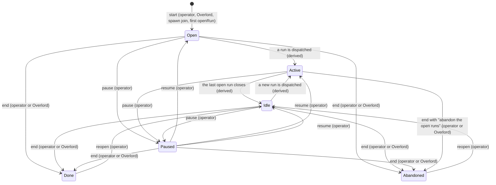

# Programme lifecycle: one end fact, derived activity, joined at spawn, ended by decision (design)

Date: 2026-11-24. Plan: `docs/superpowers/plans/2026-11-24-programme-lifecycle.md` (D-8983..D-8992, issued).
Read against `origin/main` at `6965b6d83`. Context: Coordination (programmes, runs, coordinators, the ledger doors).

This spec says what a programme is, which states it can be in, who moves it between them, what each move records, and
what the console shows at each state. It is written so that a reader can answer, for any programme on any day: why
does it read what it reads, who put it there, and when.

## 1. The operator's rulings of 2026-11-24

| # | Ruling | Overturns |
|---|---|---|
| R1 | Every coordinator joins a programme at spawn. Every session the operator starts, by any route, is a coordinator (spec 2026-10-17 §8, D-5301; D-8142). It joins the programme picked at creation, or a provisional one that it files into the right business objective on its first turn. A new objective gets a new programme. | D-8142's conditional "when your work belongs to a programme" in the start card; spec 2026-10-17 §8's "coordinator-ness is derived from claims" (the lighter run kind stays out of scope: a binding replaces the need for it) |
| R2 | A programme is a business objective that can hold diverse work. It is not one feature, one code change or one session. No rule ties one session to one programme. | — |
| R3 | The Overlord can start and end programmes, as the operator can. | — |
| R4 | The coordinator proposes an end, with evidence against the definition of done; the operator or the Overlord confirms it. An end is a decision with a recorded reason, never a side effect. The auto-retire at zero open runs goes. A finished run moves the programme to Idle, not Done. | D-51 (the auto-retire); the coordinator's `plan close` as an end (skill clause 22) |
| R5 | States: Open (a coordinator exists, nothing dispatched yet); Active (has an open run); Idle (not ended, nothing running); Paused (the operator's hold); Done and Abandoned (only by decision; the operator can reopen). | D-26's "exactly one `active` row" reading of `soleActiveCoordinator`; D-8558's "NOT `programs.state`" in `programmeLive` |
| R6 | No Waiting-on-you item for an idle programme. The console makes idle programmes easy to jump to. | The `PROGRAMME_ENDED_SENTENCE` rule (a tick is refused whenever no run is open) |
| R7 | A coordinator that exits does not end its programme. The programme shows "no coordinator", and it can be handed to a new coordinator or ended. | — |
| R8 | Each programme's page tells its whole story: its start (when, by whom), every state change (who, why), its waves, its end. | — |
| R9 | The backfill is decided programme by programme by the operator: 13 programmes with open runs become Active, 4 stay Paused, 6 become Idle, 32 Done, 1 Abandoned. The per-programme list is operator data, applied from a private file or a console act, never committed. Live coordinators with no programme get one through the spawn rule or a one-time pass over live sessions; exited sessions are left alone. | — |
| R10 | The role code's `plain` role conflicts with R1 and is aligned with it. | Overlord spec 2026-11-09 §3.3.9's `plain` row, and W1a's "auto memory for plain sessions" Settings row |

## 2. What `main` does today (measured)

Measured on the fleet on 2026-11-24: 57 programme rows, 1 with `planEnd` set, 8 reading `done` or `abandoned` while
they hold open runs.

- **Two "ended" facts with two writer sets.** `programs.state` is written by the D-51 auto-retire in
  `CoordStore#closeRun` (`done`, or `abandoned` when the closing run failed, whenever the open-run count reaches 0) and
  by `ledgersRoutes.ts#endProgrammeByOperator`. `programs.planEnd` is written by `planStore.ts#closePlan`, from the
  coordinator's `POST /api/programmes/:slug/plan/close`, the operator's end act and the Linear migration put-back.
  Gates read `planEnd` (`programmeLive`, `planGate`, the timer lanes, the close lanes); Linear and
  `soleActiveCoordinator` read `state`. A programme can read `active` with its plan closed, and `done` with a wave open.
- **Nothing moves a programme back.** `openRun` inserts with `ON CONFLICT(slug) DO NOTHING`, so a programme retired by
  D-51 stays `done` when its next wave opens. That is the 8 rows above.
- **No programme exists at spawn.** No create route, no kickoff and no ccd verb writes a `programs` row. A row first
  appears at `openRun` or at `plan put`.
- **No coordinator fact.** A programme's coordinator is derived from its runs' `claimedBy`. With no open run, nothing
  names one, `claimsProgramme` answers no, and the end act and ticks are refused.
- **Idle reads as ended.** A tick is refused when no run is open; the PWA's `programmeIsLive` marks such items ended;
  the portfolio drops the programme; the Programmes card folds it under "Finished" seven days after its last close.
- **No history.** `run_events` covers runs. Who started a programme, and who changed its state, is not recorded.
- **The `plain` role.** `roleOf` answers `plain` for a non-child session that claims no open run and declared no
  intent, and `PROFILE_OF_UNDECIDED` maps an unmeasured reading to `plain`.

## 3. The model: decisions are stored, activity is derived

**Stored, one writer each** (the writer is `server/src/coord/programmeLifecycleStore.ts`, L3, called inside the
store's transactions; nothing else in the tree writes these columns, and a census test pins it):

| Fact | Column | Values | Written by |
|---|---|---|---|
| The decision state | `programs.state` (existing) | `active` (live: not held, not ended), `paused`, `done`, `abandoned`; an out-of-vocabulary value reads `unknown` and is never folded | `decideInTx` |
| The end's record | `programs.planEnd`, `planEndWhy`, `planEndAt` (existing) | set by an end, cleared by a reopen, in the same transaction as the state | `decideInTx` |
| The coordinator | `programs.coordinator`, `programs.coordinatorSince` (new) | a session id, or null | `bindCoordinatorInTx` |
| Provisional | `programs.provisional` (new, `INTEGER NOT NULL DEFAULT 0`) | 1 for a placeholder minted at spawn | `mintInTx` |
| The story | `programme_events` (new, append-only) | one row per decision, mint, coordinator change, filing, coordinator exit | every writer above, in the same transaction |

`CoordStore#setProgramState` and `planStore.ts#closePlan` stop being writers: they become private steps of
`decideInTx`, or are deleted. `openRun`, `applyPlanChangesInTx` and `reconstruct` create rows only through `mintInTx`.

**Derived, never stored.** One pure L0 function, `shared/programmeLifecycle.ts#lifecycleOf` (a new file: `shared/api.ts`
is at its growth cap), is the only place the shown state is decided. Every server read and the PWA call it.

```
lifecycleOf(stored, runs) where runs = { live: count of runs neither terminal nor `planned`,
                                         everRan: some run has ever left `planned` }
```

| Stored `state` | `runs.live` | `runs.everRan` | Shown lifecycle |
|---|---|---|---|
| `active` | > 0 | any | **Active** |
| `active` | 0 | no | **Open** |
| `active` | 0 | yes | **Idle** |
| `paused` | any | any | **Paused** (with "n runs still open" when `live` > 0) |
| `done` | any | any | **Done** |
| `abandoned` | any | any | **Abandoned** |
| other | any | any | **Unknown** (shown as unreadable, never as live or ended) |

A run in `planned` has not been dispatched, so a programme whose only runs are planned is not Active (R5: "nothing
dispatched yet"). `isEnded(stored)` (`done` or `abandoned`) is the one end predicate; every gate that read `planEnd`
reads it instead.

**Why Idle is derived.** The runs are its only witness. Storing it would need a second writer inside `openRun` and
`closeRun`, which is the D-51 drift: a stored state that stops matching the runs. Derived, it cannot drift, and the 8
stuck rows read correctly the moment their stored state is a decision again (§13).

**The coordinator line** is derived by `coordinatorLineOf(binding, registry)`: `led` (a bound session the registry
measures present), `no-coordinator` (no binding, or the bound session measured absent), `unmeasured` (the registry
could not be read). `unmeasured` is never folded into `no-coordinator`.

## 4. The states



Resume and reopen write stored `active`; which of Open, Active and Idle the programme then shows is the runs' answer.
A reopened programme with no run ever shows Open, not Idle.

## 5. Transitions: who, through which door, under which guard, and what is recorded

Every stored transition goes through `decideInTx`. A target equal to the current stored state writes nothing (which is
what makes a re-run of the backfill safe). Every row below that is not "derived" writes exactly one
`programme_events` row in the same transaction.

| Edge | From → to | Who | Door | Guard (refusal code) | Recorded |
|---|---|---|---|---|---|
| start | none → Open | operator, Overlord | `POST /api/programmes` | slug free and well-formed (`slug-taken`); why required | row (`active`, `provisional` 0); event `started`, actor, why |
| start (spawn) | none → Open | the join act (§7) | create routes, join sweep | session is a non-child coordinator not yet bound | row (`active`, `provisional` 1); events `started` and `coordinator` |
| start (first run) | none → Open → Active | the coordinator | `POST /api/runs` (`openRun`) | today's guards | row (`active`); event `started`, actor the claimant, why "first run opened" |
| dispatch | Open/Idle → Active | derived | `openRun`, `advance` | `openRun` refuses an ended (`plan-closed`, the existing code, its words now "the programme has ended"), paused (`programme-paused`) or provisional (`programme-provisional`) programme | nothing new: `run_events` records the run |
| run closes | Active → Idle | derived | `closeRun` | — | nothing new: `run_events` records the close; no programme write (D-51 deleted) |
| pause | Open/Active/Idle → Paused | operator | `POST /api/programmes/:slug/state {edge:'pause', why}` | not ended (`programme-ended`); works while sign-in is dark (records `flag-off`) | `state` `paused`; event with why; open runs keep running |
| resume | Paused → live | operator | same door, `edge:'resume'` | was paused (`not-paused`); account gate with step-up | `state` `active`; event with why |
| propose end | (no change) | the bound coordinator | `POST /api/programmes/:slug/end-proposal` (and `plan close`, §8) | caller is the bound coordinator (`not-coordinator`); not ended; no open run (`programme-runs-open`); no open proposal (`already-asked`) | an `operator_items` decide row, `action:'end-programme'`; event `end-proposed` with outcome, evidence, item id |
| confirm end | Open/Idle/Paused → Done or Abandoned | operator, Overlord | `POST /api/items/:id/act {programme}` on the proposal | proposal open; no open run | `state`, `planEnd`/`planEndWhy`/`planEndAt`; item closed; event `ended` with outcome, why, evidence, item id |
| decline end | (no change) | operator, Overlord | `POST /api/items/:id/decline` | proposal open | item closed; system mail to the coordinator; event `end-declined` with why |
| end (direct) | Open/Idle/Paused → Done or Abandoned; Active → Abandoned | operator, Overlord | `POST /api/programmes/:slug/state {edge:'end', outcome, why, abandonRuns?}` | why required; account gate with step-up; open runs refuse (`programme-runs-open`) unless `abandonRuns:true`, which ends them first through the abandon door's own decision on the coordination serialiser; Done is refused while runs are open | as confirm, plus each abandoned run's own `run_events` |
| archive end | as direct end, outcome Abandoned | operator | `POST /api/sessions/:id/archive {programme:'end'}` | today's archive guards | as direct end, why "archived with programme end" |
| reopen | Done/Abandoned → live | operator only | `POST /api/programmes/:slug/state {edge:'reopen', why}` | was ended (`not-ended`); account gate with step-up | `state` `active`; `planEnd` fields cleared; event `reopened` with why and the end it reverses |
| hand over | (no change) | operator, Overlord; the reclaim door | `POST /api/programmes/:slug/coordinator {session, why}`; `POST /api/runs/:id/reclaim` | not ended; target is a live non-child session (`not-a-coordinator`) | `coordinator`, `coordinatorSince`; event `coordinator` with from, to, why |
| file | provisional → target | the provisional's coordinator; operator (re-file) | `POST /api/programmes/:slug/file`; `POST /api/programmes/:slug/refile` | slug is provisional (`not-provisional`); `{into}` names a live programme whose coordinator is absent, unbound or the caller (`programme-has-coordinator`); `{name, title}` takes a free slug | target bound to the coordinator; event `filed` on the target carrying the provisional's start (actor, time); the provisional row and its events are deleted |
| coordinator exit | (no change) | system | the registry measure (§9) | bound session measured absent, once per exit | event `coordinator-gone` |

**What every event row holds** (`programme_events`): `id`, `program`, `at`, `edge`, `fromState`, `toState`,
`actorKind` (`operator`, `overlord`, `coordinator`, `system`, `backfill`, `migration`), `actor` (a session id, the
signed-in device, or `unmeasured`), `why`, and `detail` (JSON: evidence lines, item id, coordinator from and to, the
provisional slug, the migration rule). The actor and why are never null except where the row says `unmeasured`.

## 6. What the console shows at each state

| Shown | Programmes list | Programme page | Waiting on you | Ticks and items |
|---|---|---|---|---|
| Open | under its chip, "Open: nothing dispatched yet"; "Unfiled" badge when provisional | goals, coordinator line, history | nothing | a tick mails the bound coordinator; with no coordinator it is refused `no-coordinator` with Hand to coordinator offered |
| Active | under its chip, current wave and runs as today | runs, waves, history | as today (runs' items) | as today |
| Idle | under the Idle chip, "Idle since <last close>"; the Fleet header's "n idle" links there | goals, last wave, coordinator line, End and Pause buttons, history | **nothing** (R6) | a tick mails the bound coordinator (no longer refused); with no coordinator, `no-coordinator` |
| Paused | under its chip, "Paused by <actor>: <why>", plus "n runs still open" | Resume button, history | nothing | ticks mail the coordinator; runs cannot open |
| Done / Abandoned | folded under "Finished" (keyed on the decision, not on the last run's close) | the end's outcome, who, why, evidence; Reopen button | the end proposal, while open, is the only item | refused `programme-ended`; dismiss works |
| Unknown | shown with "state unreadable" | history | nothing | refused, with the stored value shown |

The Programmes screen has chips with counts: **Active · Idle · Open · Paused · No coordinator · Unfiled**, and a
Finished fold. "No coordinator" and "Unfiled" cut across states. The portfolio (`portfolioStore.ts`'s listing) keeps
every programme that has not ended, Idle included.

The **coordinator line** on every row and page: "Led by <session>" (`led`), "No coordinator" with **Hand to
coordinator** and **End** (`no-coordinator`), or "Coordinator unmeasured" (`unmeasured`, no actions offered on it).

## 7. Joining at spawn (R1)

**The decision** is L1, `server/src/coord/programmeJoin.ts#joinDecision(row, bindings)`: a registry row joins when it
is not a `.child`, not on hold, not the anchor, not the Overlord, an auditor or a replay, and no programme names it as
coordinator. The answer is `join-picked <slug>`, `mint-provisional`, `already-bound` or `skip <reason>`.

**The act** is L4, `joinAtSpawn(session, pick | null, actor)`, from two places:

| Route | What changes |
|---|---|
| `POST /api/sessions` (`server.ts`) | optional `programme` in the body (additive); after the `CcdArgv` start returns, `joinAtSpawn` |
| `POST /api/projects/:project/workspaces` when not a child | the same field and call |
| The start-programme sheet | passes its picked slug in the body; the kickoff stays mail-only |
| The join sweep | catches every other route: `ccd start` by hand, `cc <wrapper> <project>`, a hand-run `ccd ws-add`; it acts on live registry rows only, so exited sessions are left alone. Its first pass after deploy is R9's one-time pass over live sessions |
| `ccd supervise` resume, a swap, a roll | nothing: the session id is kept, so the binding is kept |
| Dispatched children | nothing: a child is a worker or reviewer, never a coordinator |

No ccd verb is added; the server writes the row. The sweep extends the existing lane that re-measures the registry
for the coordination store (the plan names it after measuring; a second poller needs a recorded reason). With no pick,
`joinAtSpawn` mints a provisional programme `p-<base36 ms>` (never the session id), stored `active`, `provisional` 1,
so it shows Open and Unfiled. It then queues one system mail naming the programme and whether it is provisional.

**The start card** (`ccd/session-hook.sh#_hook_role_card`) becomes unconditional for a coordinator: "You belong to a
programme. Read it with `ccrc-api GET /api/sessions/<id>/programme`, then its goals and definition of done. If it is
provisional, file it on your first turn: into the business objective your work serves, or as a new programme for a new
objective." Children, held sessions, card-off and the anchor still get nothing.

**Filing.** The provisional row exists only to be filed: `openRun`, `plan put` and the ledger item doors refuse it
(`programme-provisional`), so it never holds a run, a plan or an item, and deleting it loses nothing but its start
record, which the `filed` event carries onto the target. `{into: slug}` binds the coordinator to an existing objective;
`{name, title}` mints a new one (`started`, actor the coordinator, why "new objective filed from <provisional>").
A session may coordinate several programmes (R2); the binding is per programme, one coordinator each.

## 8. Ending (R4)

- **The proposal.** `POST /api/programmes/:slug/end-proposal {outcome: 'done'|'abandoned', why, evidence[]}` takes the
  box token, then attribution, then ownership (`claimsProgramme`). `evidence` is answered line by line against the
  programme's `doneWhen` pin. It raises an `operator_items` decide row with `action:'end-programme'`, modelled on
  `endRequest.ts`: its why is the coordinator's case, its how is the pinned definition of done, and its two options are
  "End the programme" and "Keep it open". This is the one Waiting-on-you item the lifecycle raises: it asks for a
  decision, not for attention to idleness.
- **`plan close` becomes a proposal.** `POST /api/programmes/:slug/plan/close` raises the same proposal with outcome
  `done` and the close's why. It no longer writes `planEnd`. Skill clause 22 changes from "the programme ends with
  `plan close`" to "the programme's end is proposed with `plan close`; the operator or the Overlord confirms it".
- **Confirm and decline** are the existing item doors. Confirm runs `decideInTx` (`ended`); decline mails the
  coordinator through the existing system mail.
- **Direct ends** by the operator or the Overlord take the state door (§5); an end over open runs names
  `abandonRuns:true` and is always Abandoned. Nothing ends a programme as a side effect of anything else.
- **The archive door's `{programme:'end'}`** calls `decideInTx` explicitly (Abandoned, "archived with programme end")
  after abandoning the open runs, where today it relied on D-51.
- **Linear.** `planPolicy.ts#programmeEnd` reads the decision (`isEnded`, outcome `done`), so a reopen syncs back.
  The Linear migration put-back calls `decideInTx` with actor kind `system` and the map's reason.

## 9. The coordinator binding (R7)

- **One fact.** `programs.coordinator` names the programme's coordinator; `claimsProgramme(session, slug)` reads it
  (today it reads open runs' claimants, so an idle programme had no owner). `openRun` binds the claimant when the
  binding is empty, and refuses a claimant other than a bound coordinator (`programme-has-coordinator`), which is
  today's one-coordinator guard read from the binding instead of `claimedBy`.
- **Exit.** A coordinator session that exits writes nothing to the programme's state. The coordinator line derives
  `no-coordinator` from the registry, and the registry lane writes one `coordinator-gone` event per exit (keyed on the
  programme, the session and the exit, as the stall watch keys its observation rows), so the history shows when.
- **Hand-over.** `POST /api/programmes/:slug/coordinator` (operator, Overlord) and the reclaim door
  (`POST /api/runs/:id/reclaim`, which today moves a dead claimant's runs) both rebind through `bindCoordinatorInTx`.
- **`soleActiveCoordinator`** resolves `toId:'coordinator'` mail with no run id to the bound coordinator of the one
  programme that shows Active, and to nothing when zero or several do. That keeps D-26's intent (an unambiguous
  answer, no guessing) on the derived state.
- **The kept-worker rule** on the unmerged branch that keeps a worker in its programme's box (D-8980..D-8982)
  reads `isEnded(state)` for "a done or abandoned programme keeps no one", whichever of the two lands second.

## 10. The Overlord (R3)

- A new cell in `shared/overlord-ladder.ts#RUNG_CELL_MAP`: `programme-lifecycle: {chat:'refuse', advise:'refuse',
  full:'allow'}`, the `link-team` pattern.
- Rows in `server/src/coord/overlordDoors.ts` for start, end (direct), hand over, confirm and decline. Each records
  `actorKind:'overlord'`, the designated session and its why. Pause, resume and reopen are the operator's alone.
- A `programme.end` row in `shared/decisionModel.ts`, so the operator arms, disarms or sets a ceiling on the
  Overlord's confirm of an end, as for the other routing rows.

## 11. The programme's story (R8)

`GET /api/programmes/:slug/history` (session-gated; the box token for the programme's own coordinator) merges
`programme_events` with the programme's runs and their `run_events` into one timeline, oldest first:
start (when, by whom, from which route or provisional), every pause, resume, hand-over, filing, coordinator exit, end
proposal, decline, end and reopen (who and why), and each wave (opened, dispatched, closed, by whom). The Programme page
(`pwa/src/ledgers/ProgrammeScreen.tsx`) renders it as a History section. Rows written by the migration say so.

## 12. The role code (R10)

- `server/src/roleOf.ts#roleOf` decides a top-level session's role from its markers: a session that is not a child,
  not the Overlord, not an auditor and not a replay is `coordinator`. `claimsOpenRun` and `declaredIntent` drop out of
  the decision. An unreadable child marker keeps today's handling.
- Removed: `ROLE_AMBIGUITIES['coordinator-or-plain']`, its `PROFILE_OF_UNDECIDED` arm, and `plain` from `FleetRole`
  and `FLEET_ROLES`. The card renderer and compaction text that auditor and replay reuse keep working: they are a
  renderer, not the role.
- A persisted reading of `plain` revives as `coordinator`.
- `POST /api/coord/plain-auto-memory` stays registered for one release and refuses `role-retired`; its Settings row
  goes. Its stored value stays readable for a rollback.

## 13. Migration and backfill (R9)

**The migration** (the next `coord.db` slot when the build PR lands; 123 is the newest on `main` today) refuses to
start rather than open empty, as every migration does, and names no programme:

1. Adds `coordinator`, `coordinatorSince`, `provisional`, and the `programme_events` table with its index on
   `(program, at)`.
2. Writes one `started` event per row: `actorKind` `migration`, actor `unmeasured`, at `createdAt`, why "who started it
   was not recorded before this build".
3. Seeds the binding from the newest non-terminal run's `claimedBy`, else the newest claimed run's, with one
   `coordinator` event.
4. Rewrites the stored state by one rule, because D-51's `done` and `abandoned` are side effects, not decisions:
   a set `planEnd` keeps or becomes an end (`done` unless the row already reads `abandoned`); `paused` stays `paused`;
   an out-of-vocabulary value stays as it is; every other row becomes `active`. Each changed row gets a `migrated`
   event naming the rule. So the 8 rows that hold open runs show Active the moment the migration runs, and the other
   D-51 rows show Idle until the operator's decisions land.

**The backfill** is one console act, `POST /api/programmes/decisions`, session-gated, previewing by default and
applying with `apply:true` behind the account gate's step-up. Its body is the private decisions file, uploaded from
the operator's own device (Settings, "Apply programme decisions"); the same body can be posted by the operator's own
shell with a session. The file is a list of `{slug, to, why}` and is never committed. Rules:

- `to` is one of `active`, `idle`, `open`, `paused`, `done`, `abandoned`. `active`, `idle` and `open` set stored
  `active` (a resume or reopen edge when needed) and then check the derived state: a mismatch is reported, never
  forced, because the runs decide it.
- Refused in the preview: an unknown or provisional slug, a duplicate, a missing why, and `done` or `abandoned` over
  open runs (the file never abandons a run).
- Applied row by row through `decideInTx` with `actorKind:'backfill'`, the operator as actor and the file's why.
  Equal targets write nothing, so a second run writes zero events.
- The answer lists each entry's outcome (`unchanged`, `applied`, `mismatch`, `refused:<code>`) and the counts per
  shown state, which the operator checks against R9's counts.

Live coordinators with no programme are joined by the join sweep's first pass (§7). Exited sessions are left alone.

## 14. Doors

| Door | Credential | Census entry |
|---|---|---|
| `POST /api/programmes` | session (account gate) | `LEDGER_OPERATOR_DOORS` |
| `POST /api/programmes/:slug/state` | session; pause works dark, the rest take a step-up | `LEDGER_OPERATOR_DOORS` |
| `POST /api/programmes/:slug/coordinator` | session, step-up | `LEDGER_OPERATOR_DOORS` |
| `POST /api/programmes/:slug/refile` | session | `LEDGER_OPERATOR_DOORS` |
| `POST /api/programmes/decisions` | session; `apply` takes a step-up | `LEDGER_OPERATOR_DOORS` |
| `GET /api/programmes/:slug/history` | session, or the box token for the bound coordinator | dual-credential read |
| `GET /api/sessions/:id/programme` | session, or the box token with attribution | dual-credential read |
| `POST /api/programmes/:slug/end-proposal` | box token, attribution, ownership | `requireMailToken`; `gate.ts` EXEMPT |
| `POST /api/programmes/:slug/file` | box token, attribution, ownership of the provisional | `requireMailToken`; `gate.ts` EXEMPT |
| Overlord rows for start, end, hand over, confirm, decline | the Overlord's door, `full` rung | `OVERLORD_OPERATOR_DOORS` |
| Changed: `plan/close`, `items/:id/act`, `items/:id/decline`, `items/:id/tick`, `sessions/:id/archive`, `runs/:id/reclaim`, `POST /api/runs` | unchanged | unchanged |

`box-token-census.test.ts` checks CLAUDE.md's box-token sentence against these sets in both directions, so the build
PR that adds a door edits that sentence in the same commit.

## 15. Wire and rollback

- `ProgrammeRow` gains `lifecycle`, `coordinatorLine`, `provisional` and `pausedOpenRuns`, each additive and each read
  by one PWA reader (`pwa/src/screens/programmeLifecycleWords.ts`, L1). An older PWA ignores them.
- `ProgramState` keeps its five values, so an older build reads the column. Rolled back, an older build sees more
  `active` rows: its `soleActiveCoordinator` answers "ambiguous" more often (mail with no run id waits), and its D-51
  retires programmes again at their next close. Both are today's behaviour, not new damage; the events table is
  ignored by it.
- `FLEET_PROTO` is not bumped.

## 16. Rejected

- **A new `standing` column with `state` kept as a rollback projection** (design B): two columns for one decision.
  `state` already carries it, and the migration's rule removes D-51's side effects from it.
- **Keeping `state` as migrated, with no rule** (design A): leaves D-51's `done` on 8 programmes with open runs until a
  file is applied; the rule is generic, names no programme, and is recorded per row.
- **Storing Idle or Active**: a second writer inside `openRun` and `closeRun`, the D-51 drift again.
- **A membership run kind for the coordinator**: open forever, so no programme would read Idle, and every run reader
  (the cap, open-run counts, the stall watch, reclaim, the close lanes) would need an exclusion.
- **Renaming a provisional slug in place** (design A): a primary-key change across every table that names a slug.
- **Ending a provisional row as Abandoned when filed** (design B): filing artefacts would swell the Abandoned count.
- **A new item kind for the end proposal** (design B): the existing decide row with an action is the table to extend.
- **Hook-only joining** (design A): relies on the session acting; a hand-started session that never reads its card
  would stay unbound. The join sweep covers every route.
- **An unmeasured role reading taking the coordinator profile** (design B): an unreadable child marker would launch a
  child with a coordinator's long-lived profile; today's handling stays.
- **A Waiting-on-you item for idle programmes**: R6.
- **Letting the Overlord pause, resume or reopen**: R5 names those the operator's.
- **Committing the per-programme decisions as a migration or fixture**: operator data, and this repository is public.
- **A new ccd verb to write the programme at spawn**: the Build 7 invariant; the server writes it.

## 17. Promise delta

```promise-delta
none - a design spec for review that ships no behaviour, and the build plan carries any Promise change
```
